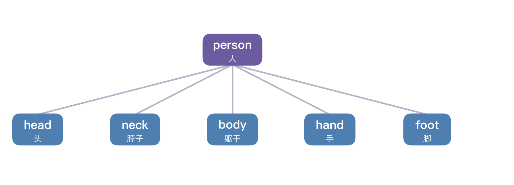
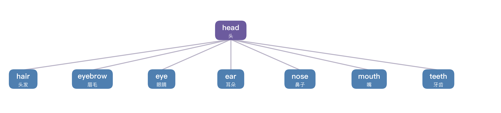
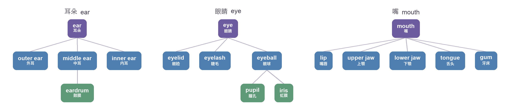
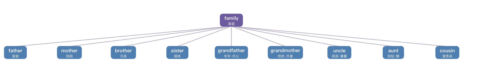

# 小学英语 · PET · KET

| 版本 | 日期 | 说明 |
|---|---|---|
| 初稿 | 2026/10/30 | 广州小学教科书单词，以及 KET · PET 的考试内容 |

---

## 前言

这一本把三块收在一处。第一块是广州小学一至六年级教科书里的词。第二块是剑桥 A2 Key（旧称 KET）。第三块是剑桥 B1 Preliminary（旧称 PET）。

拼读不在这里，在《自然拼读》。发散、联想、词根词缀这三套记词方法收在本书第十八至二十章，供检索，不替代正文章节里的词表。初中阶段的词、广州中考卷面，以及比这两场考试更细的时态讲法，仍在《初中英语学习辅导手册》。KET 和 PET 要写的时态收在本书第十七章。

小学词按话题排，不按册逐课重排。一年级、二年级用广州出版社《小学英语口语》，先听会说。三年级到六年级用教科版（广州版）。同一个词只收一次。

---

## 全文约定

一个词只标一档。

| 标记 | 用在 | 要求 |
|:---:|---|---|
| ★ | 广州小学教科书里要会用的词 | 三至六年级听说读写。一二年级先听会说 |
| ○ | 教科书里见过、不作为默写重点的词 | 见词能认，听音能指 |
| ◆ | KET 官方词表里要能写出来的词 | 读写听三会，须能拼写 |
| ● | PET 官方词表里要能写出来、前面三档还没有单列的词 | 读写听三会，须能拼写。收在第二十五章 |

小学或 KET 已经收了、PET 也要写的，标记仍用 ★、○ 或 ◆，说明栏写“兼 PET”。只在 PET 这一档新出现的，标 ●。

音标用英式（DJ）。(r) 表示连读时才发出。PET 英式卷和美式卷都接受 colour 与 color 这类对应拼写，本书统一用英式。

---

## 目录

### [第一部分 广州小学教科书单词](#第一部分-广州小学教科书单词)

- [第一章 人体部位](#第一章-人体部位)
- [第二章 家庭与人物](#第二章-家庭与人物)
- [第三章 食物与饮料](#第三章-食物与饮料)
- [第四章 动物](#第四章-动物)
- [第五章 颜色](#第五章-颜色)
- [第六章 数字与数量](#第六章-数字与数量)
- [第七章 学校与学习](#第七章-学校与学习)
- [第八章 衣物](#第八章-衣物)
- [第九章 天气与季节](#第九章-天气与季节)
- [第十章 时间与日程](#第十章-时间与日程)
- [第十一章 交通与出行](#第十一章-交通与出行)
- [第十二章 职业](#第十二章-职业)
- [第十三章 情绪与感受](#第十三章-情绪与感受)
- [第十四章 运动](#第十四章-运动)
- [第十五章 介词与冠词](#第十五章-介词与冠词)
- [第十六章 代词](#第十六章-代词)
- [第十七章 时态](#第十七章-时态)
- [第十八章 发散记忆法](#第十八章-发散记忆法)
- [第十九章 联想记忆法](#第十九章-联想记忆法)
- [第二十章 词根词缀](#第二十章-词根词缀)

### [第二部分 KET](#第二部分-ket)

- [第二十一章 KET 考什么](#第二十一章-ket-考什么)
- [第二十二章 KET 要会拼的词](#第二十二章-ket-要会拼的词)

### [第三部分 PET](#第三部分-pet)

- [第二十三章 PET 考什么](#第二十三章-pet-考什么)
- [第二十四章 PET 写作和语言](#第二十四章-pet-写作和语言)
- [第二十五章 PET 要会拼的词](#第二十五章-pet-要会拼的词)

---

# 第一部分 广州小学教科书单词

---

小学阶段先把这一部分的 ★ 写熟。表里的 ◆ 是 KET 要会拼的词，汇总在第二十二章。说明栏写“兼 PET”的，KET 或小学档已经收了，PET 也要会写。只在 PET 里新出现的词标 ●，收在第二十五章。

---

## 第一章 人体部位

人体是小学阶段唯一可以完全用动作教的词群。孩子指自己的鼻子说 *nose*，词和意义之间不需要经过中文翻译，这一步省掉，记忆就牢一半。

教科版里，身体部位不会在一课里学完。低年级先认五官和四肢，后来描写外貌时再见到 *hair*，讲生病时又把部位和病症连在一起。分散在不同学期，孩子不容易看到全貌，这一章把它们归到一处。

### 1.1 头部

表 1-1　头部部位（9 条）

| 词条 | 音标 | 释义 | 说明 |
|---|---|---|---|
| ★ head | /hed/ | 头 | 与 hat 只差一字母 |
| ★ hair | 英 /heə(r)/　美 /her/ | 头发 | 不可数。说 wash your hair，不说 wash your hairs |
| ★ face | /feɪs/ | 脸 | 搭配 wash one's face |
| ★ eye | /aɪ/ | 眼睛 | 拼写里的两个 e 像两只眼 |
| ★ ear | 英 /ɪə(r)/　美 /ɪr/ | 耳朵 | 与 hear 同音 |
| ★ nose | /nəʊz/ | 鼻子 | 词尾 se 读 /z/ |
| ★ mouth | /maʊθ/ | 嘴 | 尾音咬舌。与 mouse 形近，注意别混 |
| ★ tooth | /tuːθ/ | 牙齿 | 单数。复数见下一条 |
| ★ teeth | /tiːθ/ | 牙齿（复数） | tooth 的复数，换元音，与 meet 押韵 |

### 1.2 脖子与躯干

表 1-2　脖子与躯干（8 条）

| 词条 | 音标 | 释义 | 说明 |
|---|---|---|---|
| ★ neck | /nek/ | 脖子 | 搭配 a long neck |
| ○ shoulder | /ˈʃəʊldə(r)/ | 肩膀 | ou 读 /əʊ/，l 要读出来 |
| ★ body | /ˈbɒdi/ | 身体 | 复数 bodies，y 变 i 加 es |
| ★ back | /bæk/ | 背；后面 | 也表示“回去”，如 come back |
| ○ stomach | /ˈstʌmək/ | 胃；肚子 | ch 读 /k/，不读 /tʃ/ |
| ◆ skin | /skɪn/ | 皮肤 | 与 skip 形近 |
| ◆ bone | /bəʊn/ | 骨头 | o 读 /əʊ/ |
| ◆ heart | /hɑːt/ | 心脏 | 也表示“内心”，如 a kind heart |

### 1.3 手臂与手

表 1-3　手臂与手（3 条）

| 词条 | 音标 | 释义 | 说明 |
|---|---|---|---|
| ★ arm | 英 /ɑːm/　美 /ɑːrm/ | 手臂 | 美音卷舌，英音不卷 |
| ★ hand | /hænd/ | 手 | 含手掌与手指；也指钟表指针 |
| ★ finger | /ˈfɪŋɡə(r)/ | 手指 | 五个手指各有专名，属 B1 词，此处不展开 |

中文的“手”范围比英文的 hand 大。中文可以说“洗手”，也能说“手疼”指整条手臂；英文 wash my hands 只洗手，手臂是 arm。这个差别要早讲，否则孩子会造出 wash my arms 这样的句子。

### 1.4 腿与脚

表 1-4　腿与脚（5 条）

| 词条 | 音标 | 释义 | 说明 |
|---|---|---|---|
| ★ leg | /leɡ/ | 腿 | 桌腿也叫 leg |
| ★ foot | /fʊt/ | 脚 | 复数 feet /fiːt/ |
| ★ feet | /fiːt/ | 脚（复数） | 与 meet 押韵 |
| ○ knee | /niː/ | 膝盖 | k 不发音 |
| ○ toe | /təʊ/ | 脚趾 | 与 tow 同音 |

手对 finger，脚对 toe，一一对应，不会串。这个对照值得在黑板上并排写一次。

### 1.5 从部位到病症

高年级讲 “What's the matter?” 时，会把部位词和病症词接上。这一组词的构词极有规律，见 1.6 的说明。

表 1-5　病症与就医（11 条）

| 词条 | 音标 | 释义 | 说明 |
|---|---|---|---|
| ★ cold | /kəʊld/ | 感冒；冷的 | 搭配 have a cold，必须加 a |
| ★ fever | /ˈfiːvə(r)/ | 发烧 | 搭配 have a fever |
| ★ headache | /ˈhedeɪk/ | 头痛 | head ＋ ache |
| ★ toothache | /ˈtuːθeɪk/ | 牙痛 | tooth ＋ ache |
| ★ stomachache | /ˈstʌməkeɪk/ | 肚子痛 | stomach ＋ ache |
| ★ sore throat | /sɔː θrəʊt/ | 喉咙痛 | sore 意为酸痛 |
| ★ hurt | /hɜːt/ | 疼痛；受伤 | My leg hurts 主语是部位时动词加 s |
| ◆ health | /helθ/ | 健康 | heal ＋ -th，名词。兼 PET |
| ◆ healthy | /ˈhelθi/ | 健康的 | health ＋ -y。兼 PET |
| ◆ medicine | /ˈmedsn/ | 药 | 搭配 take medicine，不加 a |
| ◆ pain | /peɪn/ | 疼痛 | 搭配 in pain |

### 1.6 两条构词线索

第一条是 ache。ache 本身是“痛”的意思，放在部位词后面合成新词：headache、toothache、stomachache、earache、backache。五个词一条规则，比一个个背省力。

第二条是 heal 这个词根。heal（治愈）加 -th 变成 health（健康），health 加 -y 变成 healthy（健康的），再加 un- 变成 unhealthy（不健康的）。一个词根三层词缀，四层意思。这条线索在本书 20.5 还会展开。

### 1.7 三个高频错误

第一，hair 不可数。学生常写 a hairs 或 many hairs，正确说法是 a lot of hair。

第二，部位前用物主代词。说 I brush my teeth，不说 I brush the teeth。这一条中文里没有对应，因为中文说“我刷牙”根本不出现“我的”。

第三，病症表达要加冠词。I have a headache 里的 a 不能省，但 take medicine 里的 medicine 不能加 a。同样是“吃药看病”的语境，一个要冠词一个不要，学生容易一律处理。

### 1.8 一张小孩与身体部位图

下面这张图标出了头部的八个部位。让孩子指着图说英文，再指自己身上对应的部位，词和身体就长在一起了。

数字对应的单词如下：

表 1-6　标号对照

| 编号 | 英文 | 音标 | 中文 |
|:---:|---|---|---|
| ① | hair | 英 /heə(r)/　美 /her/ | 头发 |
| ② | ear | 英 /ɪə(r)/　美 /ɪr/ | 耳朵 |
| ③ | eye | /aɪ/ | 眼睛 |
| ④ | eyebrow | /ˈaɪbraʊ/ | 眉毛 |
| ⑤ | nose | /nəʊz/ | 鼻子 |
| ⑥ | mouth | /maʊθ/ | 嘴 |
| ⑦ | tooth / teeth | /tuːθ/ /tiːθ/ | 牙齿 |
| ⑧ | neck | /nek/ | 脖子 |

指图、指人、说词，三个动作连在一起，比单独背拼写多两条记忆通路。

### 1.9 从 person 出发的发散树

发散记忆法的做法是：从一个中心词出发，先分主干，再一层层往下分，分到想不出新词了，就退回上一级，换一个岔口继续。人体部位一章最适合练这个，因为孩子抬头就能指，低头就能画。

以 *person*（人）为中心，先分出五条大枝：

再从 *head*（头）这一枝往下分，分出头发、眉毛、眼睛、耳朵、鼻子、嘴、牙齿七个部位：

分到这里还不停。凡是还知道里面有什么的部位，就继续分第三层——*ear* 分外耳、中耳、内耳，*eye* 分眼睑、睫毛、眼球，*mouth* 分嘴唇、上颚、下颚、舌头、牙床：

走到 *inner ear*（内耳）、*pupil*（瞳孔）这些词，孩子的词汇就该想不出英文了。**走到想不出新词的地方，就是这一枝的尽头，不要硬挤，退回来。** 退回 *ear*，看还有没有别的词；都没有了，退到 *head*，换 *mouth* 这一枝继续。这样“往下发散 → 走不动就回溯 → 换一枝再发散”，一个 *person* 能带出几十个部位词。

### 1.10 以 eye 为例的多维联想

发散是往下钻（分出下一层），联想是往四周铺（打通同一层的各个侧面）。两者配合，一个词既有了下面一层，又有了左邻右舍。

拿 *eye*（眼睛）做例子，往四周铺开，有五个维度：

**看的功能**：see（看见）、look（看着）、watch（观看）。

**眼睛不好使了要配什么**：glasses（眼镜，恒用复数）、glass（玻璃）、contact lens（隐形眼镜）。

**眼睛里的零件**：eyeball（眼球）、eyelash（睫毛）、eyelid（眼睑）、pupil（瞳孔）。

**测视力的参数**：eyesight（视力）、near-sighted（近视的）、far-sighted（远视的）、astigmatism（散光）、diopter（近视度数）。

**眼睛的动作**：blink（眨眼）、wink（使眼色）、cry（哭）。

每个方向后面都藏着一条“凭什么能想到”的线：想到 see，凭的是功能；想到 glasses，凭的是后果；想到 eyeball，凭的是结构；想到 astigmatism，凭的是体检参数；想到 blink，凭的是动作。这条线才是真正能记住的东西。孩子学 eye 时，问自己五句话——眼睛干什么用？坏了怎么办？里面有什么？测视力报什么？它会做什么？词自己就冒出来了。

### 1.11 习题

一、指着 1.8 的图，从头到脚说出每个部位的英文，说不出就翻前面查，直到四十秒内说全。

二、以 *person* 为中心画一张发散树，能分几层分几层，分不出的地方画个问号。

三、以 *eye* 为中心，按“功能、后果、结构、参数、动作”五个方向各想一个词，写在作业本上。

---

## 第二章 家庭与人物

家庭词群的难点不在拼写，在中文亲属称谓的颗粒度远高于英文。中文分爷爷、外公、叔叔、舅舅、姑父，英文一个 *grandfather*、一个 *uncle* 全包了。教学时要把这一点讲开，否则孩子会追问“为什么叔叔和舅舅是同一个词”。

讲清楚反而降低负担：只需记住两个词，就能称呼所有叔伯姑姨舅。

### 2.1 核心家庭

表 2-1　核心家庭（9 条）

| 词条 | 音标 | 释义 | 说明 |
|---|---|---|---|
| ★ family | /ˈfæməli/ | 家庭 | 重音在首，结尾 -ly 读 /li/ |
| ★ father | /ˈfɑːðə(r)/ | 父亲 | th 是浊音 /ð/，声带要振 |
| ★ dad | /dæd/ | 爸爸 | 口语，与 father 同义 |
| ★ mother | /ˈmʌðə(r)/ | 母亲 | 与 father 只差首字母 |
| ★ mum | 英 /mʌm/　美 /mɑːm/ | 妈妈 | 美式拼作 mom |
| ★ brother | /ˈbrʌðə(r)/ | 兄弟 | 不分长幼 |
| ★ sister | /ˈsɪstə(r)/ | 姐妹 | 不分长幼 |
| ★ parents | /ˈpeərənts/ | 父母 | 常用复数 |
| ★ baby | /ˈbeɪbi/ | 婴儿 | 结尾 -y 读 /i/ |

### 2.2 兄弟姐妹的长幼

中文的哥哥、弟弟、姐姐、妹妹四个词，把性别和长幼都编进去了。英文没有对应单词，只能在 brother、sister 前加限定词。这是本章最值得讲清的中英不对应。

表 2-2　兄弟姐妹（8 条）

| 词条 | 音标 | 释义 | 说明 |
|---|---|---|---|
| ★ elder brother | /ˈeldə ˈbrʌðə(r)/ | 哥哥 | elder 意为年长的，只用于家人之间 |
| ★ elder sister | /ˈeldə ˈsɪstə(r)/ | 姐姐 | 与 elder brother 同构 |
| ★ younger brother | /ˈjʌŋɡə ˈbrʌðə(r)/ | 弟弟 | younger 意为更年幼的 |
| ★ younger sister | /ˈjʌŋɡə ˈsɪstə(r)/ | 妹妹 | 与 younger brother 同构 |
| ○ big brother | /bɪɡ ˈbrʌðə(r)/ | 哥哥 | 口语用法 |
| ○ little sister | /ˈlɪtl ˈsɪstə(r)/ | 妹妹 | 口语用法 |
| ○ older brother | /ˈəʊldə ˈbrʌðə(r)/ | 哥哥 | 美式更常用 older |
| ○ only child | /ˈəʊnli tʃaɪld/ | 独生子女 | 回答“有没有兄弟姐妹”时用 |

两点要提醒。

elder 只作定语，放在名词前，不能说 He is elder。older 没有这个限制，可以作定语也可以作表语。学生只需掌握 elder brother 和 elder sister 两个固定搭配，其余场合用 older 更安全。

问“你有兄弟姐妹吗”，说 Do you have any brothers or sisters。不用 Do you have brother。泛指时要加复数或 any，这是本章的语法配套。

### 2.3 隔代与旁系

表 2-3　隔代与旁系（12 条）

| 词条 | 音标 | 释义 | 说明 |
|---|---|---|---|
| ★ grandfather | /ˈɡrænfɑːðə(r)/ | 祖父；外祖父 | grand ＋ father |
| ★ grandma | /ˈɡrænmɑː/ | 奶奶；外婆 | 一二年级口语先会说。与 grandmother 同义 |
| ★ grandpa | /ˈɡrænpɑː/ | 爷爷；外公 | 一二年级口语先会说。与 grandfather 同义 |
| ★ grandmother | /ˈɡrænmʌðə(r)/ | 祖母；外祖母 | grand ＋ mother |
| ★ uncle | /ˈʌŋkl/ | 叔叔；舅舅；姑父 | 覆盖父系母系所有男性长辈 |
| ★ aunt | 英 /ɑːnt/　美 /ænt/ | 姑姑；姨；婶 | 美音与 ant 同音 |
| ★ cousin | /ˈkʌzn/ | 堂表兄弟姐妹 | 不分男女，不分年龄 |
| ★ son | /sʌn/ | 儿子 | 与 sun 同音 |
| ★ daughter | /ˈdɔːtə(r)/ | 女儿 | gh 不发音 |
| ◆ nephew | /ˈnefjuː/ | 侄子；外甥 | ph 读 /f/ |
| ◆ niece | /niːs/ | 侄女；外甥女 | 与 nephew 成对 |
| ◆ grandparent | /ˈɡrænpeərənt/ | 祖父母 | grand ＋ parent，常用复数 |

### 2.4 通用称谓

表 2-4　通用称谓（9 条）

| 词条 | 音标 | 释义 | 说明 |
|---|---|---|---|
| ★ boy | /bɔɪ/ | 男孩 | 与 toy 押韵 |
| ★ girl | 英 /ɡɜːl/　美 /ɡɜːrl/ | 女孩 | ir 读 /ɜː/；美音末尾卷舌 |
| ★ man | /mæn/ | 男人 | 复数 men |
| ★ woman | /ˈwʊmən/ | 女人 | 复数 women /ˈwɪmɪn/，读音特殊 |
| ★ friend | /frend/ | 朋友 | ie 读 /e/，不读 /iː/ |
| ★ child | /tʃaɪld/ | 孩子 | 复数 children |
| ○ person | /ˈpɜːsn/ | 人 | 复数常用 people |
| ○ people | /ˈpiːpl/ | 人们 | 本身是复数，不加 s |
| ◆ member | /ˈmembə(r)/ | 成员 | 与 remember 同根 |

member 这个词值得停一下。它来自拉丁语 membrum，意思是“部分”。remember 是 re-（再一次）＋ member（把部分找回来），也就是“重新想起来”。这样拆一次，两个词都记住了。

### 2.5 家里

一年级下册口语课接着认房子和房间。门、书桌、椅子已收在第七章，in、on、under、behind 在第十五章。

表 2-5　家里（12 条）

| 词条 | 音标 | 释义 | 说明 |
|---|---|---|---|
| ○ house | /haʊs/ | 房子 | 一二年级口语先会说 |
| ★ bed | /bed/ | 床 | 与 red 押韵 |
| ○ bedroom | /ˈbedruːm/ | 卧室 | bed ＋ room |
| ○ living room | /ˈlɪvɪŋ ruːm/ | 客厅 | 一二年级口语先会说 |
| ○ kitchen | /ˈkɪtʃɪn/ | 厨房 | 一二年级口语先会说 |
| ○ washroom | /ˈwɒʃruːm/ | 洗手间 | wash ＋ room。也说 toilet |
| ○ toilet | /ˈtɔɪlət/ | 马桶；厕所 | 重音在第一音节 |
| ○ sofa | /ˈsəʊfə/ | 沙发 | 一二年级口语先会说 |
| ○ fridge | /frɪdʒ/ | 冰箱 | refrigerator 的口语说法 |
| ○ closet | /ˈklɒzɪt/ | 衣柜 | 一二年级口语先会说 |
| ○ floor | /flɔː(r)/ | 地板 | 搭配 on the floor |
| ○ table | /ˈteɪbl/ | 桌子 | 吃饭的桌子。课桌用 desk |

### 2.6 一张家庭关系图

下图以中间的小孩为中心，围着他的是家里的人。认图时从左到右、从上到下，把每个称谓说一遍。

家庭这一章特别适合做发散：以 *family* 为中心，先分出爸爸妈妈，再分出兄弟姐妹，再分爷爷奶奶、叔叔姑姑这些隔代与旁系亲属。

发散的时候要留意中文和英文的不对等：中文的爷爷、外公是两个词，英文一个 *grandfather* 全包；叔叔、舅舅、姑父三个词，英文一个 *uncle* 全包。一旦发现英文一个词顶中文好几个，说明这一枝已经分到头了，退回上一级继续。

### 2.7 习题

一、看着 2.6 的家庭图，说出每个人物的英文称谓，再向家人介绍一遍“这是我的谁”(This is my …)。

二、以 *family* 为中心画发散树，把爸爸、妈妈、兄弟姐妹、祖父母、叔叔姑姑都挂上去，再把 uncle 和 aunt 各自能顶的中文称谓写全。

三、口头回答：为什么叔叔和舅舅是同一个词？用一句话说明白中文和英文在亲属词上的差别。

---

## 第三章 食物与饮料

食物是小学阶段词量最大的主题，也是唯一能在餐桌上复习的主题。建议按一顿饭的构成来排序：先主食，再菜，再水果，最后饮料。词在大脑里排成一张餐桌图，提取时就有顺序可循。

### 3.1 主食与菜品

表 3-1　主食与菜品（10 条）

| 词条 | 音标 | 释义 | 说明 |
|---|---|---|---|
| ★ rice | /raɪs/ | 米饭 | 不可数 |
| ★ noodles | /ˈnuːdlz/ | 面条 | 常用复数 |
| ★ bread | /bred/ | 面包 | 不可数。与 read 的过去式同音 |
| ★ soup | /suːp/ | 汤 | 与 soap 形近，注意 oo 与 oa |
| ★ salad | /ˈsæləd/ | 沙拉 | 重音在首 |
| ★ hamburger | /ˈhæmbɜːɡə(r)/ | 汉堡包 | ham（火腿）＋ burger |
| ★ hot dog | /hɒt dɒɡ/ | 热狗 | 两个词合成一个食物名 |
| ★ sandwich | /ˈsænwɪtʃ/ | 三明治 | d 不发音 |
| ○ cake | /keɪk/ | 蛋糕 | 可数 |
| ◆ biscuit | /ˈbɪskɪt/ | 饼干 | 英式说法。一年级口语课本写 cookie，美式也用 cookie |

### 3.2 肉、蛋、奶

表 3-2　肉、蛋、奶（9 条）

| 词条 | 音标 | 释义 | 说明 |
|---|---|---|---|
| ★ meat | /miːt/ | 肉 | 与 meet 同音 |
| ★ chicken | /ˈtʃɪkɪn/ | 鸡肉；小鸡 | 指肉时不可数 |
| ★ beef | /biːf/ | 牛肉 | ee 读 /iː/ |
| ★ fish | /fɪʃ/ | 鱼；鱼肉 | 指条数时复数仍写 fish |
| ★ egg | /eɡ/ | 蛋 | 元音开头，用 an egg |
| ○ sausage | /ˈsɒsɪdʒ/ | 香肠 | 二年级口语先会说 |
| ★ milk | /mɪlk/ | 牛奶 | 不可数 |
| ◆ cheese | /tʃiːz/ | 奶酪 | 词尾 se 读 /z/ |
| ◆ butter | /ˈbʌtə(r)/ | 黄油 | 双 t，中间读 /ʌ/ |

### 3.3 蔬菜与水果

表 3-3　蔬菜与水果（12 条）

| 词条 | 音标 | 释义 | 说明 |
|---|---|---|---|
| ★ vegetable | /ˈvedʒtəbl/ | 蔬菜 | 四个音节压成三个读 |
| ★ fruit | /fruːt/ | 水果 | 泛指时不可数 |
| ★ apple | /ˈæpl/ | 苹果 | 用 an apple |
| ★ banana | /bəˈnɑːnə/ | 香蕉 | 三个 a，重音在中间 |
| ★ orange | 英 /ˈɒrɪndʒ/　美 /ˈɔːrɪndʒ/ | 橙子；橙色 | 一词两义 |
| ★ pear | /peə(r)/ | 梨 | 与 pair 同音 |
| ★ grape | /ɡreɪp/ | 葡萄 | 常用复数 |
| ★ watermelon | /ˈwɔːtəmelən/ | 西瓜 | water ＋ melon |
| ★ strawberry | /ˈstrɔːbəri/ | 草莓 | 复数 strawberries |
| ★ tomato | 英 /təˈmɑːtəʊ/　美 /təˈmeɪtoʊ/ | 西红柿 | 美音第二个 o 读 /eɪ/；复数 tomatoes |
| ★ potato | 英 /pəˈteɪtəʊ/　美 /pəˈteɪtoʊ/ | 土豆 | 复数 potatoes |
| ○ carrot | /ˈkærət/ | 胡萝卜 | 重音在首 |

### 3.4 饮料

表 3-4　饮料（5 条）

| 词条 | 音标 | 释义 | 说明 |
|---|---|---|---|
| ★ water | 英 /ˈwɔːtə(r)/　美 /ˈwɔːtər/ | 水 | 不可数 |
| ★ juice | /dʒuːs/ | 果汁 | 不可数 |
| ★ tea | /tiː/ | 茶 | 与 tee 同音 |
| ○ cola | /ˈkəʊlə/ | 可乐 | 口语也说 coke |
| ◆ coffee | 英 /ˈkɒfi/　美 /ˈkɔːfi/ | 咖啡 | 双 f，不可数 |

### 3.5 零食与调味

表 3-5　零食与调味（7 条）

| 词条 | 音标 | 释义 | 说明 |
|---|---|---|---|
| ○ ice cream | /ˌaɪs ˈkriːm/ | 冰淇淋 | 泛指不可数 |
| ○ candy | /ˈkændi/ | 糖果 | 可数，复数 candies |
| ○ chocolate | /ˈtʃɒklət/ | 巧克力 | 中间 o 弱化，读两个音节 |
| ◆ snack | /snæk/ | 零食 | 与 snake 只差一字母。兼 PET |
| ◆ sugar | /ˈʃʊɡə(r)/ | 糖 | s 读 /ʃ/，是特例 |
| ◆ salt | /sɔːlt/ | 盐 | o 读 /ɔː/，l 要读出来 |
| ◆ dessert | /dɪˈzɜːt/ | 甜点 | 重音在第二音节。与 desert 差一个 s |

dessert 和 desert 这两个词，学生混得很厉害。可以这样区分：甜点要多吃一口，所以多一个 s；沙漠里少水，所以少一个 s。这个说法不算严谨，但比反复默写有效。

### 3.6 三餐与味道

表 3-6　三餐与味道（8 条）

| 词条 | 音标 | 释义 | 说明 |
|---|---|---|---|
| ★ breakfast | /ˈbrekfəst/ | 早餐 | break ＋ fast（禁食） |
| ★ lunch | /lʌntʃ/ | 午餐 | 与 bunch 押韵 |
| ★ dinner | /ˈdɪnə(r)/ | 晚餐 | 双 n |
| ★ hungry | /ˈhʌŋɡri/ | 饿的 | 与 angry 只差首字母 |
| ★ thirsty | /ˈθɜːsti/ | 渴的 | th 咬舌，ir 读 /ɜː/ |
| ★ delicious | /dɪˈlɪʃəs/ | 美味的 | 重音在第二音节，ci 读 /ʃ/ |
| ★ sweet | /swiːt/ | 甜的 | 英式也指糖果 |
| ◆ fresh | /freʃ/ | 新鲜的 | sh 读 /ʃ/ |

### 3.7 可数与不可数

食物词是小学阶段“可数与不可数”第一次集中爆发的地方。可以让学生自己做分类，比讲规则有效。

不可数：rice、bread、meat、milk、soup、water、juice、tea、coffee、cheese、sugar、salt。配 much、a lot of。

可数：egg、apple、cake、tomato、potato、candy、snack。配 many、a few。

fish 特殊：指鱼肉不可数，指条数可数但复数仍写 fish。

### 3.8 习题

一、把 3.7 里列出的食物词各读一遍，凡是不可数的画个圈，可数的打勾，边分边说出“一杯、一片”该怎么配量词。

二、以 food 为中心画发散树，分出主食、肉蛋奶、蔬果、饮料、零食五个大枝，每个枝至少挂三个词。

三、向家人介绍今天的饭：先说菜名（rice、tomato、meat…），再用 I like… / I don't like… 各造一句。

---

## 第四章 动物

动物词在教科版里会来两遍。低年级先成组认动物，动物园一类话题里再出现，并带上 *big*、*small*、*long*、*short*。可以把“动物＋形容词”打包教，一次解决两项内容。

### 4.1 家养与宠物

表 4-1　家养与宠物（8 条）

| 词条 | 音标 | 释义 | 说明 |
|---|---|---|---|
| ★ animal | /ˈænɪml/ | 动物 | 重音在首 |
| ★ pet | /pet/ | 宠物 | 与 net、wet 押韵 |
| ★ cat | /kæt/ | 猫 | 闭音节，a 读 /æ/ |
| ★ dog | 英 /dɒɡ/　美 /dɔːɡ/ | 狗 | 英音短促，美音拉长 |
| ★ rabbit | /ˈræbɪt/ | 兔子 | 双 b |
| ★ bird | 英 /bɜːd/　美 /bɜːrd/ | 鸟 | ir 读 /ɜː/ |
| ○ mouse | /maʊs/ | 老鼠 | 复数 mice |
| ◆ insect | /ˈɪnsekt/ | 昆虫 | in-（在内）＋ sect（切） |

一年级数数课里，cat、dog 旁边还有两种玩具：doll /dɒl/ 玩偶，teddy bear /ˈtedi beə(r)/ 泰迪熊。它们不是动物，一二年级口语先会说。

insect 这个词拆开看，是“切成几节”的意思。昆虫的身体确实分节，词和义对上了，一次就记住。

### 4.2 农场动物

表 4-2　农场动物（8 条）

| 词条 | 音标 | 释义 | 说明 |
|---|---|---|---|
| ★ duck | /dʌk/ | 鸭子 | 与 luck 押韵 |
| ★ pig | /pɪɡ/ | 猪 | 短音 /ɪ/ |
| ★ cow | /kaʊ/ | 奶牛 | ow 读 /aʊ/ |
| ★ sheep | /ʃiːp/ | 绵羊 | 单复数同形 |
| ★ horse | /hɔːs/ | 马 | or 读 /ɔː/ |
| ○ hen | /hen/ | 母鸡 | 与 pen、ten 押韵 |
| ○ chick | /tʃɪk/ | 小鸡 | 与 chicken 同源 |
| ○ goat | /ɡəʊt/ | 山羊 | oa 读 /əʊ/ |

### 4.3 野生动物

表 4-3　野生动物（18 条）

| 词条 | 音标 | 释义 | 说明 |
|---|---|---|---|
| ★ panda | /ˈpændə/ | 熊猫 | 重音在首 |
| ★ monkey | /ˈmʌŋki/ | 猴子 | 复数 monkeys，直接加 s |
| ★ elephant | /ˈelɪfənt/ | 大象 | ph 读 /f/ |
| ★ tiger | 英 /ˈtaɪɡə(r)/　美 /ˈtaɪɡər/ | 老虎 | i 读 /aɪ/ |
| ★ lion | /ˈlaɪən/ | 狮子 | 两个音节 |
| ★ bear | /beə(r)/ | 熊 | 与 pear 押韵 |
| ★ giraffe | /dʒəˈrɑːf/ | 长颈鹿 | 重音在第二音节，双 f |
| ○ snake | /sneɪk/ | 蛇 | 词尾 e 不发音 |
| ○ zebra | 英 /ˈzebrə/　美 /ˈziːbrə/ | 斑马 | 首音节元音不同 |
| ○ squirrel | /ˈskwɪrəl/ | 松鼠 | 拼写难点，双 r |
| ○ kangaroo | /ˌkæŋɡəˈruː/ | 袋鼠 | 重音在最后 |
| ○ penguin | /ˈpeŋɡwɪn/ | 企鹅 | g 与 u 连读 /ɡw/ |
| ◆ dolphin | /ˈdɒlfɪn/ | 海豚 | ph 读 /f/ |
| ◆ whale | /weɪl/ | 鲸 | wh 读 /w/ |
| ◆ fox | /fɒks/ | 狐狸 | x 读 /ks/ |
| ◆ wolf | /wʊlf/ | 狼 | 复数 wolves |
| ◆ deer | /dɪə(r)/ | 鹿 | 单复数同形 |
| ◆ spider | /ˈspaɪdə(r)/ | 蜘蛛 | i 读 /aɪ/ |

### 4.4 身体特征

表 4-4　身体特征（2 条）

| 词条 | 音标 | 释义 | 说明 |
|---|---|---|---|
| ★ tail | /teɪl/ | 尾巴 | 与 tale 同音 |
| ○ wing | /wɪŋ/ | 翅膀 | ng 读 /ŋ/ |

### 4.5 复数陷阱

这一章几乎覆盖了小学全部不规则复数，值得单独做一次小测。

内部换元音：mouse → mice，foot → feet，tooth → teeth，man → men，woman → women。

单复数同形：sheep、fish、deer。

f 变 ves：wolf → wolves，leaf → leaves，knife → knives。

孩子最容易错的是 sheep 和 deer，因为这两个词“看起来该加 s”。可以提醒一句：羊和鹿都是成群出现的，古人懒得数，就用了同一个形。

### 4.6 习题

一、以 animal 为中心画发散树，先分“宠物、农场、野生”三枝，再把 4.1 到 4.3 的每个动物挂到对应枝上。

二、把 sheep、fish、deer、mouse 四个词的复数各说一遍并写下来，再各选一个造一句。

三、给三种动物各想一个形容词（big、small、long…），说一句 it is…，再问你最喜欢哪个动物，用 My favourite animal is… 回答。

---

## 第五章 颜色

颜色是小学第一个成体系的词群。只有十来个词，内部结构却清楚：三原色、间色、中性色，而且能立刻用来描述身边所有东西。词少、结构清、马上能用，这三点让它适合做低年级的第一个主题。

### 5.1 基础色

表 5-1　基础色（6 条）

| 词条 | 音标 | 释义 | 说明 |
|---|---|---|---|
| ★ red | /red/ | 红色 | 与 bed 押韵 |
| ★ yellow | /ˈjeləʊ/ | 黄色 | 双 l |
| ★ blue | /bluː/ | 蓝色 | u 读 /uː/，词尾 e 不发音 |
| ★ green | /ɡriːn/ | 绿色 | ee 读 /iː/ |
| ★ black | /blæk/ | 黑色 | ck 读 /k/ |
| ★ white | /waɪt/ | 白色 | wh 读 /w/，i 读 /aɪ/ |

### 5.2 扩展色

表 5-2　扩展色（7 条）

| 词条 | 音标 | 释义 | 说明 |
|---|---|---|---|
| ★ orange | /ˈɒrɪndʒ/ | 橙色；橙子 | 与水果同形 |
| ★ pink | /pɪŋk/ | 粉色 | 与 sink、link 押韵 |
| ★ brown | /braʊn/ | 棕色 | ow 读 /aʊ/ |
| ★ purple | /ˈpɜːpl/ | 紫色 | ur 读 /ɜː/ |
| ★ grey | 英 /ɡreɪ/　美 /ɡreɪ/ | 灰色 | 美式拼作 gray，读音相同 |
| ◆ silver | /ˈsɪlvə(r)/ | 银色；银 | 与 silk 形近 |
| ◆ gold | /ɡəʊld/ | 金色；金子 | 与 cold 押韵 |

### 5.3 深浅明暗

表 5-3　深浅明暗（4 条）

| 词条 | 音标 | 释义 | 说明 |
|---|---|---|---|
| ◆ dark | /dɑːk/ | 深的；暗的 | 搭配 dark blue |
| ◆ light | /laɪt/ | 浅的；光 | 搭配 light green |
| ◆ bright | /braɪt/ | 鲜艳的；明亮的 | 与 right 押韵 |
| ○ colourful | /ˈkʌləfl/ | 色彩丰富的 | colour ＋ -ful |

### 5.4 句型

颜色词常配四个句型，可以连着教。

| 句型 | 释义 | 用途 |
|---|---|---|
| What colour is it? | 它是什么颜色？ | 单数物品 |
| It's red. | 它是红色的。 | 回答 |
| What colour are they? | 它们是什么颜色？ | 复数物品 |
| I like blue. | 我喜欢蓝色。 | 颜色名前不加 the |

最后一条要强调。中文说“我喜欢蓝色”，英文说 I like blue，不加 the。学生受中文影响容易写成 I like the blue。

### 5.5 一个省力的教法

颜色词最适合“物品绑定”。让学生给自己书包里的东西各贴一个颜色标签：a red pen、a blue ruler、a yellow pencil case。一周之内这些词自然内化，不必专门背诵。

后缀也顺带一句：colour 加 -ful 是 colourful，加 -less 是 colourless。中文没有对应后缀，但孩子能理解充满颜色和没有颜色的差别。详见本书 20.5。

### 5.6 习题

一、把 5.1 和 5.2 的颜色词按“红黄蓝三原色、间色、黑灰白中性色”分成三组，每个读三遍。

二、给书包里五样东西各配一个颜色，说 a red pen、a blue ruler…，做到不用想就脱口。

三、用 What colour is it? 和 It's… 互相问答，一人指物一人答，交换玩三轮。

---

## 第六章 数字与数量

数字是小学阶段唯一必须脱口而出的词群。它不允许“想一想再说”，因为听写、报时间、说价格、算加减都要求即时反应。教学关键在分组攻克，而不是从 1 数到 100 反复念。

### 6.1 基数词 1 至 12

这十二个词拼写不规则，只能逐个记。但其实也有线索：1 至 10 是英语最古老的词，11 和 12 特殊，从 13 开始才有规律。

表 6-1　基数词 1 至 12（12 条）

| 词条 | 音标 | 释义 | 说明 |
|---|---|---|---|
| ★ one | /wʌn/ | 1 | 与 won 同音 |
| ★ two | /tuː/ | 2 | w 不发音 |
| ★ three | /θriː/ | 3 | th 咬舌，中国学生最易错 |
| ★ four | /fɔː(r)/ | 4 | 与 for 同音 |
| ★ five | /faɪv/ | 5 | 词尾 ve 读 /v/ |
| ★ six | /sɪks/ | 6 | 词尾 ks 两个音 |
| ★ seven | /ˈsevn/ | 7 | 第二个 e 不发音 |
| ★ eight | /eɪt/ | 8 | gh 不发音 |
| ★ nine | /naɪn/ | 9 | 与 fine 押韵 |
| ★ ten | /ten/ | 10 | 与 pen 押韵 |
| ★ eleven | /ɪˈlevn/ | 11 | 重音在第二音节 |
| ★ twelve | /twelv/ | 12 | 词尾 ve 读 /v/ |

### 6.2 十三至十九

从 13 到 19，全部是“个位数 ＋ teen”。这不是十三个词，是一条规则加几个拼写特例。

表 6-2　基数词 13 至 19（7 条）

| 词条 | 音标 | 释义 | 说明 |
|---|---|---|---|
| ★ thirteen | /ˌθɜːˈtiːn/ | 13 | three 变 thir ＋ teen |
| ★ fourteen | /ˌfɔːˈtiːn/ | 14 | four ＋ teen，去掉 u |
| ★ fifteen | /ˌfɪfˈtiːn/ | 15 | five 变 fif ＋ teen |
| ★ sixteen | /ˌsɪksˈtiːn/ | 16 | six ＋ teen |
| ★ seventeen | /ˌsevnˈtiːn/ | 17 | seven ＋ teen |
| ★ eighteen | /ˌeɪˈtiːn/ | 18 | eight 去 t ＋ een |
| ★ nineteen | /ˌnaɪnˈtiːn/ | 19 | nine ＋ teen |

### 6.3 整十

20 到 90，全部是“个位数 ＋ ty”。规则与上一组平行，只是后缀不同。

表 6-3　整十（9 条）

| 词条 | 音标 | 释义 | 说明 |
|---|---|---|---|
| ★ twenty | /ˈtwenti/ | 20 | two 变 twen ＋ ty |
| ★ thirty | /ˈθɜːti/ | 30 | 与 thirteen 对比，重音位置不同 |
| ★ forty | /ˈfɔːti/ | 40 | 拼写特殊，没有 u |
| ★ fifty | /ˈfɪfti/ | 50 | five 变 fif ＋ ty |
| ★ sixty | /ˈsɪksti/ | 60 | six ＋ ty |
| ★ seventy | /ˈsevnti/ | 70 | seven ＋ ty |
| ★ eighty | /ˈeɪti/ | 80 | eight 去 t ＋ y |
| ★ ninety | /ˈnaɪnti/ | 90 | nine ＋ ty |
| ◆ thousand | /ˈθaʊznd/ | 千 | 前有具体数字时不加 s |

### 6.4 百与序数

表 6-4　百、序数与数量词（9 条）

| 词条 | 音标 | 释义 | 说明 |
|---|---|---|---|
| ★ hundred | /ˈhʌndrəd/ | 100 | 前有数字时不加 s |
| ★ number | /ˈnʌmbə(r)/ | 数字；号码 | b 不发音 |
| ○ zero | /ˈzɪərəʊ/ | 零 | 电话号码中常读字母 O |
| ○ first | /fɜːst/ | 第一 | 序数词，前面加 the |
| ○ second | /ˈsekənd/ | 第二 | 也表示“秒” |
| ○ third | /θɜːd/ | 第三 | ir 读 /ɜː/ |
| ○ half | /hɑːf/ | 一半 | 复数 halves |
| ◆ quarter | /ˈkwɔːtə(r)/ | 四分之一；一刻钟 | qu 读 /kw/ |
| ◆ double | /ˈdʌbl/ | 两倍；双的 | 搭配 double bed |

### 6.5 teen 与 ty 的听力分辨

13 和 30、14 和 40、15 和 50，听错一个音节就差十倍。这是小学数字教学最大的听力难点。

区别只有两条：-teen 重音在后、元音长；-ty 重音在前、元音短。thirTEEN 对 THIRty，fourTEEN 对 FORty，反复对比朗读十遍，耳朵就分开了。

可以配一个动作：念 -teen 时手往上抬，念 -ty 时手往下压。身体记忆有时比耳朵快。

### 6.6 英语里的量词

数完可数的东西，还有一大批东西不可数：水、牛奶、面包、纸。它们不能直接说 a water、two milks，得借一个"装东西的词"来数。这个装东西的词，就是量词。

表 6-5　常用量词（10 条）

| 量词 | 音标 | 装什么 | 例子 |
|---|---|---|---|
| a cup of | /ə kʌp əv/ | 一杯（茶水、咖啡） | a cup of tea |
| a glass of | /ə ɡlɑːs əv/ | 一杯（水、牛奶、果汁） | a glass of milk |
| a bottle of | /ə ˈbɒtl əv/ | 一瓶 | a bottle of juice |
| a bowl of | /ə bəʊl əv/ | 一碗（米饭、汤） | a bowl of rice |
| a plate of | /ə pleɪt əv/ | 一盘 | a plate of fruit |
| a piece of | /ə piːs əv/ | 一块、一片、一张 | a piece of bread、a piece of paper |
| a slice of | /ə slaɪs əv/ | 一片（薄片） | a slice of bread |
| a kilo of | /ə ˈkiːləʊ əv/ | 一公斤 | a kilo of meat |
| a pair of | /ə peə əv/ | 一双、一副、一条 | a pair of shoes、a pair of glasses |
| a lot of | /ə lɒt əv/ | 许多 | a lot of water、a lot of books |

量词有一条关键规则：**量词本身要数，被量的不可数名词不变。** 说"两杯水"，不是 two cup of water，而是 two cups of water——复数加在量词 cup 上；water 是装进来的"东西"，不可数，永远不变成 waters。

*a pair of* 后面多跟复数名词。一双鞋 a pair of shoes，一副眼镜 a pair of glasses，一条裤子 a pair of trousers。鞋、眼镜、裤子都是"成双或成套"的东西，恒用复数。要数"几双几副"时数 pair：two pairs of shoes 两双鞋。

表 6-6　量词单数复数对照

| 单数 | 复数 | 中文 |
|---|---|---|
| a cup of tea | two cups of tea | 一杯 / 两杯茶 |
| a glass of milk | three glasses of milk | 一杯 / 三杯牛奶 |
| a piece of cake | two pieces of cake | 一块 / 两块蛋糕 |
| a pair of shoes | two pairs of shoes | 一双 / 两双鞋 |

### 6.7 名词单复数的变化规则

量词解决了"不可数怎么数"，普通可数名词还有自己的一套单复数规则。集中列一张表，方便对照。

表 6-7　名词复数规则

| 规则 | 例子 |
|---|---|
| 一般加 s | book → books、pen → pens |
| s、x、ch、sh 结尾加 es | bus → buses、box → boxes、watch → watches、dish → dishes |
| 辅音加 y 结尾，去 y 加 ies | baby → babies、city → cities、story → stories |
| 元音加 y 结尾，直接加 s | boy → boys、day → days |
| f、fe 结尾，变 f 为 v 加 es | knife → knives、leaf → leaves、wolf → wolves |
| 不规则，逐个记 | man → men、woman → women、child → children、foot → feet、tooth → teeth、mouse → mice |
| 单复数同形 | sheep → sheep、fish → fish、deer → deer |

这张表的每一行，前面各章都已经逐条讲过，这里合并成一张速查。记的时候不要全背，先记那条最常错的"辅音加 y 变 ies"，再记几个不规则复数，其余的加 s 基本不会错。

两条最要紧的提醒：

**第一，fish 单复同形但意思有讲究。** 指"鱼"这种动物、论"条数"，复数仍写 fish（three fish）；只有强调"不同种类"时才说 fishes，小学阶段用不到。

**第二，hair 不可数。** 说"很多头发"是 a lot of hair，不是 hairs。"一根头发"才说 a hair。孩子最容易在这里加 s，要专门纠一次。

### 6.8 习题

一、从 1 数到 20，再倒着从 20 数回 1，三十秒内完成；再报出 13/30、14/40、15/50 三对，说出重音在哪。

二、挑五个不可数词（water、milk、bread、rice、meat），每个说一个带量词的说法，比如 a glass of water、two bowls of rice。

三、把 6.7 的名词复数规则抄一遍，再给规则里每个“例外”各写一个正确复数（teeth、feet、mice、children、sheep）。

---

## 第七章 学校与学习

学校是学生每天在其中的场景，因此这一章的词最容易在生活中复现，也最容易被忽视。孩子会说 *school*，却常常说不出 *playground*、*teachers' office*。可以做一次校园地图标注活动，把词和真实空间对应起来。

### 7.1 场所

表 7-1　校内场所（13 条）

| 词条 | 音标 | 释义 | 说明 |
|---|---|---|---|
| ★ school | /skuːl/ | 学校 | ch 读 /k/ |
| ★ classroom | /ˈklɑːsruːm/ | 教室 | class ＋ room |
| ★ library | /ˈlaɪbrəri/ | 图书馆 | 两个 r |
| ★ playground | /ˈpleɪɡraʊnd/ | 操场 | play ＋ ground |
| ★ gym | /dʒɪm/ | 体育馆 | g 读 /dʒ/ |
| ○ art room | /ɑːt ruːm/ | 美术教室 | art ＋ room |
| ○ music room | /ˈmjuːzɪk ruːm/ | 音乐教室 | music ＋ room |
| ○ wall | /wɔːl/ | 墙 | 与 ball 押韵 |
| ○ floor | /flɔː(r)/ | 地板；楼层 | 也表示“第几层” |
| ★ window | /ˈwɪndəʊ/ | 窗户 | 重音在首 |
| ★ door | /dɔː(r)/ | 门 | 与 four 押韵 |
| ◆ office | /ˈɒfɪs/ | 办公室 | 教师办公室写 teachers' office |
| ◆ lab | /læb/ | 实验室 | laboratory 的缩略 |

### 7.2 人员

表 7-2　校内人员（4 条）

| 词条 | 音标 | 释义 | 说明 |
|---|---|---|---|
| ★ teacher | 英 /ˈtiːtʃə(r)/　美 /ˈtiːtʃər/ | 老师 | teach ＋ -er |
| ★ student | 英 /ˈstjuːdnt/　美 /ˈstuːdnt/ | 学生 | 英音有 /j/，美音没有 |
| ○ classmate | /ˈklɑːsmeɪt/ | 同学 | class ＋ mate |
| ★ friend | /frend/ | 朋友 | ie 读 /e/ |

student 和 pupil 都表示学生，但范围不同。student 泛指，从小学到大学都能用，美式更常用；pupil 特指中小学生，英式教材里常见。两个词都出现在 KET 词汇表里，认读时不必纠结，写作时用 student 更稳妥。

### 7.3 文具与书本

表 7-3　文具与书本（18 条）

| 词条 | 音标 | 释义 | 说明 |
|---|---|---|---|
| ★ book | /bʊk/ | 书 | 短音 /ʊ/。兼 PET |
| ★ bag | /bæɡ/ | 包 | 与 schoolbag 同族 |
| ○ schoolbag | /ˈskuːlbæɡ/ | 书包 | school ＋ bag |
| ★ pen | /pen/ | 钢笔 | 与 ten 押韵 |
| ★ pencil | /ˈpensl/ | 铅笔 | 重音在首 |
| ★ ruler | /ˈruːlə(r)/ | 尺子 | 也表示“统治者” |
| ★ eraser | /ɪˈreɪzə(r)/ | 橡皮 | 重音在第二音节 |
| ○ crayon | /ˈkreɪən/ | 蜡笔 | 重音在首 |
| ○ pencil box | /ˈpensl bɒks/ | 铅笔盒 | 也说 pencil case |
| ○ notebook | /ˈnəʊtbʊk/ | 笔记本 | note ＋ book |
| ★ desk | /desk/ | 书桌 | 与 disk 只差一字母 |
| ★ chair | /tʃeə(r)/ | 椅子 | 与 air 押韵 |
| ○ blackboard | /ˈblækbɔːd/ | 黑板 | black ＋ board |
| ○ computer | /kəmˈpjuːtə(r)/ | 电脑 | 重音在第二音节 |
| ○ picture | /ˈpɪktʃə(r)/ | 图画 | ture 读 /tʃə/ |
| ◆ dictionary | /ˈdɪkʃənri/ | 词典 | 四个音节，重音在首 |
| ◆ magazine | /ˌmæɡəˈziːn/ | 杂志 | 重音在最后 |
| ◆ newspaper | 英 /ˈnjuːzpeɪpə(r)/　美 /ˈnuːzpeɪpər/ | 报纸 | news ＋ paper |

### 7.4 学科

表 7-4　学科（10 条）

| 词条 | 音标 | 释义 | 说明 |
|---|---|---|---|
| ★ English | /ˈɪŋɡlɪʃ/ | 英语 | 首字母大写 |
| ★ Chinese | /ˌtʃaɪˈniːz/ | 语文；中文 | 首字母大写，重音在第二音节 |
| ★ maths | /mæθs/ | 数学 | 英式 maths，美式 math |
| ★ music | /ˈmjuːzɪk/ | 音乐 | 重音在首 |
| ★ art | /ɑːt/ | 美术 | 与 part 押韵。兼 PET |
| ○ PE | /ˌpiː ˈiː/ | 体育 | 两个字母分别读 |
| ○ science | /ˈsaɪəns/ | 科学 | sc 读 /s/。兼 PET |
| ◆ history | /ˈhɪstri/ | 历史 | 与 story 同源。兼 PET |
| ◆ geography | /dʒiˈɒɡrəfi/ | 地理 | geo（地球）＋ graphy（记述）。兼 PET |
| ◆ subject | /ˈsʌbdʒɪkt/ | 科目 | 也表示“主题”。兼 PET |

### 7.5 学习动作

表 7-5　学习动作（10 条）

| 词条 | 音标 | 释义 | 说明 |
|---|---|---|---|
| ★ lesson | /ˈlesn/ | 课 | 第二个 e 不发音 |
| ○ homework | /ˈhəʊmwɜːk/ | 家庭作业 | 不可数 |
| ★ read | /riːd/ | 读 | 过去式读 /red/ |
| ★ write | /raɪt/ | 写 | w 不发音，与 right 同音 |
| ★ draw | /drɔː/ | 画 | aw 读 /ɔː/ |
| ★ listen | /ˈlɪsn/ | 听 | t 不发音 |
| ★ speak | /spiːk/ | 说 | ea 读 /iː/ |
| ◆ learn | /lɜːn/ | 学习 | 过去式 learned 或 learnt |
| ◆ study | /ˈstʌdi/ | 学习；研究 | 复数 studies |
| ◆ practise | /ˈpræktɪs/ | 练习 | 英式动词拼写。美式用 practice |

### 7.6 考试与成绩

表 7-6　考试与成绩（6 条）

| 词条 | 音标 | 释义 | 说明 |
|---|---|---|---|
| ◆ exam | /ɪɡˈzæm/ | 考试 | examination 的缩略。兼 PET |
| ◆ test | /test/ | 测验 | 与 text 只差一字母 |
| ◆ mark | /mɑːk/ | 分数；标记 | 搭配 get a good mark。兼 PET |
| ◆ result | /rɪˈzʌlt/ | 结果 | 重音在第二音节 |
| ◆ mistake | /mɪˈsteɪk/ | 错误 | mis-（错）＋ take（拿） |
| ◆ correct | /kəˈrekt/ | 正确的；改正 | 重音在第二音节 |

### 7.7 三个易错点

homework 不可数。学生常写 a homework 或 two homeworks，正确说法是 a lot of homework。

maths 和 math 都能用，但要统一一种。课本用哪套，作业就用哪套，混着来会显得不严谨。

write 的 w 不发音，是拼写和读音脱节最典型的词之一。同类还有 wrong、wrist、wrap。这四个词都以 wr- 开头，记住“wr- 的 w 不发音”这一条就够了。

### 7.8 习题

一、画出自己教室的简图，给窗、门、课桌、椅子、黑板、书、书包各标上英文。

二、以 school 为中心画发散树，分清“场所、人员、文具、学科”四枝，每枝至少三个词。

三、说出你每天在学校做的三件事，用 I read / I write / I listen 各造一句。

---

## 第八章 衣物

衣物词的教学价值，在于它天然带出两个语法点：单复数（shoes、socks、trousers 成对出现，恒用复数）和穿戴动词（wear、put on、try on 的区别）。这两点比单词本身更值得花时间。

### 8.1 上装

表 8-1　上装（6 条）

| 词条 | 音标 | 释义 | 说明 |
|---|---|---|---|
| ★ shirt | /ʃɜːt/ | 衬衫 | sh 读 /ʃ/ |
| ★ T-shirt | /ˈtiː ʃɜːt/ | T 恤 | 字母 T 加连字符 |
| ★ coat | /kəʊt/ | 外套 | oa 读 /əʊ/ |
| ★ jacket | /ˈdʒækɪt/ | 夹克 | ck 读 /k/ |
| ★ sweater | /ˈswetə(r)/ | 毛衣 | ea 在此读 /e/，是特例 |
| ★ dress | /dres/ | 连衣裙 | 双 s |

### 8.2 下装

表 8-2　下装（4 条）

| 词条 | 音标 | 释义 | 说明 |
|---|---|---|---|
| ★ skirt | /skɜːt/ | 短裙 | 与 shirt 只差首字母 |
| ★ shorts | /ʃɔːts/ | 短裤 | 恒用复数 |
| ★ trousers | /ˈtraʊzəz/ | 长裤 | 英式说法，美式用 pants，恒用复数 |
| ○ jeans | /dʒiːnz/ | 牛仔裤 | 恒用复数，来自地名 Genoa |

### 8.3 鞋帽与配饰

表 8-3　鞋帽与配饰（14 条）

| 词条 | 音标 | 释义 | 说明 |
|---|---|---|---|
| ★ hat | /hæt/ | 帽子 | 有檐的帽子 |
| ★ cap | /kæp/ | 鸭舌帽 | 有帽舌，与 hat 区别在此 |
| ★ shoes | /ʃuːz/ | 鞋 | 恒用复数，一只叫 a shoe |
| ★ socks | /sɒks/ | 袜子 | 恒用复数 |
| ○ gloves | /ɡlʌvz/ | 手套 | 恒用复数 |
| ○ scarf | /skɑːf/ | 围巾 | 复数 scarves |
| ◆ boot | /buːt/ | 靴子 | 常用复数 boots。二年级口语先会说 |
| ○ sandals | /ˈsændlz/ | 凉鞋 | 恒用复数。二年级口语先会说 |
| ○ trainers | /ˈtreɪnəz/ | 运动鞋 | 英式。美式多用 sneakers。恒用复数。二年级口语先会说 |
| ○ sunglasses | /ˈsʌnɡlɑːsɪz/ | 太阳镜 | 恒用复数。二年级口语先会说 |
| ◆ belt | /belt/ | 腰带 | 与 melt 押韵 |
| ◆ tie | /taɪ/ | 领带；系 | 一词两义 |
| ◆ uniform | /ˈjuːnɪfɔːm/ | 制服；校服 | uni-（一）＋ form（形式） |
| ◆ pocket | /ˈpɒkɪt/ | 口袋 | 与 packet 形近 |

### 8.4 穿戴动作

表 8-4　穿戴动作（5 条）

| 词条 | 音标 | 释义 | 说明 |
|---|---|---|---|
| ★ wear | /weə(r)/ | 穿着 | 强调状态 |
| ○ put on | /pʊt ɒn/ | 穿上 | 强调动作 |
| ○ try on | /traɪ ɒn/ | 试穿 | 代词放中间，try it on |
| ◆ fit | /fɪt/ | 合身 | 搭配 It fits me well |
| ◆ size | /saɪz/ | 尺码 | 搭配 What size do you wear? |

wear 和 put on 的区别，学生常分不清。一句话可以说明白：wear 是“穿着”这个状态，put on 是“穿上”这个动作。早上出门说 I put on my coat，一整天说 I am wearing a coat。

### 8.5 成对的东西用复数

shoes、socks、gloves、trousers、shorts、jeans、boots，凡是成对或成套的东西，英文一律用复数。

这条规律一次记住，八个词都不会错。中文说“一条裤子”是单数，英文 trousers 却是复数，因为裤子有两条腿。讲这个理由，孩子容易接受。

### 8.6 习题

一、把 8.5 列出的成对衣物每个读两遍，再说出它们为什么都用复数。

二、以 clothes 为中心画发散树，分“上装、下装、鞋帽、配饰”四枝，每枝至少两个词。

三、说说今天你穿什么，用 I am wearing… 造三句，再用 put on 和 try on 各造一句。

---

## 第九章 天气与季节

天气词是小学阶段最实用的一组。它是英语国家日常寒暄的固定开场（*Lovely day, isn't it?*），也是唯一能每天验证一次的词群。可以在班里设一个“每日天气播报员”，让一个学生用三句话报天气，一学期下来这组词再也不会忘。

### 9.1 四季

表 9-1　四季（6 条）

| 词条 | 音标 | 释义 | 说明 |
|---|---|---|---|
| ★ season | /ˈsiːzn/ | 季节 | ea 读 /iː/ |
| ★ spring | /sprɪŋ/ | 春天 | spr 三个辅音连读，别加元音 |
| ★ summer | /ˈsʌmə(r)/ | 夏天 | 双 m |
| ★ autumn | 英 /ˈɔːtəm/　美 /ˈɔːtəm/ | 秋天 | 英式常用，词尾 n 不发音 |
| ★ fall | 英 /fɔːl/　美 /fɔːl/ | 秋天 | 美式常用，也表示“落下” |
| ★ winter | /ˈwɪntə(r)/ | 冬天 | 与 winner 只差一个 t |

### 9.2 天气形容词

表 9-2　天气形容词（12 条）

| 词条 | 音标 | 释义 | 说明 |
|---|---|---|---|
| ★ sunny | /ˈsʌni/ | 晴朗的 | sun ＋ n ＋ y，双 n |
| ★ cloudy | /ˈklaʊdi/ | 多云的 | cloud ＋ y |
| ★ windy | /ˈwɪndi/ | 有风的 | wind ＋ y |
| ★ rainy | /ˈreɪni/ | 下雨的 | rain ＋ y |
| ★ snowy | /ˈsnəʊi/ | 下雪的 | snow ＋ y |
| ★ hot | 英 /hɒt/　美 /hɑːt/ | 热的 | 与 pot 押韵 |
| ★ cold | /kəʊld/ | 冷的 | 与 old 押韵 |
| ★ warm | /wɔːm/ | 温暖的 | ar 读 /ɔː/ |
| ★ cool | /kuːl/ | 凉爽的 | 也表示“酷” |
| ◆ wet | /wet/ | 湿的 | 与 pet 押韵 |
| ◆ dry | /draɪ/ | 干的 | y 读 /aɪ/ |
| ◆ terrible | /ˈterəbl/ | 糟糕的 | terr ＋ -ible |

### 9.3 自然现象

表 9-3　自然现象（9 条）

| 词条 | 音标 | 释义 | 说明 |
|---|---|---|---|
| ★ rain | /reɪn/ | 雨；下雨 | 与 reign 同音 |
| ★ snow | /snəʊ/ | 雪；下雪 | ow 读 /əʊ/ |
| ★ wind | /wɪnd/ | 风 | 作“上弦”讲时读 /waɪnd/ |
| ★ cloud | /klaʊd/ | 云 | 与 loud 押韵 |
| ○ umbrella | /ʌmˈbrelə/ | 雨伞 | 重音在第二音节，用 an umbrella |
| ◆ storm | /stɔːm/ | 暴风雨 | 与 warm 押韵 |
| ◆ thunder | /ˈθʌndə(r)/ | 雷 | th 咬舌 |
| ◆ lightning | /ˈlaɪtnɪŋ/ | 闪电 | light ＋ ning。lightening 是另一个词，表示变亮 |
| ◆ fog | /fɒɡ/ | 雾 | 与 dog 押韵 |

### 9.4 温度与预报

表 9-4　温度与预报（3 条）

| 词条 | 音标 | 释义 | 说明 |
|---|---|---|---|
| ◆ temperature | /ˈtemprətʃə(r)/ | 温度 | 四个音节压成三个读 |
| ◆ degree | /dɪˈɡriː/ | 度 | 重音在第二音节 |
| ◆ forecast | /ˈfɔːkɑːst/ | 预报 | fore-（提前）＋ cast（抛出） |

### 9.5 一条构词规则

名词加 -y 变成形容词：sun → sunny、cloud → cloudy、wind → windy、rain → rainy、snow → snowy、storm → stormy、fog → foggy。

一条规则七个词。要注意 sunny 和 foggy 要双写末辅音，因为 sun 和 fog 都是“辅音＋元音＋辅音”结构。

forecast 拆开是 fore（提前）＋ cast（抛），提前抛出来的判断。fore- 这个前缀还能带出 foretell、foresee、forehead（额头，即头的前面）。

### 9.6 习题

一、说出四个季节，各配一个天气词：In spring it's warm，In summer it's hot… 说满四句。

二、把 sun、cloud、wind、rain、snow 各加 -y 变成形容词，读一遍，指出哪两个要双写。

三、今天天气怎么样？用 It's sunny / rainy… 播报三句，一人当播音员，一人提问 What's the weather like today?

---

## 第十章 时间与日程

时间词在教科版里横跨好几个学期。作息、校历和日期常常不在同一课，学得久，也最难一次讲完。建议分三次输入：先学时段，再学星期，最后学月份，每次只攻克一组。

### 10.1 一天时段

表 10-1　一天时段（7 条）

| 词条 | 音标 | 释义 | 说明 |
|---|---|---|---|
| ★ time | /taɪm/ | 时间 | 与 thyme 同音 |
| ★ morning | /ˈmɔːnɪŋ/ | 上午 | or 读 /ɔː/，ng 读 /ŋ/ |
| ★ afternoon | /ˌɑːftəˈnuːn/ | 下午 | after ＋ noon，重音在最后 |
| ★ evening | /ˈiːvnɪŋ/ | 傍晚 | 与 morning 对举 |
| ★ night | /naɪt/ | 夜晚 | gh 不发音 |
| ★ day | /deɪ/ | 白天；一天 | 与 they 押韵 |
| ○ o'clock | /əˈklɒk/ | 点钟 | of the clock 的缩略，前面必须有数字 |

### 10.2 星期

表 10-2　星期（7 条）

| 词条 | 音标 | 释义 | 说明 |
|---|---|---|---|
| ★ Monday | /ˈmʌndeɪ/ | 星期一 | Moon 之日，首字母必须大写 |
| ★ Tuesday | 英 /ˈtjuːzdeɪ/　美 /ˈtuːzdeɪ/ | 星期二 | 英音有 /j/ |
| ★ Wednesday | /ˈwenzdeɪ/ | 星期三 | 拼写最难，d 和 e 都不发音 |
| ★ Thursday | /ˈθɜːzdeɪ/ | 星期四 | th 咬舌 |
| ★ Friday | /ˈfraɪdeɪ/ | 星期五 | i 读 /aɪ/ |
| ★ Saturday | /ˈsætədeɪ/ | 星期六 | 重音在首 |
| ★ Sunday | /ˈsʌndeɪ/ | 星期日 | Sun 之日 |

Wednesday 这个拼写，学生几乎人人都错过。可以说一句来历：它来自古英语 Wōdnesdæg，Woden 是北欧的众神之父。中间的 d 和 e 是古英语留下的，现在不发音了。知道来历，学生对“拼写不讲道理”这件事的抵触会小一些。

### 10.3 月份

表 10-3　月份（12 条）

| 词条 | 音标 | 释义 | 说明 |
|---|---|---|---|
| ★ January | /ˈdʒænjuəri/ | 一月 | 罗马门神 Janus，一年的门 |
| ★ February | /ˈfebruəri/ | 二月 | 第一个 r 常被漏读 |
| ★ March | /mɑːtʃ/ | 三月 | ch 读 /tʃ/ |
| ★ April | /ˈeɪprəl/ | 四月 | 与 April Fool's Day 联想 |
| ★ May | /meɪ/ | 五月 | 与 may（可以）同形 |
| ★ June | /dʒuːn/ | 六月 | 与 July 一起记 |
| ★ July | /dʒuˈlaɪ/ | 七月 | 重音在第二音节 |
| ★ August | /ˈɔːɡəst/ | 八月 | 重音在首 |
| ★ September | /sepˈtembə(r)/ | 九月 | sept 意为七 |
| ★ October | /ɒkˈtəʊbə(r)/ | 十月 | octo 意为八 |
| ★ November | /nəʊˈvembə(r)/ | 十一月 | novem 意为九 |
| ★ December | /dɪˈsembə(r)/ | 十二月 | decem 意为十 |

九月到十二月的字头，分别来自拉丁语的七、八、九、十，却对应九月到十二月。原因是罗马历原本以三月为岁首，后来加了两个月往前挪，序号就错位了。这个小故事值得讲，讲完学生对月份的记忆会顺很多。

### 10.4 相对时间与日期

表 10-4　相对时间（14 条）

| 词条 | 音标 | 释义 | 说明 |
|---|---|---|---|
| ★ today | /təˈdeɪ/ | 今天 | to ＋ day，重音在后 |
| ★ tomorrow | /təˈmɒrəʊ/ | 明天 | 双 m 双 r |
| ★ yesterday | /ˈjestədeɪ/ | 昨天 | 重音在首 |
| ★ week | /wiːk/ | 星期；周 | 与 weak 同音 |
| ○ weekend | /ˌwiːkˈend/ | 周末 | week ＋ end |
| ○ month | /mʌnθ/ | 月份 | 复数 months |
| ○ year | /jɪə(r)/ | 年 | 与 ear 押韵 |
| ○ hour | /ˈaʊə(r)/ | 小时 | h 不发音，用 an hour |
| ○ minute | /ˈmɪnɪt/ | 分钟 | 与 minute（微小的）拼写同、读音异 |
| ★ half | /hɑːf/ | 一半；半小时 | 半小时 half an hour |
| ★ quarter | /ˈkwɔːtə(r)/ | 一刻钟；四分之一 | 一刻钟 a quarter of an hour |
| ◆ second | /ˈsekənd/ | 秒 | 与序数词同形 |
| ◆ past | /pɑːst/ | 过（几点几分） | 分钟数不超过 30 时用 |
| ◆ to | /tuː/ | 差（几分钟到几点） | 分钟数超过 30 时用 |

### 10.5 时刻的三种说法

英语说时间有三套说法。核心只有一条：以 30 分钟为界，前半用 past，后半用 to。

| 时间 | 顺读法 | 逆读法 | 释义 |
|---|---|---|---|
| 6:00 | six o'clock | six | 六点整 |
| 6:15 | six fifteen | a quarter past six | 六点一刻 |
| 6:30 | six thirty | half past six | 六点半 |
| 6:45 | six forty-five | a quarter to seven | 差一刻七点 |
| 6:50 | six fifty | ten to seven | 差十分七点 |

half an hour 和 a quarter of an hour 这两个短语，在 KET 听力里出现频率极高，值得单独记。注意冠词位置：half an hour，不是 a half hour。

quarter 表示四分之一，来自拉丁语 quartus（第四）。同族的 quart 是“夸脱”，四分之一加仑。分数词的基本规律是分子用基数词、分母用序数词：three quarters、one third。

### 10.6 习题

一、按“一天时段、星期、月份”把本章词分成三组，各读一遍；再从头说出七个星期、十二个月。

二、认钟：家长拨钟或用纸画钟，孩子分别用顺读法和逆读法报时（six thirty / half past six）。

三、说说你的一天：用 in the morning、at noon、in the afternoon、at night 各造一句，讲清早上做什么、晚上做什么。

---

## 第十一章 交通与出行

这一章的语言价值，在于它带出一个高频语法结构：by ＋ 交通工具，以及 on foot 这个例外。孩子最容易错的是 by foot。记住“脚不算交通工具，所以用 on”，一次就能记牢。

### 11.1 交通工具

表 11-1　交通工具（17 条）

| 词条 | 音标 | 释义 | 说明 |
|---|---|---|---|
| ★ bus | /bʌs/ | 公共汽车 | 复数 buses |
| ★ bike | /baɪk/ | 自行车 | bicycle 的口语缩略 |
| ○ bicycle | /ˈbaɪsɪkl/ | 自行车 | bi-（两）＋ cycle（轮） |
| ○ scooter | /ˈskuːtə(r)/ | 滑板车 | 一年级口语先会说。Here's my scooter |
| ★ car | 英 /kɑː(r)/　美 /kɑːr/ | 小汽车 | ar 读 /ɑː/ |
| ★ train | /treɪn/ | 火车 | 与 rain 押韵 |
| ★ plane | /pleɪn/ | 飞机 | 与 plain 同音 |
| ★ ship | /ʃɪp/ | 轮船 | 与 sheep 长短音对比 |
| ★ boat | /bəʊt/ | 小船 | oa 读 /əʊ/ |
| ◆ metro | 英 /ˈmetrəʊ/　美 /ˈmetroʊ/ | 地铁 | 国内通称，KET 优先记这个 |
| ◆ subway | 英 /ˈsʌbweɪ/　美 /ˈsʌbweɪ/ | 地铁 | 美式说法 |
| ◆ underground | 英 /ˈʌndəɡraʊnd/　美 /ˈʌndərɡraʊnd/ | 地铁；地下的 | 英式说法 |
| ○ taxi | 英 /ˈtæksi/　美 /ˈtæksi/ | 出租车 | 重音在首 |
| ◆ truck | 英 /trʌk/　美 /trʌk/ | 卡车 | 英式用 lorry |
| ◆ motorcycle | /ˈməʊtəsaɪkl/ | 摩托车 | motor ＋ cycle。二年级口语也说 motorbike /ˈməʊtəbaɪk/ |
| ◆ ambulance | /ˈæmbjələns/ | 救护车 | 重音在首 |
| ◆ helicopter | /ˈhelɪkɒptə(r)/ | 直升机 | helico（螺旋）＋ pter（翼） |

### 11.2 出行方式与设施

表 11-2　出行方式与设施（9 条）

| 词条 | 音标 | 释义 | 说明 |
|---|---|---|---|
| ★ on foot | /ɒn fʊt/ | 步行 | 唯一用 on 的交通方式 |
| ★ by bus | /baɪ bʌs/ | 乘公交 | by ＋ 工具，中间不加冠词 |
| ○ station | /ˈsteɪʃən/ | 车站 | 与 stay 同源。兼 PET |
| ○ traffic light | /ˈtræfɪk laɪt/ | 红绿灯 | traffic 双 f |
| ◆ airport | /ˈeəpɔːt/ | 机场 | air ＋ port（港口）。兼 PET |
| ◆ ticket | /ˈtɪkɪt/ | 票 | 与 pocket 押韵。兼 PET |
| ◆ journey | /ˈdʒɜːni/ | 旅程 | 元音读 /ɜː/。兼 PET |
| ◆ passenger | /ˈpæsɪndʒə(r)/ | 乘客 | 双 s。兼 PET |
| ◆ map | /mæp/ | 地图 | 与 cap、tap 押韵 |

### 11.3 地铁的四种说法

地铁是中文里少有的、英文有四个说法而意思完全相同的词。这四个词都能用，只是地区习惯不同。学生做题时遇到哪个都能认，自己写的时候选一个记牢就行。

表 11-3　地铁的四种说法

| 说法 | 音标 | 通行地区 | 说明 |
|---|---|---|---|
| metro | /ˈmetrəʊ/ | 国内通称 | 来自法语 métropolitain，欧洲多国也用 |
| subway | /ˈsʌbweɪ/ | 美国 | sub-（在下）＋ way（路） |
| underground | /ˈʌndəɡraʊnd/ | 英国 | 伦敦地铁的正式名称是 the Underground |
| tube | /tjuːb/ | 英国口语 | 因伦敦地铁隧道呈管状，口语常说 the Tube |

**建议优先记 metro。** 理由有三个。

第一，广州教材和后面的中考材料里，*metro* 最常用。广州地铁的英文名称是 Guangzhou Metro。

第二，*metro* 拼写短、读音规则，me-tro 两个音节都按字母读，没有例外，对小学生最友好。

第三，*subway* 在美国之外容易引起误解。在英国、香港等地，*subway* 指的是“地下人行通道”，不是地铁。学生如果只记 subway，到英国说 “I took the subway” 会让人以为他走了一条地下通道。

*underground* 的问题在长度和歧义。它既是名词“地铁”，也是形容词“地下的”，还可指“地下组织”。用在地铁上，英国人说的时候通常加 the，写成 the Underground。

*tube* 只在英国口语里用，属于生活用语，KET 不考，知道即可。

所以四个词的关系可以概括成一句：**广州说 metro，美国人说 subway，英国人说 underground 或 the Tube，写作文用 metro。**

### 11.4 句型

| 句型 | 释义 | 用途 |
|---|---|---|
| How do you go to school? | 你怎么去上学？ | 问交通方式 |
| I go to school by bus. | 我坐公交上学。 | by ＋ 工具 |
| I go to school on foot. | 我步行上学。 | 唯一的 on |
| How can I get to the park? | 我怎么去公园？ | 问路 |
| How long does it take? | 要花多长时间？ | KET 常考，答 It takes 20 minutes |

### 11.5 口诀与词根

口诀一句：by 车 by 船 by 飞机，唯独走路用 on foot。这一句能解决小学阶段九成的交通方式错误。

airport 拆开是 air（空中）＋ port（港口），即空中的港口。port 这个词根表示搬运、运送，能带出 transport（运输）、import（进口）、export（出口）、report（报告，把消息带回来）。一个词根五个高频词，是所有词根里性价比最高的一支，本书 20.4 会详细讲。

### 11.6 习题

一、把本章交通工具分成“路上、水上、空中”三组读一遍，再说出地铁的四种说法。

二、回答 How do you go to school? 用 by bus、by bike、on foot 各答一句，指出哪个用 on。

三、两人玩问路：用 How can I get to…? 提问，用 by 或 on foot 回答，交换五轮。

---

## 第十二章 职业

职业词的教学重点不在记词，而在记构词规律：动词加 -er、-or 或 -ist，表示做这件事的人。teach → teacher，drive → driver，sing → singer，dance → dancer，write → writer，work → worker。掌握这一条，一半的职业词可以自己推出来。

### 12.1 校园与医疗

表 12-1　校园与医疗（9 条）

| 词条 | 音标 | 释义 | 说明 |
|---|---|---|---|
| ★ teacher | /ˈtiːtʃə(r)/ | 教师 | teach ＋ -er |
| ★ student | /ˈstjuːdnt/ | 学生 | study ＋ -ent |
| ★ pupil | 英 /ˈpjuːpl/　美 /ˈpjuːpl/ | 小学生 | 英式说法，也指“瞳孔” |
| ★ doctor | 英 /ˈdɒktə(r)/　美 /ˈdɑːktər/ | 医生 | 与 daughter 押韵 |
| ★ nurse | 英 /nɜːs/　美 /nɜːrs/ | 护士 | ur 读 /ɜː/ |
| ★ patient | /ˈpeɪʃnt/ | 病人 | 也表示“有耐心的”。兼 PET |
| ○ scientist | /ˈsaɪəntɪst/ | 科学家 | science 变 scientist |
| ◆ dentist | /ˈdentɪst/ | 牙医 | dent（牙）＋ -ist |
| ◆ engineer | /ˌendʒɪˈnɪə(r)/ | 工程师 | engine ＋ -eer，重音在最后 |

student 和 patient 都以 -ent 结尾，意义却不同。student 是 stud（学习）＋ ent（人），patient 是 pati（忍受）＋ ent（人），“忍受病痛的人”。后缀相同、词根不同，正好说明后缀只管身份，词根才管意思。

### 12.2 服务与生产

表 12-2　服务与生产（12 条）

| 词条 | 音标 | 释义 | 说明 |
|---|---|---|---|
| ★ driver | /ˈdraɪvə(r)/ | 司机 | drive 去 e 加 r |
| ★ farmer | /ˈfɑːmə(r)/ | 农民 | farm ＋ -er |
| ★ worker | /ˈwɜːkə(r)/ | 工人 | work ＋ -er |
| ★ cook | /kʊk/ | 厨师；做饭 | 与 look 押韵，不加 -er |
| ○ policeman | 英 /pəˈliːsmən/　美 /pəˈliːsmən/ | 警察 | 复数 policemen |
| ○ fireman | /ˈfaɪəmən/ | 消防员 | 复数 firemen。也说 firefighter。二年级口语先会说 |
| ○ pilot | /ˈpaɪlət/ | 飞行员 | 重音在首 |
| ◆ waiter | /ˈweɪtə(r)/ | 服务员 | wait ＋ -er，女服务员用 waitress |
| ◆ shop assistant | /ʃɒp əˈsɪstənt/ | 店员 | assistant 来自 assist ＋ -ant |
| ◆ secretary | /ˈsekrətri/ | 秘书 | 四个音节压成三个读 |
| ◆ manager | /ˈmænɪdʒə(r)/ | 经理 | manage 去 e 加 r |
| ◆ lawyer | /ˈlɔːjə(r)/ | 律师 | law ＋ -yer |

### 12.3 文体与管理

表 12-3　文体与管理（10 条）

| 词条 | 音标 | 释义 | 说明 |
|---|---|---|---|
| ★ singer | /ˈsɪŋə(r)/ | 歌手 | sing ＋ -er |
| ★ dancer | /ˈdɑːnsə(r)/ | 舞蹈演员 | dance 去 e 加 r |
| ★ writer | /ˈraɪtə(r)/ | 作家 | write 去 e 加 r |
| ★ artist | /ˈɑːtɪst/ | 艺术家 | art ＋ -ist |
| ○ cartoonist | /kɑːˈtuːnɪst/ | 漫画家 | cartoon ＋ -ist。二年级口语先会说 |
| ○ football player | /ˈfʊtbɔːl ˈpleɪə(r)/ | 足球运动员 | play ＋ -er |
| ◆ journalist | /ˈdʒɜːnəlɪst/ | 记者 | journal（日报）＋ -ist |
| ◆ business | /ˈbɪznəs/ | 生意 | busy ＋ -ness |
| ◆ company | /ˈkʌmpəni/ | 公司 | 复数 companies |
| ◆ job | /dʒɒb/ | 工作 | 可数，与 work 对比 |

### 12.4 句型

| 句型 | 释义 | 用途 |
|---|---|---|
| What does he do? | 他是做什么的？ | 第三人称单数用 does |
| He is a doctor. | 他是医生。 | 职业前必须加 a 或 an |
| What do you want to be? | 你想成为什么？ | 回答用 I want to be a... |
| Where does she work? | 她在哪里工作？ | 追问工作地点 |
| What's your job? | 你的工作是什么？ | KET 常用，比 What do you do 更直接 |

### 12.5 一条构词规则与两个例外

动词加 -er、-or 或 -ist 表示职业，这是本主题最有用的规则。teach → teacher、drive → driver、sing → singer、art → artist、dent → dentist。学一条规则，能推出一批词。

三个常用词需要单独记：cook 不加 -er（cooker 是“炉子”），nurse 与 nursing 同源，pilot 来自意大利语 pilota。

job 和 work 的区别也要讲清。job 可数，a job、two jobs；work 不可数，不说 a work。这是 KET 写作的高频失分点。

### 12.6 习题

一、以 job 为中心画发散树，分“校园、医疗、服务、文体”四枝，把本章职业词都挂上去。

二、说出五个“动词加 -er”的职业，再说出三个不按这条规律的（cook、nurse、pilot）。

三、问家人：What does he / she do? 用 He is a… 介绍三位家人的职业，记住职业前要加 a。

---

## 第十三章 情绪与感受

情绪词在教科版里出现得比较晚，常常和建议句 *You should...* 一起教。这些词不是孤立记忆的，而是“情绪＋应对”成对出现。讲 angry 时可以带上 take a deep breath，讲 sad 时可以带上 talk to a friend。

### 13.1 正面情绪

表 13-1　正面情绪（7 条）

| 词条 | 音标 | 释义 | 说明 |
|---|---|---|---|
| ★ happy | /ˈhæpi/ | 高兴的 | 名词 happiness |
| ★ excited | /ɪkˈsaɪtɪd/ | 兴奋的 | 重音在第二音节 |
| ★ fine | /faɪn/ | 好的 | 回答 How are you 最常用 |
| ○ great | /ɡreɪt/ | 很棒的 | ea 读 /eɪ/ |
| ◆ glad | /ɡlæd/ | 高兴的 | 比 happy 书面，常接 to do |
| ◆ proud | /praʊd/ | 自豪的 | 搭配 be proud of |
| ◆ confident | /ˈkɒnfɪdənt/ | 自信的 | con-（完全）＋ fid（信任）＋ -ent |

### 13.2 负面情绪

表 13-2　负面情绪（9 条）

| 词条 | 音标 | 释义 | 说明 |
|---|---|---|---|
| ★ sad | /sæd/ | 伤心的 | 与 bad 押韵 |
| ★ angry | /ˈæŋɡri/ | 生气的 | 与 hungry 只差首字母 |
| ★ tired | /ˈtaɪəd/ | 疲倦的 | 与 tried 拼写相近 |
| ★ bored | /bɔːd/ | 无聊的 | 与 board 同音 |
| ○ worried | /ˈwʌrid/ | 担心的 | worry 变 y 为 i 加 ed |
| ○ afraid | /əˈfreɪd/ | 害怕的 | 搭配 be afraid of |
| ◆ nervous | /ˈnɜːvəs/ | 紧张的 | nerve ＋ -ous。兼 PET |
| ◆ surprised | /səˈpraɪzd/ | 惊讶的 | sur-（在上）＋ prise（抓） |
| ◆ lonely | /ˈləʊnli/ | 孤独的 | lone ＋ -ly |

### 13.3 身体感受

表 13-3　身体感受（4 条）

| 词条 | 音标 | 释义 | 说明 |
|---|---|---|---|
| ★ hungry | /ˈhʌŋɡri/ | 饿的 | 与 angry 只差首字母 |
| ★ thirsty | /ˈθɜːsti/ | 渴的 | th 咬舌，ir 读 /ɜː/ |
| ★ ill | 英 /ɪl/　美 /ɪl/ | 生病的 | 英式说法，美式用 sick |
| ★ hurt | /hɜːt/ | 疼痛 | My leg hurts |

### 13.4 询问与应答

| 句型 | 释义 | 用途 |
|---|---|---|
| How do you feel? | 你感觉怎么样？ | 问情绪 |
| I feel happy. | 我觉得开心。 | feel ＋ 形容词 |
| What's the matter? | 怎么了？ | 关切询问，也用于问病痛 |
| Don't be sad. | 别难过。 | 祈使句安慰 |
| You should see a doctor. | 你应该去看医生。 | should ＋ 动词原形 |
| Cheer up! | 振作起来！ | KET 口语常用鼓励语 |

### 13.5 ed 与 ing

excited 是“人感到兴奋”，exciting 是“事情令人兴奋”。bored 是“人感到无聊”，boring 是“事情无聊”。

一条规则可以解决：修饰人用 -ed，修饰事用 -ing。学生常说我 am boring，其实想说“我觉得无聊”，正确说法是 I am bored。

nervous、confident、famous 都以 -ous 结尾，意思是充满某种性质。这是形容词后缀里最成批的一个，详见本书 20.5。

### 13.6 习题

一、把情绪词分成“好的、不好的、身体的”三组读一遍，每组至少四个。

二、用 I feel… 说出今天自己的心情，再问家人 How do you feel? 请对方用情绪词回答。

三、说清 bored 和 boring 的差别：各造一句（I am bored / The film is boring），做到不出错。

---

## 第十四章 运动

运动是全书最容易动起来教的主题。说 *run* 就跑两步，说 *jump* 就跳一下，说 *swim* 就做划水动作。教科版里，球类会成组出现，运动会话题里再见到 *race*、*win*、*team*。若另外考 KET，再扩展到 *competition*、*champion*、*score*。

### 14.1 运动项目

表 14-1　运动项目（20 条）

| 词条 | 音标 | 释义 | 说明 |
|---|---|---|---|
| ★ sport | /spɔːt/ | 运动 | 泛指，搭配 play sports |
| ★ football | /ˈfʊtbɔːl/ | 足球 | 英式说法，美式指橄榄球 |
| ★ basketball | /ˈbɑːskɪtbɔːl/ | 篮球 | basket（篮筐）＋ ball |
| ★ ping-pong | /ˈpɪŋpɒŋ/ | 乒乓球 | 拟声词。正式说法 table tennis |
| ★ swim | /swɪm/ | 游泳 | 过去式 swam，过去分词 swum |
| ★ run | /rʌn/ | 跑 | 过去式 ran |
| ★ jump | /dʒʌmp/ | 跳 | 与 lump 押韵 |
| ★ race | /reɪs/ | 赛跑；比赛 | 与 face 押韵 |
| ○ table tennis | /ˈteɪbl tenɪs/ | 乒乓球 | table ＋ tennis |
| ○ volleyball | /ˈvɒlibɔːl/ | 排球 | volley（截击）＋ ball |
| ◆ tennis | /ˈtenɪs/ | 网球 | 与 table tennis 成对 |
| ◆ baseball | /ˈbeɪsbɔːl/ | 棒球 | base（垒）＋ ball |
| ◆ badminton | /ˈbædmɪntən/ | 羽毛球 | 拼写难点，别漏中间的 n |
| ◆ golf | /ɡɒlf/ | 高尔夫球 | l 要发音 |
| ◆ cycling | /ˈsaɪklɪŋ/ | 骑自行车 | cycle ＋ -ing |
| ◆ skiing | /ˈskiːɪŋ/ | 滑雪 | ski ＋ -ing，两个 i |
| ◆ skating | /ˈskeɪtɪŋ/ | 滑冰 | skate 去 e ＋ -ing |
| ◆ swimming | /ˈswɪmɪŋ/ | 游泳 | 双写 m |
| ◆ jogging | /ˈdʒɒɡɪŋ/ | 慢跑 | 双写 g |
| ◆ climbing | /ˈklaɪmɪŋ/ | 攀登 | b 不发音 |

### 14.2 比赛与输赢

表 14-2　比赛与输赢（16 条）

| 词条 | 音标 | 释义 | 说明 |
|---|---|---|---|
| ★ game | /ɡeɪm/ | 游戏；比赛 | 与 name 押韵 |
| ★ team | /tiːm/ | 队；团队 | 与 teem 同音 |
| ★ win | /wɪn/ | 赢 | 过去式 won |
| ★ lose | /luːz/ | 输；丢失 | 与 loose 拼写易混 |
| ○ player | /ˈpleɪə(r)/ | 运动员；选手 | play ＋ -er |
| ◆ match | /mætʃ/ | 比赛 | 英式说法，美式用 game |
| ◆ coach | /kəʊtʃ/ | 教练 | 也指长途汽车 |
| ◆ score | /skɔː(r)/ | 得分；比分 | 搭配 score a goal |
| ◆ goal | /ɡəʊl/ | 进球；球门 | 也表示“目标” |
| ◆ point | /pɔɪnt/ | 分数；点 | 与 joint 押韵 |
| ◆ beat | /biːt/ | 打败 | 过去式 beat，过去分词 beaten |
| ◆ draw | /drɔː/ | 平局；画 | 一词三义：画、拉、平局 |
| ◆ competition | /ˌkɒmpəˈtɪʃn/ | 比赛；竞争 | com-（共同）＋ pet（追求）＋ -ition |
| ◆ champion | /ˈtʃæmpiən/ | 冠军 | 重音在首 |
| ◆ medal | /ˈmedl/ | 奖牌 | 与 metal 同音 |
| ◆ prize | /praɪz/ | 奖品 | 与 price 只差一字母 |

### 14.3 器材与场所

表 14-3　器材与场所（10 条）

| 词条 | 音标 | 释义 | 说明 |
|---|---|---|---|
| ★ ball | /bɔːl/ | 球 | 与 tall、wall 押韵 |
| ◆ bat | /bæt/ | 球拍 | 也指蝙蝠 |
| ◆ racket | /ˈrækɪt/ | 球拍 | 网球、羽毛球用 |
| ◆ net | /net/ | 球网 | 与 pet、wet 押韵 |
| ◆ gym | /dʒɪm/ | 体育馆；健身房 | g 读 /dʒ/ |
| ◆ stadium | /ˈsteɪdiəm/ | 体育场 | 重音在首。兼 PET |
| ◆ pool | /puːl/ | 游泳池 | 搭配 swimming pool |
| ◆ court | /kɔːt/ | 球场 | 网球、篮球用 |
| ◆ field | /fiːld/ | 场地 | 足球、田径用 |
| ◆ track | /træk/ | 跑道 | 与 black 押韵 |

场地四个词各管一片：stadium 是带看台的大型体育场，gym 是室内馆，court 是硬地场，field 是草地场。中文都叫“场”，英文按项目分。

### 14.4 动词与搭配

表 14-4　动词与搭配（12 条）

| 词条 | 音标 | 释义 | 说明 |
|---|---|---|---|
| ★ play | /pleɪ/ | 打（球）；玩 | 球类前不加 the |
| ○ skate | /skeɪt/ | 滑冰 | 二年级口语先会说。go skating |
| ○ skip | /skɪp/ | 跳绳 | skip rope。加 -ing 双写 p |
| ○ kite | /kaɪt/ | 风筝 | fly a kite。二年级口语先会说 |
| ★ exercise | /ˈeksəsaɪz/ | 锻炼；练习 | 搭配 do exercise |
| ○ do sports | /duː spɔːts/ | 做运动 | do 配 sports，play 配球类 |
| ◆ practise | /ˈpræktɪs/ | 练习 | 搭配 practise doing |
| ◆ train | /treɪn/ | 训练 | 也指火车 |
| ◆ join | /dʒɔɪn/ | 加入 | 搭配 join the team |
| ◆ fit | /fɪt/ | 健康的；合身 | 搭配 keep fit |
| ◆ tired | /ˈtaɪəd/ | 累的 | 见第十三章 |
| ◆ cheer | /tʃɪə(r)/ | 欢呼；加油 | Cheer up 也用于鼓励 |

### 14.5 三种 play

play 有三种搭配，考试常考。

球类前不加 the：play basketball、play football。

乐器前必须加 the：play the piano、play the guitar。

游戏前不加 the：play games、play chess。

这一条能解决小学阶段大量冠词错误。学生常写 play the basketball，就是没分清球类和乐器。

### 14.6 双写与辨析

swim → swimming、run → running、jog → jogging、skip → skipping。凡是“辅音＋元音＋辅音”结尾的单音节动词，加 -ing 都双写末辅音。一条规则解决五个词的拼写。

win 和 beat 的区别：win 后面接比赛或奖品，beat 后面接对手。中文都说“赢”，英文分得清。学生常写 I won him，正确说法是 I beat him。

比赛三个词的层次：game 是球类比赛，美式通用；match 是正式对抗赛，英式常用；competition 是竞赛，规模最大、最正式。

competition 拆开是 com（共同）＋ pet（追求）＋ ition。pet 这个词根表示追求、争取，同族还有 compete、competitor、appetite（食欲，ad- 向 ＋ pet 追求）。一个词根四个词。

### 14.7 习题

一、把运动词分成“球类、水上、田赛”三组读一遍，说清每一个属于哪组。

二、说清 play 的三条：play basketball（不加 the）、play the piano（加 the）、play games（不加 the），各造一句。

三、说出 win 和 beat 的差别：各造一句（We won the game / We beat them），做到不混。

---

## 第十五章 介词与冠词

前十四章都是实词，这一章是虚词。介词和冠词本身没有多少意思，却决定句子对不对。小学阶段大量失分不在单词不认识，而在 *in*、*on*、*at* 用错，*a*、*an*、*the* 漏掉或滥用。

这一章按用法而不是按词表组织。每个词给出判断依据，让孩子能推，而不是背。

### 15.1 表示位置

表 15-1　位置介词（17 条）

| 词条 | 音标 | 释义 | 说明 |
|---|---|---|---|
| ★ in | /ɪn/ | 在……里面 | 大空间：in China、in the room |
| ★ on | /ɒn/ | 在……上面 | 接触表面：on the desk |
| ★ under | /ˈʌndə(r)/ | 在……下面 | 正下方 |
| ★ behind | /bɪˈhaɪnd/ | 在……后面 | 与 in front of 相对 |
| ★ near | /nɪə(r)/ | 在……附近 | 不如 next to 近 |
| ★ between | /bɪˈtwiːn/ | 在……之间 | 只能两者 |
| ○ in front of | /ɪn frʌnt əv/ | 在……前面 | 三个词 |
| ○ next to | /nekst tu/ | 紧挨着 | 几乎是贴着 |
| ○ beside | /bɪˈsaɪd/ | 在……旁边 | 与 next to 近义 |
| ○ over | /ˈəʊvə(r)/ | 在……正上方 | 悬空，不接触 |
| ○ above | /əˈbʌv/ | 在……上方 | 不必正上方 |
| ○ below | /bɪˈləʊ/ | 在……下方 | under 的反义 |
| ◆ among | /əˈmʌŋ/ | 在……之间 | 三者以上 |
| ◆ around | /əˈraʊnd/ | 在……周围 | around the table |
| ◆ opposite | /ˈɒpəzɪt/ | 在……对面 | opposite the bank |
| ◆ inside | /ˌɪnˈsaɪd/ | 在……内部 | 强调内部空间 |
| ◆ outside | /ˌaʊtˈsaɪd/ | 在……外部 | inside 的反义 |

in、on、at 的大小三级，是小学阶段最重要的介词规律。in 管大（in China、in the room），on 管面（on the wall、on the floor），at 管点（at the door、at the bus stop）。把三个词想成由大到小的三个圈，比记二十条例句有效。

表 15-2　三组易混对照

| 对照 | 区别 | 例句 |
|---|---|---|
| in / on / at | 大地方、面、点 | in Beijing；on the desk；at the bus stop |
| on / over / above | 接触、正上悬空、上方偏斜 | on the table；a lamp over it；a plane above the clouds |
| under / below | 正下方、下方偏低 | under the chair；below zero |

### 15.2 表示方向与移动

表 15-3　方向介词（12 条）

| 词条 | 音标 | 释义 | 说明 |
|---|---|---|---|
| ★ to | /tuː/ | 到…… | go to school。home 前不加 to |
| ★ from | /frɒm/ | 从…… | from Monday to Friday |
| ★ into | /ˈɪntuː/ | 进入 | 从外到内 |
| ○ out of | /aʊt əv/ | 从……出来 | into 的反义，三个词 |
| ○ up | /ʌp/ | 向上 | get up |
| ○ down | /daʊn/ | 向下 | sit down |
| ◆ across | /əˈkrɒs/ | 横穿 | 从表面横过 |
| ◆ through | /θruː/ | 穿过 | 从内部穿过 |
| ◆ along | /əˈlɒŋ/ | 沿着 | along the river |
| ◆ past | /pɑːst/ | 经过 | walk past the bank |
| ◆ off | /ɒf/ | 离开 | get off the bus |
| ◆ onto | /ˈɒntuː/ | 到……上面 | jump onto the table |

across 是横穿表面（across the road），through 是穿过内部（through the forest）。中文都译成“穿过”，英文分得清。

上车下车也要分：公交、火车、飞机用 get on 和 get off，因为能站上去；小汽车用 get in 和 get out of，因为要钻进去。

### 15.3 表示时间

表 15-4　时间介词（10 条）

| 词条 | 音标 | 释义 | 说明 |
|---|---|---|---|
| ★ in | /ɪn/ | 在（年、月、季节） | in 2026、in May、in spring |
| ★ on | /ɒn/ | 在（具体某天） | on Monday、on May 1st |
| ★ at | /æt/ | 在（时刻） | at 7 o'clock、at night |
| ★ before | /bɪˈfɔː(r)/ | 在……之前 | before dinner |
| ★ after | /ˈɑːftə(r)/ | 在……之后 | after school |
| ○ for | /fɔː(r)/ | 持续一段时间 | for two hours |
| ◆ during | /ˈdjʊərɪŋ/ | 在……期间 | during the holiday |
| ◆ until | /ənˈtɪl/ | 直到 | wait until 6 o'clock |
| ◆ since | /sɪns/ | 自从 | since 2020 |
| ◆ by | /baɪ/ | 不迟于 | by Friday，含周五 |

时间介词也是三级：in 管年、月、季节、早中晚；on 管具体某天、星期、日期；at 管时刻和固定短语。

三个例外必须单记。in the morning、in the afternoon、in the evening 用 in，但 at night 用 at；at noon、at midnight 也用 at。

for 和 since 的区别：for 接时长（for three years），since 接起点（since 2020）。中文都能译成“三年了”，英文要看后面接的是长度还是时间点。

### 15.4 表示其他关系

表 15-5　其他介词（8 条）

| 词条 | 音标 | 释义 | 说明 |
|---|---|---|---|
| ★ with | /wɪð/ | 和……一起；用 | with my friend；write with a pen |
| ★ of | /əv/ | ……的 | the name of the school |
| ★ about | /əˈbaʊt/ | 关于 | a book about animals |
| ★ by | /baɪ/ | 通过；乘坐 | by bus。by the way 顺便说 |
| ○ like | /laɪk/ | 像……一样 | He looks like his father |
| ◆ without | /wɪˈðaʊt/ | 没有 | without water |
| ◆ because of | /bɪˈkɒz əv/ | 因为 | because of the rain |
| ◆ instead of | /ɪnˈsted əv/ | 代替 | instead of coffee |

### 15.5 a 与 an

a 用在辅音音素开头的单数可数名词前，an 用在元音音素开头的。判断依据是音，不是字母。这是小学阶段最大的陷阱。

表 15-6　看音不看字母

| 词条 | 首字母 | 首音素 | 用哪个 | 原因 |
|---|---|---|---|---|
| apple | 元音字母 | /æ/ 元音 | an | 元音开头 |
| university | 元音字母 | /juː/ 辅音 | a | u 读 /juː/ |
| hour | 辅音字母 | /aʊ/ 元音 | an | h 不发音 |
| umbrella | 元音字母 | /ʌ/ 元音 | an | 元音开头 |
| European | 元音字母 | /jʊ/ 辅音 | a | 读 /j/ 起头 |
| honest | 辅音字母 | /ɒ/ 元音 | an | h 不发音 |

一句话判断：读出来的第一个音是元音就用 an，是辅音就用 a。让孩子先读再选，不要看字母。

### 15.6 the 的用法

表 15-7　用 the 的情形（7 种）

| 情形 | 例句 |
|---|---|
| 第二次提到 | I have a cat. The cat is white. |
| 双方都知道 | Close the door, please. |
| 独一无二 | the sun、the moon、the earth |
| 序数词、最高级前 | the first、the biggest |
| 乐器前 | play the piano |
| 方位、江河海洋 | in the east、the Yellow River |
| 姓氏复数 | the Smiths（史密斯一家） |

### 15.7 零冠词

表 15-8　不加冠词的情形（6 种）

| 情形 | 例句 |
|---|---|
| 泛指的复数 | I like apples. |
| 泛指的不可数名词 | Milk is good for you. |
| 球类、棋类、三餐 | play football、have breakfast |
| 专有名词 | Tom、Beijing、China、May、Monday |
| by ＋ 交通工具 | by bus、by bike |
| 称呼语、表身份 | Good morning, teacher. |

三个高频错误：play the basketball 应为 play basketball；play piano 应为 play the piano；He is doctor 应为 He is a doctor。

球类不加 the，乐器要加 the。这一对反差是小学最经典的冠词考点，当成一对记比分开记牢固。

### 15.8 固定搭配

以下搭配没有道理可讲，只能整体记。

表 15-9　常用搭配（16 组）

| 搭配 | 释义 | 搭配 | 释义 |
|---|---|---|---|
| at home | 在家 | in the morning | 在上午 |
| at school | 在学校 | in the afternoon | 在下午 |
| at night | 在夜里 | in the evening | 在傍晚 |
| at noon | 在中午 | in the end | 最后 |
| on foot | 步行 | by the way | 顺便说 |
| on time | 准时 | in time | 及时 |
| on Sunday | 在周日 | for example | 例如 |
| in front of | 在……前面 | take care of | 照顾 |
| look after | 照顾 | look for | 寻找 |
| look at | 看 | listen to | 听 |
| wait for | 等待 | arrive at / in | 到达 |
| be good at | 擅长 | be interested in | 对……感兴趣 |
| depend on | 依靠 | different from | 与……不同 |
| play the piano | 弹钢琴 | play basketball | 打篮球 |

动词加介词要整体记。look at、look for、look after、look like 四个短语都带 look，介词不同、意思全变。这类短语是 KET 的重点，也是词根法帮不上忙的地方，只能靠语境反复见。

### 15.9 虚词与词根法

介词和冠词没有可拆的词根。in、on、at、a、the 都只有两三个字母，是英语最古老的底层词。硬要给它们编一套拆解，只会增加负担。

这一章应该用另外两种方法。一是规则推导：位置和时间都按大小三级推。二是搭配整体记：look at、be good at、by bus 这些没有道理可讲，靠反复见。

本书 20.8 讲的第一条纪律说的就是这件事：该整体记的就整体记。

### 15.10 习题

一、画两张"三级表"：位置 in / on / at 和时间 in / on / at，各配一个例子，记熟。

二、说出 a 和 an 的用法，判断 a hour 和 an hour 哪个对，再各举三个例子。

三、口头填空：in China / on the desk / at night / on Monday / in May，说出每处为什么用这个介词。

---

## 第十六章 代词

代词是小学阶段最容易被低估的一块。词只有三十来个，每个都认识，可一用就错：*I* 和 *me* 混、*my* 和 *mine* 混、*he* 和 *his* 混。错的原因不在记不住词形，在于没弄清每个代词在句子里站哪个位置。

这一章按“格”来讲，不按字母顺序讲。位置先定，词形自然跟上。

### 16.1 人称代词主格

主格是动作的发出者，站在动词前面。中文里“我打他”和“他打我”，“我、他”字形不变；英文要换成 *I* 和 *he*，这是中国学生第一个要适应的差别。

表 16-1　人称代词主格（7 条）

| 词条 | 音标 | 释义 | 说明 |
|---|---|---|---|
| ★ I | /aɪ/ | 我 | 永远大写，句中也不例外 |
| ★ you | /juː/ | 你；你们 | 单复数同形 |
| ★ he | /hiː/ | 他 | 指男性 |
| ★ she | /ʃiː/ | 她 | 指女性 |
| ★ it | /ɪt/ | 它 | 指物、动物、天气、时间 |
| ★ we | /wiː/ | 我们 | 说话人加上其他人 |
| ★ they | /ðeɪ/ | 他们；她们；它们 | 不分性别，也不分人与物 |

*I* 永远大写，这条没有例外。学生在句中出现 *i* 是常见的低级错误，小学阶段就要改掉。

*it* 的用法比中文的“它”宽。天气说 *It's cold*，时间说 *It's five o'clock*，距离说 *It's far*。这三处中文里根本不出现“它”，学生容易漏。

### 16.2 人称代词宾格

宾格是动作的承受者，站在动词或介词后面。中文的“我”在主格宾格同形，英文要变，这是第二个要适应的差别。

表 16-2　人称代词宾格（7 条）

| 词条 | 音标 | 释义 | 说明 |
|---|---|---|---|
| ★ me | /miː/ | 我 | 与 I 对应 |
| ★ you | /juː/ | 你；你们 | 与主格同形 |
| ★ him | /hɪm/ | 他 | 与 he 对应 |
| ★ her | /hɜː(r)/ | 她 | 与 she 对应，也与形容词性物主代词 her 同形 |
| ★ it | /ɪt/ | 它 | 与主格同形 |
| ★ us | /ʌs/ | 我们 | 与 we 对应 |
| ★ them | /ðem/ | 他们 | 与 they 对应 |

判断用主格还是宾格，只问一句：这个词是做事的人，还是被做的人。做事的人用主格，被做的或跟在介词后的用宾格。

表 16-3　主格宾格对照

| 主格 | 宾格 | 例句 |
|:---:|:---:|---|
| I | me | I like her. She likes me. |
| he | him | He helps us. We help him. |
| she | her | She calls me. I call her. |
| we | us | We know them. They know us. |
| they | them | They visit me. I visit them. |

两个高频错误要提前讲。

第一，*between you and me*，不能说 between you and I。介词后面一律用宾格。

第二，*It's me*，口语里回答“是谁”用宾格，不用 It's I。这条与语法书上的旧规则不符，但实际使用中 It's me 才是常态。

### 16.3 形容词性物主代词

这一类表示“谁的”，必须后面跟名词，不能单独用。中文说“我的书”，“我的”后面跟了“书”；英文 *my book* 同理。

表 16-4　形容词性物主代词（7 条）

| 词条 | 音标 | 释义 | 说明 |
|---|---|---|---|
| ★ my | /maɪ/ | 我的 | 后面必须跟名词 |
| ★ your | /jɔː(r)/ | 你的；你们的 | 后面必须跟名词 |
| ★ his | /hɪz/ | 他的 | 与 he 同源 |
| ★ her | /hɜː(r)/ | 她的 | 与 she 同源，也与宾格 her 同形 |
| ★ its | /ɪts/ | 它的 | 没有撇号，与 it's 不同 |
| ★ our | /ˈaʊə(r)/ | 我们的 | 与 we 同源 |
| ★ their | /ðeə(r)/ | 他们的 | 与 they 同源 |

*its* 和 *it's* 是小学阶段最高频的拼写混淆。*its* 是“它的”，*it's* 是 *it is* 的缩写。判断方法：能换成 *it is* 的就写撇号，不能换的就不写。The dog wags its tail 里换成 it is 说不通，所以不加撇号。

### 16.4 名词性物主代词

这一类也表示“谁的”，但后面不跟名词，因为它自己就代替了“某人的东西”。中文说“这本书是我的”，“我的”后面没有名词，英文就用 *mine*，不能用 *my*。

表 16-5　名词性物主代词（7 条）

| 词条 | 音标 | 释义 | 说明 |
|---|---|---|---|
| ★ mine | /maɪn/ | 我的（东西） | 相当于 my ＋ 名词 |
| ★ yours | /jɔːz/ | 你的（东西） | 相当于 your ＋ 名词 |
| ★ his | /hɪz/ | 他的（东西） | 与形容词性同形 |
| ★ hers | /hɜːz/ | 她的（东西） | 比形容词性 her 多一个 s |
| ★ its | /ɪts/ | 它的（东西） | 极少用，了解即可 |
| ★ ours | /ˈaʊəz/ | 我们的（东西） | 比 our 多一个 s |
| ★ theirs | /ðeəz/ | 他们的（东西） | 比 their 多一个 s |

两类的对应关系可以排成一张表看，规律立刻显出来：除了 *my → mine* 和 *his* 不变，其余全部在原形后面加 s。

表 16-6　两类物主代词对照

| 形容词性（＋名词） | 名词性（独立使用） | 例句 |
|:---:|:---:|---|
| my | mine | This is my book. This book is mine. |
| your | yours | Is this your pen? Is this pen yours? |
| his | his | This is his bag. This bag is his. |
| her | hers | This is her coat. This coat is hers. |
| our | ours | This is our school. This school is ours. |
| their | theirs | This is their room. This room is theirs. |

最省力的记法是一句话：**后面有名词就用 my，没有名词就用 mine。**

学生常写 This book is my，原因就是没意识到 *my* 必须带名词。让他把句子补全成 This book is my book，再改成 This book is mine，这样对比一次就懂了。

### 16.5 反身代词

反身代词表示“自己”，用在三种场合：动作回到主语身上、强调某人亲自、固定搭配。

表 16-7　反身代词（8 条）

| 词条 | 音标 | 释义 | 说明 |
|---|---|---|---|
| ★ myself | /maɪˈself/ | 我自己 | my ＋ self |
| ★ yourself | /jɔːˈself/ | 你自己 | your ＋ self |
| ★ himself | /hɪmˈself/ | 他自己 | him ＋ self |
| ★ herself | /hɜːˈself/ | 她自己 | her ＋ self |
| ★ itself | /ɪtˈself/ | 它自己 | it ＋ self |
| ★ ourselves | 英 /ɑːˈselvz/　美 /aʊərˈselvz/ | 我们自己 | our ＋ selves |
| ★ yourselves | 英 /jɔːˈselvz/　美 /jʊrˈselvz/ | 你们自己 | your ＋ selves |
| ★ themselves | /ðəmˈselvz/ | 他们自己 | them ＋ selves |

构词规律很整齐：形容词性物主代词（my、your、our）或宾格（him、her、it、them）后面接 self。复数时 self 变 selves，和 knife 变 knives 是同一条规则。

三种用法各有例句：

第一种，动作回到主语。*I hurt myself.* 我伤了自己。这里的主语和宾语是同一个人，所以宾语必须用 myself，不能用 me。

第二种，强调。*I made the cake myself.* 蛋糕是我自己做的。去掉 myself 句子仍然完整，加上只是加强语气。这一类 myslf 常放在句末或主语后。

第三种，固定搭配。*by myself* 独自，*enjoy yourself* 玩得开心，*help yourself* 随便吃。这三组要整体记。

一个常见错误要提醒：*feel good about yourself* 里用 yourself 不用 you，因为“感觉”的对象和“感觉的人”是同一个。类似的还有 *look after yourself* 照顾好自己。

### 16.6 指示代词

指示代词只有四个，按“远近”和“单复”交叉，构成一个二乘二的格子。

表 16-8　指示代词（4 条）

| 词条 | 音标 | 释义 | 说明 |
|---|---|---|---|
| ★ this | /ðɪs/ | 这个 | 近指，单数 |
| ★ that | /ðæt/ | 那个 | 远指，单数 |
| ★ these | /ðiːz/ | 这些 | 近指，复数，this 的复数 |
| ★ those | /ðəʊz/ | 那些 | 远指，复数，that 的复数 |

表 16-9　远近与单复

| | 单数 | 复数 |
|---|---|---|
| 近指 | this 这个 | these 这些 |
| 远指 | that 那个 | those 那些 |

除了指东西，指示代词还有几种用法，小学阶段会遇到：

指人。介绍别人时用 *This is my friend Tom.* 不用 *He is my friend Tom.*。这一条中文里没有对应，学生容易漏。

打电话。*Who's that?* 问对方是谁，*This is Tom speaking.* 自报姓名。都用 this 和 that，不用 I 和 you。

代替前面说过的话。*I'm tired. That's why I'm going to bed.* 这里的 that 指前面“我累了”这件事。

回答问题时避免重复。*The weather in Beijing is colder than that in Guangzhou.* 这里的 that 代替 the weather，避免重说一遍。

复数的读音要注意。*this* 读 /ðɪs/，短音；*these* 读 /ðiːz/，长音。*that* 读 /ðæt/；*those* 读 /ðəʊz/。中国学生常把 these 和 this 念混，可以对比练：this 短促收尾，these 拖长带 /z/ 的振动。

### 16.7 不定代词

不定代词指“不确定的某人、某物、某数量”。这一类词不算多，但用法上有几条规律必须掌握，否则冠词和主谓一致都会跟着错。

表 16-10　不定代词（12 条）

| 词条 | 音标 | 释义 | 说明 |
|---|---|---|---|
| ★ some | /sʌm/ | 一些 | 肯定句；也用于表示请求的疑问句 |
| ★ any | /ˈeni/ | 一些；任何 | 否定句和疑问句 |
| ★ no | /nəʊ/ | 没有 | 相当于 not any |
| ★ every | /ˈevri/ | 每一个 | 后接单数名词 |
| ★ each | /iːtʃ/ | 每一个 | 强调个体，可接 of |
| ★ all | /ɔːl/ | 全部 | 接复数或不可数 |
| ★ both | /bəʊθ/ | 两者都 | 只用于两者 |
| ○ other | /ˈʌðə(r)/ | 其他的 | 复数 others，前面加 the 表特指 |
| ○ another | /əˈnʌðə(r)/ | 另一个 | an ＋ other，只接单数 |
| ◆ something | /ˈsʌmθɪŋ/ | 某事 | 用于肯定句 |
| ◆ anything | /ˈeniθɪŋ/ | 任何事 | 用于否定句和疑问句 |
| ◆ nothing | /ˈnʌθɪŋ/ | 没有事 | 本身即否定，不再加 not |

表 16-11　some 与 any

| 句式 | 用哪个 | 例句 |
|---|---|---|
| 肯定句 | some | I have some apples. |
| 否定句 | any | I don't have any apples. |
| 疑问句 | any | Do you have any apples? |
| 请求、邀请 | some | Would you like some tea? |
| 期待肯定回答 | some | Can I have some water? |

最后两行是例外的关键。*Would you like some tea?* 是问句却用 some，因为说话人希望对方说“好”。*Can I have some water?* 同理，是请求不是询问。这一条考试常考，值得单独提醒。

不定代词有几条共同规律：

**第一条，作主语时谓语用单数。** *Everyone is here.* 不说 Everyone are here。*Something is wrong.* 同理。因为 every-、some-、any-、no- 开头的复合词都被视为单数。

**第二条，形容词要后置。** *something important* 重要的事，*nothing new* 没有新东西。形容词放在不定代词后面，这一点与中文语序相反，学生容易写成 important something。

**第三条，复合不定代词不能加 of。** 说 *some of them*，不说 *someones of them*；说 *every one of us*，every 和 one 要分开写。

**第四条，both 只用于两者。** 三者以上用 all。*Both of my parents* 父母两人，*All of my friends* 朋友三人以上。学生常把 both 用在三者以上，这是受中文“都”的影响，因为中文的“都”不分数目。

### 16.8 it 的特殊用法

*it* 在小学阶段出现频率极高，用法比中文的“它”多。集中列一下，避免学生见一次错一次。

表 16-12　it 的五种用法

| 用法 | 例句 | 说明 |
|---|---|---|
| 指物 | I have a cat. It is black. | 最基础 |
| 指天气 | It is raining. | 中文不出现主语 |
| 指时间 | It is six o'clock. | 同上 |
| 指距离 | It is two kilometres from here. | 同上 |
| 作形式主语 | It is important to learn English. | 真正的主语是 to learn English |

最后一种在小学高年级出现，值得说明。*It is important to learn English* 里，*it* 本身没有意义，只是占住主语的位置，真正的主语是后面那一串。中文说“学英语很重要”，不需要占位，所以学生常写成 *Learn English is important*，这是典型的中式错误。

### 16.9 一张总表

人称代词和物主代词的全部词形，集中在一张表里，便于对照和背诵。

表 16-13　人称与物主代词总表

| 人称 | 主格 | 宾格 | 形容词性物主 | 名词性物主 | 反身 |
|:---:|:---:|:---:|:---:|:---:|:---:|
| 第一人称单数 | I | me | my | mine | myself |
| 第二人称 | you | you | your | yours | yourself |
| 第三人称阳性 | he | him | his | his | himself |
| 第三人称阴性 | she | her | her | hers | herself |
| 第三人称中性 | it | it | its | its | itself |
| 第一人称复数 | we | us | our | ours | ourselves |
| 第二人称复数 | you | you | your | yours | yourselves |
| 第三人称复数 | they | them | their | theirs | themselves |

这张表值得贴在书桌上。五列对应五个位置，横着看是一个人称的全套词形，竖着看是一类格的规律。

### 16.10 六个高频错误

第一，主宾格混用。*Me and Tom went to school* 应为 *Tom and I went to school*。英语习惯把 I 放在后面，而且主语位置必须用主格。

第二，形容词性与名词性混用。*This is my* 应为 *This is mine*。后面没有名词就不能用 my。

第三，its 与 it's 混。*The cat licked it's paw* 应为 *its paw*。

第四，反身代词当宾格用。*She saw herself in the mirror* 是对的，但 *She saw herself a movie* 就错了，看电影不是“看自己”。反身代词只在主语和宾语是同一人时用。

第五，指示代词指人时用 he 或 she。介绍时说 *This is my sister*，不说 *She is my sister*，也不说 *That is my sister* 除非人在远处。

第六，不定代词后形容词前置。*I have something important to tell you* 是对的，写成 important something 就错了。

### 16.11 与虚词章的关系

代词和上一章的介词、冠词同属“功能词”。它们本身没有多少意思，却决定句子对不对，而且都没有可拆的词根。*I*、*me*、*my* 都只有一两个字母，是英语最古老的底层词。

所以这一章和第十五章一样，不参与词根法。要靠的是两条：一是位置判断，看它在句中站哪；二是整表记忆，把上面的总表背熟。表背下来了，位置判断也就有了依据。

### 16.12 习题

一、把 16.9 的代词总表默写一遍（主格、宾格、物主、反身四大栏），对照改正。

二、各造一组句子说清差别：I 和 me、my 和 mine、its 和 it's，每组两句。

三、介绍自己和家人：用 This is… 介绍两个人，再用 my、his、her 各说一句"谁的东西"。

---

## 第十七章 时态

广州小学教科书先学三个：一般现在时、一般过去时、一般将来时。17.1 到 17.5 整理这三种的词和句子。每个时态有自己的信号词，看到信号词就知道该用哪个时态。

KET（A2 Key）和 PET（B1 Preliminary）的 2024 年教师手册还把现在进行时、过去进行时、现在完成时写进时态清单，将来时也不只 will 一种。那些从 17.6 写起。两份清单都收到现在完成时为止。阅读里若见到 had ＋ 过去分词，按“更早的那一件过去的事”理解；写作把两件事都写成一般过去时，用 first、then、before 写清先后。

### 17.1 三种时态的构成

先用一张表看清三者的差别。同一个句子，只换时间和助动词。

表 17-1　三种时态的构成

| 时态 | 结构 | 例句 | 中文 |
|---|---|---|---|
| 一般现在时 | 主语 ＋ 动词原形（第三人称单数加 s） | I play football. He plays football. | 我（他）踢足球 |
| 一般过去时 | 主语 ＋ 动词过去式 | I played football yesterday. | 我昨天踢了足球 |
| 一般将来时 | 主语 ＋ will ＋ 动词原形 | I will play football tomorrow. | 我明天要踢足球 |

三处必须记住的差别：

第一，只有一般现在时的第三人称单数要加 s，其余两个时态都不加。学生常写 He will plays，就是把这个 s 带到了 will 后面。

第二，只有一般过去时的动词要变形，其余两个时态都用原形。

第三，在这三种里，只有一般将来时要加助动词 will，其余两个时态的主句动词直接充当谓语。

这三条只管上面三种。现在进行时、过去进行时、现在完成时各有自己的助动词，见 17.6 起。

学生还会把 be 和实义动词并排。He is go to school 应写成 He goes to school。一个谓语只能有一个中心动词。

### 17.2 一般现在时

一般现在时表示习惯、事实、客观规律。它最重要的信号是频率副词，看到这些词，动词就该用现在时。

表 17-2　频率副词（11 条）

| 词条 | 音标 | 释义 | 说明 |
|---|---|---|---|
| ★ always | /ˈɔːlweɪz/ | 总是 | 频率最高，接近百分之百 |
| ★ usually | /ˈjuːʒuəli/ | 通常 | 频率次之，约七成 |
| ★ often | 英 /ˈɒfn/　美 /ˈɔːftən/ | 经常 | 英音常不读 t，美音多读 t，两种都可以 |
| ★ sometimes | /ˈsʌmtaɪmz/ | 有时 | some ＋ times，有 s |
| ○ seldom | /ˈseldəm/ | 很少 | 书面色彩，低于两成 |
| ★ never | /ˈnevə(r)/ | 从不 | 本身含否定，不再加 not |
| ★ every day | /ˈevri deɪ/ | 每天 | 也可写 everyday，但作状语要分开写 |
| ○ once a week | /wʌns ə wiːk/ | 每周一次 | once 读 /wʌns/，不是 /wʌnsɪz/ |
| ○ twice a month | /twaɪs ə mʌnθ/ | 每月两次 | twice 是“两次”的专用词 |
| ◆ hardly ever | /ˈhɑːdli ˈevə(r)/ | 几乎从不 | hardly 本身已含否定 |
| ◆ now and then | /naʊ ənd ðen/ | 偶尔 | 固定短语 |

频率副词在句中的位置有规律，排错了读起来别扭。

表 17-3　频率副词的位置

| 位置 | 规则 | 例句 |
|---|---|---|
| 实义动词前 | 副词放在动词前面 | I always get up at six. |
| be 动词后 | 副词放在 am / is / are 后面 | He is usually late. |
| 助动词后 | 副词放在 will / can / do 后面 | I will never forget it. |
| 句首或句末 | sometimes、usually 可移到句首或句末 | Sometimes I walk to school. |

be 动词后的那一条最容易错。学生常说 He usually is late，正确说法是 He is usually late。记法是：be 动词像一堵墙，频率副词只能站在墙后面。

除频率副词，一般现在时还有两类信号词：

表 17-4　一般现在时的其他信号（5 条）

| 词条 | 音标 | 释义 | 说明 |
|---|---|---|---|
| ◆ on Sundays | /ɒn ˈsʌndeɪz/ | 每逢周日 | 星期复数表示“每逢” |
| ◆ in the morning | /ɪn ðə ˈmɔːnɪŋ/ | 在上午 | 表示习惯性动作 |
| ◆ at weekends | /ət ˌwiːkˈendz/ | 在周末 | 英式说法，美式用 on weekends |
| ◆ every year | /ˈevri jɪə(r)/ | 每年 | every ＋ 单数名词 |
| ◆ three times a day | /θriː taɪmz ə deɪ/ | 一天三次 | 吃药、刷牙的常用说法 |

一般现在时还有一个特殊用法：表示客观事实和真理。The sun rises in the east，地球绕太阳转这类句子永远用现在时，即使讲的是几千年的事。

### 17.3 一般过去时

一般过去时表示过去某个时间发生的事，或过去一段时间的状态。它的信号词都是“指向过去”的时间。

表 17-5　过去时间词（14 条）

| 词条 | 音标 | 释义 | 说明 |
|---|---|---|---|
| ★ yesterday | /ˈjestədeɪ/ | 昨天 | 最基础的过去时间词 |
| ★ last night | /lɑːst naɪt/ | 昨晚 | last ＋ 时间，表示“上一个” |
| ★ last week | /lɑːst wiːk/ | 上周 | 同理还有 last month、last year |
| ★ last year | /lɑːst jɪə(r)/ | 去年 | 同上 |
| ★ ago | /əˈɡəʊ/ | 以前 | 放在时间段后面，two days ago |
| ○ the day before yesterday | /ðə deɪ bɪˈfɔː ˈjestədeɪ/ | 前天 | 五个词，整体记 |
| ○ just now | /dʒʌst naʊ/ | 刚才 | 配过去时，不配现在完成时 |
| ◆ in 2020 | /ɪn ˈtuː ˈθaʊznd ənd ˈtwenti/ | 在 2020 年 | 具体过去年份用 in |
| ◆ once upon a time | /wʌns əˈpɒn ə taɪm/ | 从前 | 讲故事的开头 |
| ◆ when I was young | /wen aɪ wəz jʌŋ/ | 我小时候 | 从句里也用过去时 |
| ◆ at that time | /ət ðæt taɪm/ | 那时 | 指前文提到的过去时刻 |
| ◆ in the past | /ɪn ðə pɑːst/ | 在过去 | 常与 used to 连用 |
| ◆ long ago | /lɒŋ əˈɡəʊ/ | 很久以前 | ago 前面接时间段 |
| ◆ on that day | /ɒn ðæt deɪ/ | 在那天 | 指特定的过去某天 |

ago 的位置要强调：中文说“两天前”，英文说 two days ago，时间段在前，ago 在后。学生常按中文语序写成 ago two days，这是典型的中式错误。

一般过去时的动词分两类。规则动词加 ed，不规则动词要单独记。规则变化的拼写规则在《自然拼读》第八章讲过，这里只列不规则动词。

表 17-6　高频不规则动词过去式（24 条）

| 原形 | 过去式 | 释义 | 变化类型 |
|---|---|---|---|
| be | was / were | 是 | 完全变形 |
| have | had | 有 | 不规则 |
| do | did | 做 | 换元音 |
| go | went | 去 | 换词 |
| come | came | 来 | 换元音 |
| see | saw | 看见 | 换词 |
| eat | ate | 吃 | 换元音 |
| drink | drank | 喝 | 换元音 |
| take | took | 拿 | 换元音 |
| give | gave | 给 | 换元音 |
| get | got | 得到 | 换元音 |
| make | made | 做 | 换元音 |
| say | said | 说 | 读音变 /sed/ |
| tell | told | 告诉 | 换元音 |
| think | thought | 想 | 换词加 gh |
| buy | bought | 买 | 换词加 gh |
| bring | brought | 带来 | 换词加 gh |
| find | found | 找到 | 换元音 |
| run | ran | 跑 | 换元音 |
| swim | swam | 游泳 | 换元音 |
| write | wrote | 写 | 换元音 |
| read | read | 读 | 拼写不变，读音变 /red/ |
| sing | sang | 唱 | 换元音 |
| put | put | 放 | 三态同形 |

这二十四个词值得做成卡片，每天读一遍。它们的共同点是：都是小学阶段最高频的动词，几乎每篇课文都会出现。

按变化方式可以归成几组，比逐个记省力：

换元音的：do / did、come / came、eat / ate、drink / drank、give / gave、take / took、make / made、get / got、find / found、run / ran、swim / swam、write / wrote、sing / sang。这一组最多，特征是词头和词尾不变，只换中间那个元音。

换词的：go / went、see / saw。这两个完全看不出原形，只能硬记。过去分词另记，规则在 17.8。

加 gh 的：think / thought、buy / bought、bring / brought。这三个的规律是三态都带 ght，读音都是 /ɔːt/。

同形的：put / put、read / read。read 拼写不变但读音变，属于特殊情况。

还有一组词特别值得讲，因为学生错得最多：

表 17-7　三个易混组合

| 组别 | 词形 | 要点 |
|---|---|---|
| was / were | I was；you were；he was；we were | 第一、三人称单数用 was，其余用 were |
| did 的用法 | Did you go? 不说 Did you went | 助动词已经表示过去，动词回原形 |
| there be 过去式 | There was a park. There were two parks. | be 动词随后面名词的单复数变 |

第二组是高频错误。学生一旦用了 did，动词就必须回原形，因为“过去”这件事已经由 did 承担了。这是英语“一个句子里时态只标一次”的规则。

### 17.4 一般将来时

一般将来时表示将来要发生的事。它有两种表达，will 和 be going to，小学阶段都要会。

表 17-8　将来时间词（13 条）

| 词条 | 音标 | 释义 | 说明 |
|---|---|---|---|
| ★ tomorrow | /təˈmɒrəʊ/ | 明天 | 最基础的将来时间词 |
| ★ next week | /nekst wiːk/ | 下周 | next ＋ 时间，不加 the |
| ★ next month | /nekst mʌnθ/ | 下个月 | 同上 |
| ★ next year | /nekst jɪə(r)/ | 明年 | 同上 |
| ○ the day after tomorrow | /ðə deɪ ˈɑːftə təˈmɒrəʊ/ | 后天 | 五个词，整体记 |
| ○ soon | /suːn/ | 很快 | 位置灵活，可放句末 |
| ○ later | /ˈleɪtə(r)/ | 稍后 | 也表示“后来” |
| ◆ in the future | /ɪn ðə ˈfjuːtʃə(r)/ | 将来 | 表示较长远的未来 |
| ◆ in two days | /ɪn tuː deɪz/ | 两天后 | in ＋ 时间段，表示“过多久” |
| ◆ from now on | /frəm naʊ ɒn/ | 从今以后 | 从现在起的持续 |
| ◆ this evening | /ðɪs ˈiːvnɪŋ/ | 今晚 | this ＋ 未到的时间 |
| ◆ tonight | /təˈnaɪt/ | 今晚 | 一个词，注意拼写 |
| ◆ someday | /ˈsʌmdeɪ/ | 将来的某天 | some ＋ day，一个词 |

next 前面不加 the，也不加介词。说 next week，不说 in next week，也不说 on next week。这一条学生常错，因为中文说“在下周”，英文直接说 next week。

in two days 和 after two days 不同。in two days 表示“从现在起两天后”，配将来时；after two days 表示“从过去某点起两天后”，多配过去时。小学阶段只需掌握 in。

表 17-9　will 与 be going to

| 表达 | 结构 | 用法 | 例句 |
|---|---|---|---|
| will | will ＋ 动词原形 | 临时决定、预测、承诺 | I will help you. |
| be going to | am / is / are ＋ going to ＋ 动词原形 | 已有计划、有迹象 | I am going to visit my aunt. |

两者的区别，小学阶段不必讲太细，记住两条就够：

第一，临时起意用 will。电话响了，你说 I will answer it，这是当场决定的。

第二，事先想好或有迹象用 be going to。Look at those clouds. It is going to rain，这是有迹象；I am going to visit my aunt this weekend，这是早计划好的。

will 的否定是在后面加 not，缩写成 won't；be going to 的否定是把 not 加在 be 后面。两处都要提醒：

表 17-10　三种时态的否定与疑问

| 时态 | 否定 | 疑问 |
|---|---|---|
| 一般现在时 | I don't play. He doesn't play. | Do you play? Does he play? |
| 一般过去时 | I didn't play. | Did you play? |
| 一般将来时 | I won't play. / I am not going to play. | Will you play? / Are you going to play? |

表里有个共同规律：一旦用了助动词（do、does、did、will），后面的动词一律回原形。学生把 He didn't went 写成这样，就是没抓住这条规律。

### 17.5 三种时态对照

三种时态的信号词放在一起看，判断时态就不必想语法，看词就行。

表 17-11　信号词对照

| 时态 | 频率或时间信号 | 动词形式 |
|---|---|---|
| 一般现在时 | always、usually、often、sometimes、never、every day、on Sundays | 原形；第三人称单数加 s |
| 一般过去时 | yesterday、last night、ago、just now、in 2020、once upon a time | 过去式 |
| 一般将来时 | tomorrow、next week、soon、in the future、in two days、tonight | will ＋ 原形；或 be going to ＋ 原形 |

同一个句子换个信号词，时态就跟着变。可以拿一组句子做练习，让孩子只换时间词，其余部分跟着调整：

- I go to school by bus every day.
- I went to school by bus yesterday.
- I will go to school by bus tomorrow.

三句话的主语和其余部分完全一样，只有时间词和动词变了。这种练习最能建立“信号词决定时态”的直觉。表 17-11 只对照教科书里的三种。KET、PET 的全表在 17.10。

### 17.6 现在进行时

KET 和 PET 都要求现在进行时。它做两件事：说话这一刻正在发生；将来的事已经安排好了。

表 17-12　现在进行时

| 用法 | 结构 | 信号 | 例句 |
|---|---|---|---|
| 此刻正在做 | am / is / are ＋ doing | now、at the moment、Look、Listen | Look! The bus is coming. |
| 已经安排的将来 | am / is / are ＋ doing | 将来的具体时间，事情已定 | I'm meeting Tom at five. |

I'm meeting Tom at five 的意思是五点的见面已经约好，不是“我此刻正在见他”。临时起意仍用 will。早写在日历上的用现在进行时。事先的计划或眼前的迹象用 be going to，见 17.4。

有一批动词表示状态，两份手册都写明它们不用进行时，改回一般现在时。

表 17-13　通常不用进行时的动词

| 动词 | 正确说法 |
|---|---|
| know、believe、understand | I know the answer. |
| like、love、prefer、want、need | She likes music. He wants a ticket. |
| remember、forget | I remember his name. |
| belong、own、mean、seem | The bag belongs to me. |
| see、hear | 无意识的“看见、听见”用一般现在时。有意去看、去听，用 look、listen |

不说 I am knowing，也不说 She is belonging。

-ing 的拼写：去 e（make → making）；重读闭音节双写末尾辅音（sit → sitting，run → running）；ie 变 y（lie → lying）。英式 travel 写成 travelling。

否定把 not 放在 be 后面：I am not reading. 疑问把 be 提前：Are you reading?

### 17.7 过去进行时

KET 和 PET 都要求过去进行时。结构是 was / were ＋ doing。I、he、she、it 用 was，you、we、they 用 were。它回答的是：那个时刻正在做什么。

表 17-14　过去进行时

| 格局 | 结构 | 例句 |
|---|---|---|
| 过去某一刻 | at ＋ 钟点 ＋ 过去时间 | What were you doing at 8 last night? |
| 长动作被短动作打断 | 过去进行 when 一般过去 | I was walking when it began to rain. |
| 两件长动作同时进行 | 过去进行 while 过去进行 | I was reading while my brother was drawing. |

when 后面常接那个短的、突然的动作，用一般过去时。while 后面常接那段持续的动作，用过去进行时。I was cooking when the phone rang. While I was cooking, the phone rang. 电话是短动作，做饭是长动作。

只说“昨晚写了作业”，用一般过去时：I did my homework last night. 一旦要说“昨晚八点正在写”，用过去进行时。

PET 在情态动词一栏另点了 used to，表示过去的习惯、现在不这样了。KET 的清单没有这一条。结构是 used to ＋ 原形：I used to walk to school. be used to ＋ 名词或 -ing 表示“习惯于”：I am used to getting up early. 两句意思不同。

否定：I was not sleeping. 疑问：Were you sleeping at nine?

### 17.8 现在完成时

KET 和 PET 都要求现在完成时。结构是 have / has ＋ 过去分词。I、you、we、they 用 have，he、she、it 用 has。过去分词不是过去式。规则动词的过去分词和过去式一样，都是 -ed。不规则动词要分开记：go 的过去式是 went，过去分词是 gone。过去分词不能单独作谓语，前面要有 have 或 has。

它讲的是和现在有关的过去。句子里一旦出现 yesterday、last year、in 2020、ago、just now 这种已经结束的过去时间，就改用一般过去时。不说 I have seen him yesterday。

表 17-15　现在完成时（两份手册点名的用法）

| 用法 | 信号 | 例句 |
|---|---|---|
| 最近发生 | just | I have just finished. |
| 经历，时间不确定 | yet、already、never、ever | Have you ever been there? I have never tried it. I haven't finished yet. |
| 从过去持续到现在 | for ＋ 时间段；since ＋ 起点 | I have lived here for ten years. I have lived here since 2016. |

already 多用于肯定句。yet 用于否定句和疑问句，放在句末。just 放在 have 和过去分词之间。just now 是“刚才”，配一般过去时：I saw him just now. 单独的 just 才配现在完成时。

for 后面是一段时间：for three days。since 后面是起点：since Monday、since 2016、since I was ten。since 后面的从句用一般过去时。

表 17-16　have been 和 have gone

| 形式 | 意思 | 人现在在哪 |
|---|---|---|
| have / has been to | 去过，已经回来 | 在说话的地方 |
| have / has gone to | 去了，还没回来 | 在途中或目的地 |

He has been to Beijing 是去过，人已经回来。He has gone to Beijing 是已经出发，人不在这儿。不对着本人说 You have gone to Beijing。

一下子就完成的动作，不能用 for 拉成一段时间。不说 I have bought this bike for two years，要说 I have had this bike for two years。不说 He has left for an hour，要说 He has been away for an hour。

否定和疑问：I have not finished. Has she finished? 用了 have / has，后面是过去分词，不再加 did。

### 17.9 将来时在考试里的几种说法

17.4 的 will 和 be going to，KET 和 PET 都要会。两份手册还把下面几种写进了同一栏。

表 17-17　将来的几种说法

| 说法 | 哪场考试 | 什么时候用 | 例句 |
|---|---|---|---|
| will ＋ 原形 | KET、PET | 临时决定、预测、承诺 | I'll answer the phone. |
| shall ＋ 原形 | KET、PET | I / we 的提议或主动帮忙 | Shall I open the window? |
| be going to ＋ 原形 | KET、PET | 事先的计划，或眼前有迹象 | I'm going to visit my aunt. |
| 现在进行时 | KET、PET | 已经安排好，常有具体时间 | I'm meeting Tom at five. |
| 一般现在时 | KET、PET | 时刻表、日程 | The train leaves at eight. |
| was / were going to | 只在 PET | 过去打算做，后来常没做成 | I was going to call you, but I forgot. |

shall 主要用于 Shall I ...? 和 Shall we ...? 写故事、写邮件用 will 即可。

if、when、before、after、until、as soon as 表示将来时，从句用一般现在时，will 放在主句：If it rains tomorrow, we will stay at home. 不说 If it will rain。

### 17.10 考试时态对照

表 17-18　KET 与 PET 的时态

| 时态 | KET | PET | 动词形式 | 先看这些信号 |
|---|---|---|---|---|
| 一般现在时 | 要会写 | 要会写 | 原形；第三人称单数加 s | always、every day、时刻表上的钟点 |
| 现在进行时 | 要会写 | 要会写 | am / is / are ＋ doing | now、Look；或已定的将来时间 |
| 一般过去时 | 要会写 | 要会写 | 过去式 | yesterday、last、ago、just now |
| 过去进行时 | 要会写 | 要会写 | was / were ＋ doing | at 8 last night、when、while |
| 现在完成时 | 要会写 | 要会写 | have / has ＋ 过去分词 | just、yet、already、never、ever、for、since |
| will / shall | 要会写 | 要会写 | will / shall ＋ 原形 | 临时决定、预测；Shall I |
| be going to | 要会写 | 要会写 | be going to ＋ 原形 | 计划、有迹象 |
| was / were going to |  | 要会写 | was / were going to ＋ 原形 | 过去的打算 |

同一个简单句里，时态只标一次。用了 do、does、did、will，后面的动词回原形。have / has 后面是过去分词。was / were 后面是 doing。

### 17.11 习题

一、盖住表 17-18 的动词形式，按行说出结构和一个信号词，并指出哪一行只在 PET 点名。

二、用 go 写五句，时间分别用 every day、yesterday、now、tomorrow、never。五句的时态不能相同。再写出 go 的过去式和过去分词。

三、改错：I have seen him yesterday. I was watch TV when he called. If it will rain, we will stay home. I am knowing the answer.

---

## 第十八章 发散记忆法

前面十七章讲的是词本身：怎么读、什么意思、怎么用。这一章换个角度，讲词与词之间怎么连起来。

一个词单独摆在面前，是孤零零的。但如果你知道它上面属于哪个大类、下面分哪几小类、旁边还有哪些兄弟，这个词就挂进了一张网里。想不起来的时候，顺着网找，就找得到。这张网叫发散树。

### 18.1 三个动作

发散只有三个动作，反复执行。

**第一，分主干。** 拿到一个中心词，先问它下面分哪几类。这个问题决定树有几条大枝。

**第二，一层层往下分。** 每一条大枝，凡是你还知道它里面有什么，就继续分下一层，直到在这个枝上想不出新词。

**第三，走不动就回溯。** 走到尽头，退回上一个还能继续分的岔口，换一条枝再往下走。

就这一套“往下发散，走不动就回溯，换一枝再发散”，能把这一片相关的词全部扫一遍。

### 18.2 一个完整的例子

拿 *person*（人）做示范。先分五条大枝：head（头）、neck（脖子）、body（躯干）、arm（手臂）、leg（腿）。

再从 *head* 往下分：hair（头发）、eyebrow（眉毛）、eye（眼睛）、ear（耳朵）、nose（鼻子）、mouth（嘴）、teeth（牙齿），七个小枝。

再往下，*ear* 分 outer ear（外耳）、middle ear（中耳）、inner ear（内耳）；*eye* 分 eyelid（眼睑）、eyelash（睫毛）、eyeball（眼球）；*mouth* 分 lip（嘴唇）、tongue（舌头）、gum（牙床）。

走到 *inner ear*、*pupil*（瞳孔）这一类词，多半就想不出英文了。**走到想不出新词的地方，就是这一枝的尽头，不要硬挤，退回来。** 退回 *ear*，看还有没有别的词；都没有了，退到 *head*，换 *mouth* 这一枝继续。

### 18.3 可以在哪些章上用

不是每一章都值得画树。按话题的层级清不清楚来挑：

表 18-1　可画发散树的章

| 章 | 中心词 | 能分出的大枝 |
|---|---|---|
| 第一章 人体部位 | person | 头、颈、躯干、手臂、腿 |
| 第二章 家庭与人物 | family | 长辈、同辈、晚辈、亲戚 |
| 第三章 食物与饮料 | food | 主食、肉蛋奶、蔬果、饮料、零食 |
| 第四章 动物 | animal | 家养、农场、野生 |
| 第七章 学校与学习 | school | 场所、人员、文具、学科、动作 |
| 第十一章 交通与出行 | transport | 陆、海、空；公共、私人 |
| 第十四章 运动 | sport | 球类、田径、水上、冰雪 |

层级最清楚的是人体、动物、食物这三章，孩子抬头能指、低头能画，最适合起步。

### 18.4 三个好处

**第一，暴露词汇的窟窿。** 树上画到某个位置画不下去，就说明这个词还没掌握。缺哪里补哪里，比从头背一遍省力。

**第二，词和词有了位置关系。** 孤立背 *ear* 和 *lip*，是两个不相关的词；放进树里，都知道它们在“头”下面。回想时顺着树走就能到。

**第三，发散自己会“长出”词。** 走到“耳朵”这一枝，孩子会自己发现“耳垂”这个词还不会说，主动来问。这种“碰到不会的”比“背到不会的”记得牢。

### 18.5 习题

一、以 *person* 为中心画一张发散树，能分几层分几层，分不出的地方画个问号。

二、以 *food* 为中心画一张，限定三分钟内画完，看能填多少个词。

三、翻回第一章的表格，把表里的词往树上挂，挂不上去的说明这个词不属于这个大类。

---

## 第十九章 联想记忆法

发散是往下挖，分出下一层。联想是往四周铺，打通同一层的各个侧面。两者一纵一横，合起来才成网。

联想听起来玄，其实只有四种具体做法，按线索从哪来分类。

### 19.1 四类联想

表 19-1　四类联想

| 类型 | 线索来自哪里 | 举例 |
|---|---|---|
| 音联想 | 读音 | 谐音、押韵、拟声 |
| 形联想 | 拼写 | 字母形状、词形对比、加减字母 |
| 义联想 | 意思 | 同义、反义、搭配、场景 |
| 荒诞联想 | 人为编造 | 夸张画面、故事、身体定位 |

四类的用法不同。音联想和形联想解决拼写，义联想解决理解，荒诞联想解决那些怎么都想不起来的漏网之词。

四类可以叠用。*pest*（害虫）读音像“拍死它”，意思又正好是“该被拍死的东西”，音和义合上，一次就记住。能叠两层的时候，别只用一层。

### 19.2 音联想

音联想借的是汉语里已有的声音记忆，最快见效。分三种。

**谐音**：把英文读音对到发音相近的汉语词上。

表 19-2　谐音联想（6 条）

| 词条 | 音标 | 释义 | 谐音 |
|---|---|---|---|
| pest | /pest/ | 害虫 | 拍死它 |
| umbrella | /ʌmˈbrelə/ | 雨伞 | 俺不来了 |
| ambulance | /ˈæmbjələns/ | 救护车 | 俺不能死 |
| strong | /strɒŋ/ | 强壮的 | 死壮 |
| pour | /pɔː(r)/ | 倒、泼 | 泼 |
| fee | /fiː/ | 费用 | 费 |

谐音有三条边界，必须守住：

第一，谐音只覆盖读音的一部分。*ambulance* 记成“俺不能死”只对了前两个音节，结尾 /ləns/ 还得自己补。

第二，有些谐音会带偏发音。*thank* 不能记成“三克”，因为 th 是咬舌音，不是 s。

第三，谐音有地域局限。“俺不来了”是北方话，南方孩子可能没听过，要用自己生活里的话。

**押韵**：把读音相近的一批词放在一起记，靠声音的相似性成组。

表 19-3　押韵词组（7 组）

| 韵脚 | 词群 | 意思 |
|---|---|---|
| -ight | light, night, right, bright | 光、夜、右、明亮 |
| -ake | cake, lake, make, take | 蛋糕、湖、做、拿 |
| -all | ball, tall, small, wall | 球、高、小、墙 |
| -eep | sleep, deep, keep, sheep | 睡、深、保持、羊 |
| -eat | eat, meat, seat, heat | 吃、肉、座位、热 |
| -ain | rain, train, pain, gain | 雨、火车、痛、获得 |
| -ing | sing, ring, king, wing | 唱、铃、国王、翅膀 |

押韵最实用的地方是记不规则发音。*-ight* 这一组四个词全读 /aɪt/，一次念顺，四个词的读音同时解决。但念顺之后还要知道哪个是光、哪个是夜，这一步不能省。

**拟声**：有些词本身就在模仿声音，不用编，只要知道它在模仿什么。

表 19-4　拟声词（8 条）

| 词条 | 音标 | 释义 | 模仿什么 |
|---|---|---|---|
| bang | /bæŋ/ | 砰的一声 | 关门、枪响 |
| buzz | /bʌz/ | 嗡嗡声 | 蜜蜂 |
| hiss | /hɪs/ | 嘶嘶声 | 蛇、漏气 |
| drip | /drɪp/ | 滴落 | 水滴 |
| splash | /splæʃ/ | 溅水声 | 跳进水里 |
| whisper | /ˈwɪspə(r)/ | 低语 | 小声说话 |
| giggle | /ˈɡɪɡl/ | 咯咯笑 | 孩子憋不住的笑 |
| tick | /tɪk/ | 滴答声 | 钟表 |

*ping-pong* 也是拟声词，模仿球拍击球，第十四章运动那一章收过。

### 19.3 形联想

形联想看拼写，解决“怎么写”。

**字母形状**：有些字母长得就像它代表的东西。

表 19-5　字母形状联想（7 条）

| 词条 | 音标 | 释义 | 形状 |
|---|---|---|---|
| eye | /aɪ/ | 眼睛 | 两个 e 是两只眼，y 是鼻梁 |
| bed | /bed/ | 床 | b 和 d 是床头床尾，e 是床垫 |
| look | /lʊk/ | 看 | 两个 o 是一双眼睛 |
| moon | /muːn/ | 月亮 | 两个 o 是月圆 |
| zoo | /zuː/ | 动物园 | 两个 o 是围栏里的动物 |
| tooth | /tuːθ/ | 牙齿 | 两个 o 是两颗牙 |
| snake | /sneɪk/ | 蛇 | s 就是蛇的形状 |

*bed* 那个最好用，b 和 d 这两个最容易混的字母，放在一个词里反而分清了：床头的 b 在左，床尾的 d 在右。

**词形对比**：把容易混的词并排放，差别就出来了。

表 19-6　形近词对比（8 组）

| 词对 | 音标 | 差别 | 记法 |
|---|---|---|---|
| horse / house | /hɔːs/ /haʊs/ | or 与 ou | 马有 orange 的 o |
| sheep / ship | /ʃiːp/ /ʃɪp/ | ee 与 i | 羊叫得长，船走得短 |
| walk / work | /wɔːk/ /wɜːk/ | al 与 or | 走路有 l |
| quite / quiet | /kwaɪt/ /ˈkwaɪət/ | 字母顺序 | 安静多一个字母 |
| desert / dessert | /ˈdezət/ /dɪˈzɜːt/ | 一个 s 与两个 s | 甜点多吃一口 |
| weather / whether | /ˈweðə/ /ˈweðə/ | ea 与 he | 天气有 ea |
| diary / dairy | /ˈdaɪəri/ /ˈdeəri/ | 字母顺序 | 日记是自己的 |
| angel / angle | /ˈeɪndʒl/ /ˈæŋɡl/ | el 与 le | 天使在后，角度在角上 |

**加减字母**：在熟悉的词上加一个字母，变出新词。

表 19-7　加减字母（8 组）

| 基础词 | 加字母 | 释义 | 变化 |
|---|---|---|---|
| ear | hear | 听见 | 加 h |
| eat | heat | 热的 | 加 h |
| and | hand | 手 | 加 h |
| our | hour | 小时 | 加 h，h 不读 |
| ice | rice | 米饭 | 加 r |
| old | cold | 冷的 | 加 c |
| air | hair | 头发 | 加 h |
| top | stop | 停止 | 加 s |

*our* 加 h 变 *hour* 值得单独说。两个词读音一样，都读 /ˈaʊə(r)/，区别只在意思。学生写错多半是把 hour 写成 our，提醒他“小时有个不发音的 h”。

### 19.4 义联想

义联想从意思出发，把词和其他词、和具体场景连起来。

**反义成对**：记住一半，另一半不用教。

表 19-8　反义词对（14 组）

| 词 | 反义 | 词 | 反义 |
|---|---|---|---|
| big 大 | small 小 | long 长 | short 短 |
| hot 热 | cold 冷 | fast 快 | slow 慢 |
| heavy 重 | light 轻 | early 早 | late 晚 |
| easy 容易 | difficult 难 | clean 干净 | dirty 脏 |
| full 满 | empty 空 | open 开 | closed 关 |
| happy 高兴 | sad 难过 | strong 强壮 | weak 虚弱 |
| wet 湿 | dry 干 | tall 高 | short 矮 |

**搭配成链**：一个词常和哪些词一起出现，本身就是很强的记忆线索。

表 19-9　搭配链（6 组）

| 中心词 | 常见搭配 |
|---|---|
| make | make a cake 做蛋糕、make friends 交朋友、make a mistake 犯错 |
| take | take a photo 拍照、take a bus 坐车、take a rest 休息 |
| have | have breakfast 吃早饭、have a cold 感冒、have fun 玩得开心 |
| do | do homework 做作业、do sports 做运动 |
| get | get up 起床、get on 上车、get well 康复 |
| play | play football 踢球、play the piano 弹琴 |

搭配同时解决三件事：记词、记用法、记语法。*have breakfast* 没有冠词，*take a photo* 有冠词，这两条规则讲十遍不如记两个搭配。

**场景成线**：把一个真实场景里会出现的词按顺序串起来。

早餐链：get up → brush my teeth → wash my face → have breakfast → bread, milk, egg → go to school。

生病链：feel bad → have a headache → see a doctor → take medicine → stay in bed → get well。

场景链的好处是词与词之间有因果关系，不是随便凑的。孩子回想时顺着事情走，一个环节带出下一个。

### 19.5 荒诞联想

常规方法都失效的时候，用它。大脑对“正常”的东西会自动忽略，对“反常”的东西会记住。

**夸张**：把词的意思往极端推。

表 19-10　夸张联想（6 条）

| 词条 | 音标 | 释义 | 画面 |
|---|---|---|---|
| enormous | /ɪˈnɔːməs/ | 巨大的 | 一头大象站在客厅，天花板顶破了 |
| tiny | /ˈtaɪni/ | 极小的 | 一只蚂蚁穿着校服 |
| starving | /ˈstɑːvɪŋ/ | 饿极了 | 饿得把桌子啃掉一个角 |
| freezing | /ˈfriːzɪŋ/ | 冻死了 | 呼出的气结成冰柱挂在下巴上 |
| furious | /ˈfjʊəriəs/ | 暴怒 | 气得头发竖起来 |
| exhausted | /ɪɡˈzɔːstɪd/ | 精疲力尽 | 躺在地上像晒干的毛巾 |

夸张的关键是具体。说“巨大”没用，说“天花板被顶破”才有画面。

**身体定位**：把词挂在身体的固定位置，回想时走一遍身体。

表 19-11　身体定位（7 个位置）

| 位置 | 词 | 音标 | 释义 |
|---|---|---|---|
| 头顶 | crown | /kraʊn/ | 王冠 |
| 眼睛 | glasses | /ˈɡlɑːsɪz/ | 眼镜 |
| 鼻子 | smell | /smel/ | 闻 |
| 肩膀 | backpack | /ˈbækpæk/ | 背包 |
| 手上 | pencil | /ˈpensl/ | 铅笔 |
| 口袋 | key | /kiː/ | 钥匙 |
| 脚上 | boots | /buːts/ | 靴子 |

人对位置的记忆远比对话词的记忆牢固。小学阶段用它记十到二十个词的短清单刚好，数量再多，身体位置就不够分。

### 19.6 三条纪律

**第一条，先有正确的音，再联想。** 用谐音记读音，最怕记成错的。先听准、读准，再用谐音加固。

**第二条，联想只是钩子，不是答案。** 用“拍死它”记住 pest 怎么拼，但考试要写的是 pest，不是“拍死它”。

**第三条，一个词不要挂太多钩子。** 给一个词编三个故事，三个故事互相干扰，一个都想不起来。一词一钩，最多两个。

### 19.7 什么样的词值得联想

**读过就会的词，不必联想。** cat、dog、red 见两次就记住了，硬编故事反而增加负担。

**有规律可循的词，用规律。** light、night、right 都读 /aɪt/，这是拼读的事，用不着联想。

**怎么都记不住的词，才动联想。** 判断标准很实在：这个词已经错过两次以上，说明常规方法失效，这时候再动联想。

### 19.8 习题

一、给下面五个词各编一个谐音，编完对照音标念一遍，确认没带偏：umbrella、strong、fee、pour、pest。

二、把 *-ight* 那一组词念五遍，然后不看书写出四个词的中文。

三、从第十九章挑五个反义词对，抄在作业本上，左边写一个，右边默写另一个。

---

## 第二十章 词根词缀

前面两章讲怎么把词连起来，这一章讲怎么把词拆开。

长词看着吓人，其实多数是拼起来的。英语里超过六成的词可以拆成三段，拆开之后要记的不是十个字母，而是三段意义。这就是词根记忆法：把记符号换成读说明书。

### 20.1 三段式

一个可拆的词，结构永远是三块：

表 20-1　三段式

| 位置 | 名称 | 作用 | 例子 |
|---|---|---|---|
| 前 | 前缀 | 管方向，表示否定、方向、数量 | un-、re-、pre- |
| 中 | 词根 | 管意思，是核心意义所在 | port 搬、spect 看 |
| 后 | 后缀 | 管身份，标示词性 | -er 人、-ful 充满的 |

用 *reporter* 举例。re- 是“回”，port 是“搬运”，-er 是“人”。三段合起来，是把消息搬回来的人，也就是记者。

三块各管什么，合成一句口诀：**词根管意思，前缀管方向，后缀管身份。**

### 20.2 三步拆词

遇到没见过的长词，按三步走。

**第一步，剥后缀。** 看结尾有没有 -er、-tion、-ful、-ly 这类零件，有就先剥掉。*uncomfortable* 剥掉 -able，剩 *uncomfort*。

**第二步，剥前缀。** 再看开头有没有 un-、re-、dis-、pre-。*uncomfort* 剥掉 un-，剩 *comfort*，这是已经认识的“舒适”。合起来就是“不舒适的”。

**第三步，验证词根。** 剩下的核心部分不认识，就查词根。*inspect* 剥不出熟悉的词，但知道 spect 是“看”、in- 是“向内”，就是向里看，也就是检查。

### 20.3 小学阶段够用的前缀

前缀有二十来个，小学到 KET 阶段用得上的，主要是这几组。

**否定类**，把意思反过来：

表 20-2　否定前缀（10 条）

| 前缀 | 意思 | 例词 | 释义 |
|---|---|---|---|
| un- | 不 | unhappy | 不高兴的 |
| un- | 不 | unhealthy | 不健康的 |
| un- | 不 | unknown | 未知的 |
| dis- | 不 | disagree | 不同意 |
| dis- | 不 | disappear | 消失 |
| in- | 不 | incorrect | 不正确的 |
| im- | 不 | impossible | 不可能的 |
| im- | 不 | impolite | 不礼貌的 |
| mis- | 错 | mistake | 错误 |
| mis- | 错 | misunderstand | 误解 |

这里有一条规律值得单独讲。in- 遇到 m、p、b 就变成 im-，遇到 l 变成 il-，遇到 r 变成 ir-。这不是四个前缀，是一个前缀为了好读换了四张脸。记住这条，四个前缀一次拿下。

**方向类**，给动作指路：

表 20-3　方向前缀（10 条）

| 前缀 | 意思 | 例词 | 释义 |
|---|---|---|---|
| re- | 回、再 | return | 返回 |
| re- | 回、再 | repeat | 重复 |
| re- | 回、再 | remember | 记得 |
| pre- | 预先 | prepare | 准备 |
| pre- | 预先 | preview | 预习 |
| inter- | 之间 | international | 国际的 |
| sub- | 在下 | subway | 地铁 |
| trans- | 穿过 | transport | 运输 |
| ex- | 向外 | export | 出口 |
| super- | 超 | supermarket | 超市 |

import、export、transport 三个词值得并排讲。同一个词根 port（搬），配三个前缀，三个方向：im- 向内，ex- 向外，trans- 穿过。这是“词根管意思、前缀管方向”最清楚的样本。

**数量类**：

表 20-4　数量前缀（5 条）

| 前缀 | 意思 | 例词 | 释义 |
|---|---|---|---|
| uni- | 一 | uniform | 制服 |
| bi- | 二 | bicycle | 自行车 |
| tri- | 三 | triangle | 三角形 |
| multi- | 多 | multimedia | 多媒体 |
| semi- | 半 | semicircle | 半圆 |

### 20.4 小学阶段够用的词根

拉丁词根有几百个，小学到 KET 阶段真正用得上的，就这么二十来个。

表 20-5　常用词根（20 个）

| 词根 | 意思 | 例词 | 释义 |
|---|---|---|---|
| port | 搬、运 | transport, import, export, airport | 运输、进口、出口、机场 |
| spect | 看 | inspect, respect, expect | 检查、尊重、期待 |
| vis, vid | 看 | visit, visible, video | 拜访、可见的、视频 |
| dict | 说 | dictionary, predict | 词典、预言 |
| scrib, script | 写 | describe, subscribe | 描述、订阅 |
| graph | 写、记录 | photograph, geography | 照片、地理 |
| struct | 建造 | structure, construct, instruct | 结构、建造、指导 |
| form | 形状 | uniform, information, transform | 制服、信息、转变 |
| duc, duct | 引导 | introduce, produce, reduce | 介绍、生产、减少 |
| tract | 拉 | attract, tractor, contract | 吸引、拖拉机、合同 |
| mit, miss | 送 | mission, submit | 任务、提交 |
| cred | 相信 | credit, incredible | 信用、难以置信的 |
| bio | 生命 | biology, biography | 生物学、传记 |
| phon | 声音 | telephone, microphone | 电话、麦克风 |
| aud | 听 | audience, audio | 听众、音频 |
| manu | 手 | manual, manage | 手册、管理 |
| ped | 脚 | pedal, pedestrian | 踏板、行人 |
| mot, mov | 动 | move, motor, emotion | 移动、发动机、情绪 |
| cycl | 圆、轮 | bicycle, tricycle | 自行车、三轮车 |
| tele | 远 | telephone, television | 电话、电视 |

port 这一支最省力。一个词根加不同前缀，带出 transport、import、export、airport、report、porter、portable 七个词，全是高频。

*reduce* 是 re-（向后）＋ duce（引），往后退，所以是减少。这个解释比“减少”两个字好记，因为能看见动作。

*contract* 是 con-（共同）＋ tract（拉），双方拉到一起，所以是合同。合同的本义就是两方被拉到一处。

*emotion* 是 e-（向外）＋ motion（动），心里往外动的那一下。这个拆法能一次打通 emotion、motion、move、motor 四个词。

### 20.5 小学阶段够用的后缀

后缀是词的身份证，告诉你这个词该放在句子哪个位置。

**名词后缀**，表示人或抽象概念：

表 20-6　名词后缀（9 条）

| 后缀 | 意思 | 例词 | 释义 |
|---|---|---|---|
| -er | 做某事的人或物 | teacher, worker, computer | 教师、工人、电脑 |
| -or | 做某事的人 | doctor, visitor | 医生、参观者 |
| -ist | 从事某事的人 | artist, scientist | 艺术家、科学家 |
| -ian | 从事某事的人 | musician | 音乐家 |
| -tion | 动作、状态 | information, education | 信息、教育 |
| -ment | 动作、结果 | movement, government | 运动、政府 |
| -ness | 性质、状态 | happiness, kindness | 幸福、善良 |
| -ity | 性质、状态 | activity | 活动 |
| -ship | 关系、身份 | friendship | 友谊 |

**形容词后缀**：

表 20-7　形容词后缀（7 条）

| 后缀 | 意思 | 例词 | 释义 |
|---|---|---|---|
| -ful | 充满 | careful, helpful, useful | 小心的、有帮助的、有用的 |
| -less | 没有 | careless, helpless, useless | 粗心的、无助的、无用的 |
| -y | 有某种性质的 | sunny, healthy | 晴朗的、健康的 |
| -ous | 充满 | nervous, famous | 紧张的、著名的 |
| -able | 能 | comfortable, drinkable | 舒适的、可饮用的 |
| -al | 的 | natural | 自然的 |
| -ive | 有倾向的 | active, creative | 积极的、有创造力的 |

**副词后缀**：-ly，加在形容词后面。

quick → quickly、careful → carefully、happy → happily。这一条能覆盖大部分副词。

### 20.6 -ful 与 -less

这一对反义后缀值得单独讲，因为它们成对出现，学会一对等于学会两批词。

careful 是“充满关心的”，careless 是“没有关心的”。helpful 与 helpless、useful 与 useless、hopeful 与 hopeless，四对共八个词，一条规律全包。

学生常把 -less 理解成“少”，其实它表示“没有”。careless 不是“关心少”，是“完全不关心”，也就是粗心。

### 20.7 词族：一个词长成一串

单个词缀学会之后，看词族。八个词族，每个都是完整的小系统。

表 20-8　常用词族（5 组）

| 词族 | 派生链 |
|---|---|
| care | care → careful → carefully；care → careless → carelessly |
| help | help → helpful → helpless；help → helper |
| use | use → useful → useless；use → user；reuse、misuse |
| hope | hope → hopeful → hopeless |
| port | port → transport、import、export、report；reporter、portable、airport |

care 这一族最该先学，因为 care 是小学三年级就会的词，其余全是它长出来的。七条词，一条词根，孩子只要认识 care，其余六个都不必单独背。

care、help、use 三族结构完全一样，都是词根加 -ful、-less、-er。孩子把第一族学透，后两族可以自己推。

### 20.8 三条纪律

**第一条，不追求拆得干净。** 有些词拆不动，apple、water、school 都属于这一类。不必为凑词根硬拆。

**第二条，优先学“基础词＋后缀”。** 小学阶段最划算的不是拉丁词根，而是孩子已经认识的简单词加常见后缀。这类词占日常表达的大多数，拆起来也没有风险。

**第三条，词根是猜词工具，不是背词工具。** 它最大的价值在阅读和听力：遇到没见过的词，能猜出大概方向，不慌。不能指望靠背词根表代替正常的词汇积累。

### 20.9 习题

一、给下面五个词剥后缀，写出剥完剩下的部分：unhappy、careless、impossible、disagreement、useless。

二、*port* 加三个不同前缀能变出三个词，写出来并注明方向。

三、从本章的形容词后缀里挑三个，各写一个例词和中文。

四、用 care 造五个词，画成一条链。

---

---

# 第二部分 KET

---

## 第二十一章 KET 考什么

KET 的正式名称是 A2 Key。面向中小学生的一套叫 A2 Key for Schools。它在 PET 下面一档。广州小学的词是底，◆ 是这张卷子要能写出来的那一层。

卷面分三项。阅读和写作合在一场，60 分钟，共七个部分。前五个部分是阅读，材料是告示、便条、短信和简短的说明文字。第六部分写一封短信或邮件，至少 25 个词，要把题目里的几点都写到。第七部分根据三幅图写一个小故事，至少 35 个词。

听力约 30 分钟，五部分，都是短对话或短独白。口语双人约 8 到 10 分钟，分两部分：先互问个人信息，再一起看图完成一个小任务。

词表是命题用的指南，不是背完就能封顶的清单。第一部分各表里标 ◆ 的词，按第二十二章再过一遍拼写。时态按第十七章表 17-18 准备。KET 要会写的是一般现在时、现在进行时、一般过去时、过去进行时、现在完成时，以及 will、shall 和 be going to。现在完成时要会 just、yet、already、never、ever、for、since。故事里一件长的事被一件短的事打断，长的用过去进行时，短的用一般过去时。was / were going to 和 used to 是 PET 多出来的，KET 的清单里没有。

### 习题

一、用至少 25 个词写一条短信，告诉朋友三件事：你明天有空，你想去公园，你问他几点见面。

二、从第二十二章里挑十个 ◆ 词，盖住英文，只看中文，把拼写写出来。

三、用一般过去时讲三幅图里可能发生的事，写满 35 个词。先写开头 One day，再写 then，最后写一句结果。

---

## 第二十二章 KET 要会拼的词

下面只留第一部分里标 ◆ 的词，方便考前专背拼写。音标和释义与第一部分相同。说明栏只留怎么拼、怎么读；“兼 PET”以第一部分的原表为准。一个词若在小学表里是 ★ 或 ○，即使 KET 也收，仍按小学那一档，不在这里重复。小节标题写“来自第×章”，回到第一部分查原表，这里不再另起一章。

### 来自第一章 人体部位

| 词条 | 音标 | 释义 | 说明 |
|---|---|---|---|
| ◆ skin | /skɪn/ | 皮肤 | 与 skip 形近 |
| ◆ bone | /bəʊn/ | 骨头 | o 读 /əʊ/ |
| ◆ heart | /hɑːt/ | 心脏 | 也表示“内心”，如 a kind heart |
| ◆ health | /helθ/ | 健康 | heal ＋ -th，名词 |
| ◆ healthy | /ˈhelθi/ | 健康的 | health ＋ -y |
| ◆ medicine | /ˈmedsn/ | 药 | 搭配 take medicine，不加 a |
| ◆ pain | /peɪn/ | 疼痛 | 搭配 in pain |

### 来自第二章 家庭与人物

| 词条 | 音标 | 释义 | 说明 |
|---|---|---|---|
| ◆ nephew | /ˈnefjuː/ | 侄子；外甥 | ph 读 /f/ |
| ◆ niece | /niːs/ | 侄女；外甥女 | 与 nephew 成对 |
| ◆ grandparent | /ˈɡrænpeərənt/ | 祖父母 | grand ＋ parent，常用复数 |
| ◆ member | /ˈmembə(r)/ | 成员 | 与 remember 同根 |

### 来自第三章 食物与饮料

| 词条 | 音标 | 释义 | 说明 |
|---|---|---|---|
| ◆ biscuit | /ˈbɪskɪt/ | 饼干 | 英式说法。一年级口语课本写 cookie，美式也用 cookie |
| ◆ cheese | /tʃiːz/ | 奶酪 | 词尾 se 读 /z/ |
| ◆ butter | /ˈbʌtə(r)/ | 黄油 | 双 t，中间读 /ʌ/ |
| ◆ coffee | 英 /ˈkɒfi/　美 /ˈkɔːfi/ | 咖啡 | 双 f，不可数 |
| ◆ snack | /snæk/ | 零食 | 与 snake 只差一字母 |
| ◆ sugar | /ˈʃʊɡə(r)/ | 糖 | s 读 /ʃ/，是特例 |
| ◆ salt | /sɔːlt/ | 盐 | o 读 /ɔː/，l 要读出来 |
| ◆ dessert | /dɪˈzɜːt/ | 甜点 | 重音在第二音节。与 desert 差一个 s |
| ◆ fresh | /freʃ/ | 新鲜的 | sh 读 /ʃ/ |

### 来自第四章 动物

| 词条 | 音标 | 释义 | 说明 |
|---|---|---|---|
| ◆ insect | /ˈɪnsekt/ | 昆虫 | in-（在内）＋ sect（切） |
| ◆ dolphin | /ˈdɒlfɪn/ | 海豚 | ph 读 /f/ |
| ◆ whale | /weɪl/ | 鲸 | wh 读 /w/ |
| ◆ fox | /fɒks/ | 狐狸 | x 读 /ks/ |
| ◆ wolf | /wʊlf/ | 狼 | 复数 wolves |
| ◆ deer | /dɪə(r)/ | 鹿 | 单复数同形 |
| ◆ spider | /ˈspaɪdə(r)/ | 蜘蛛 | i 读 /aɪ/ |

### 来自第五章 颜色

| 词条 | 音标 | 释义 | 说明 |
|---|---|---|---|
| ◆ silver | /ˈsɪlvə(r)/ | 银色；银 | 与 silk 形近 |
| ◆ gold | /ɡəʊld/ | 金色；金子 | 与 cold 押韵 |
| ◆ dark | /dɑːk/ | 深的；暗的 | 搭配 dark blue |
| ◆ light | /laɪt/ | 浅的；光 | 搭配 light green |
| ◆ bright | /braɪt/ | 鲜艳的；明亮的 | 与 right 押韵 |

### 来自第六章 数字与数量

| 词条 | 音标 | 释义 | 说明 |
|---|---|---|---|
| ◆ thousand | /ˈθaʊznd/ | 千 | 前有具体数字时不加 s |
| ◆ quarter | /ˈkwɔːtə(r)/ | 四分之一；一刻钟 | qu 读 /kw/ |
| ◆ double | /ˈdʌbl/ | 两倍；双的 | 搭配 double bed |

### 来自第七章 学校与学习

| 词条 | 音标 | 释义 | 说明 |
|---|---|---|---|
| ◆ office | /ˈɒfɪs/ | 办公室 | 教师办公室写 teachers' office |
| ◆ lab | /læb/ | 实验室 | laboratory 的缩略 |
| ◆ dictionary | /ˈdɪkʃənri/ | 词典 | 四个音节，重音在首 |
| ◆ magazine | /ˌmæɡəˈziːn/ | 杂志 | 重音在最后 |
| ◆ newspaper | 英 /ˈnjuːzpeɪpə(r)/　美 /ˈnuːzpeɪpər/ | 报纸 | news ＋ paper |
| ◆ history | /ˈhɪstri/ | 历史 | 与 story 同源 |
| ◆ geography | /dʒiˈɒɡrəfi/ | 地理 | geo（地球）＋ graphy（记述） |
| ◆ subject | /ˈsʌbdʒɪkt/ | 科目 | 也表示“主题” |
| ◆ learn | /lɜːn/ | 学习 | 过去式 learned 或 learnt |
| ◆ study | /ˈstʌdi/ | 学习；研究 | 复数 studies |
| ◆ practise | /ˈpræktɪs/ | 练习 | 英式动词拼写。美式用 practice |
| ◆ exam | /ɪɡˈzæm/ | 考试 | examination 的缩略 |
| ◆ test | /test/ | 测验 | 与 text 只差一字母 |
| ◆ mark | /mɑːk/ | 分数；标记 | 搭配 get a good mark |
| ◆ result | /rɪˈzʌlt/ | 结果 | 重音在第二音节 |
| ◆ mistake | /mɪˈsteɪk/ | 错误 | mis-（错）＋ take（拿） |
| ◆ correct | /kəˈrekt/ | 正确的；改正 | 重音在第二音节 |

### 来自第八章 衣物

| 词条 | 音标 | 释义 | 说明 |
|---|---|---|---|
| ◆ boot | /buːt/ | 靴子 | 常用复数 boots。二年级口语先会说 |
| ◆ belt | /belt/ | 腰带 | 与 melt 押韵 |
| ◆ tie | /taɪ/ | 领带；系 | 一词两义 |
| ◆ uniform | /ˈjuːnɪfɔːm/ | 制服；校服 | uni-（一）＋ form（形式） |
| ◆ pocket | /ˈpɒkɪt/ | 口袋 | 与 packet 形近 |
| ◆ fit | /fɪt/ | 合身 | 搭配 It fits me well |
| ◆ size | /saɪz/ | 尺码 | 搭配 What size do you wear? |

### 来自第九章 天气与季节

| 词条 | 音标 | 释义 | 说明 |
|---|---|---|---|
| ◆ wet | /wet/ | 湿的 | 与 pet 押韵 |
| ◆ dry | /draɪ/ | 干的 | y 读 /aɪ/ |
| ◆ terrible | /ˈterəbl/ | 糟糕的 | terr ＋ -ible |
| ◆ storm | /stɔːm/ | 暴风雨 | 与 warm 押韵 |
| ◆ thunder | /ˈθʌndə(r)/ | 雷 | th 咬舌 |
| ◆ lightning | /ˈlaɪtnɪŋ/ | 闪电 | light ＋ ning。lightening 是另一个词，表示变亮 |
| ◆ fog | /fɒɡ/ | 雾 | 与 dog 押韵 |
| ◆ temperature | /ˈtemprətʃə(r)/ | 温度 | 四个音节压成三个读 |
| ◆ degree | /dɪˈɡriː/ | 度 | 重音在第二音节 |
| ◆ forecast | /ˈfɔːkɑːst/ | 预报 | fore-（提前）＋ cast（抛出） |

### 来自第十章 时间与日程

| 词条 | 音标 | 释义 | 说明 |
|---|---|---|---|
| ◆ second | /ˈsekənd/ | 秒 | 与序数词同形 |
| ◆ past | /pɑːst/ | 过（几点几分） | 分钟数不超过 30 时用 |
| ◆ to | /tuː/ | 差（几分钟到几点） | 分钟数超过 30 时用 |

### 来自第十一章 交通与出行

| 词条 | 音标 | 释义 | 说明 |
|---|---|---|---|
| ◆ metro | 英 /ˈmetrəʊ/　美 /ˈmetroʊ/ | 地铁 | 国内通称，KET 优先记这个 |
| ◆ subway | 英 /ˈsʌbweɪ/　美 /ˈsʌbweɪ/ | 地铁 | 美式说法 |
| ◆ underground | 英 /ˈʌndəɡraʊnd/　美 /ˈʌndərɡraʊnd/ | 地铁；地下的 | 英式说法 |
| ◆ truck | 英 /trʌk/　美 /trʌk/ | 卡车 | 英式用 lorry |
| ◆ motorcycle | /ˈməʊtəsaɪkl/ | 摩托车 | motor ＋ cycle。二年级口语也说 motorbike /ˈməʊtəbaɪk/ |
| ◆ ambulance | /ˈæmbjələns/ | 救护车 | 重音在首 |
| ◆ helicopter | /ˈhelɪkɒptə(r)/ | 直升机 | helico（螺旋）＋ pter（翼） |
| ◆ airport | /ˈeəpɔːt/ | 机场 | air ＋ port（港口） |
| ◆ ticket | /ˈtɪkɪt/ | 票 | 与 pocket 押韵 |
| ◆ journey | /ˈdʒɜːni/ | 旅程 | 元音读 /ɜː/ |
| ◆ passenger | /ˈpæsɪndʒə(r)/ | 乘客 | 双 s |
| ◆ map | /mæp/ | 地图 | 与 cap、tap 押韵 |

### 来自第十二章 职业

| 词条 | 音标 | 释义 | 说明 |
|---|---|---|---|
| ◆ dentist | /ˈdentɪst/ | 牙医 | dent（牙）＋ -ist |
| ◆ engineer | /ˌendʒɪˈnɪə(r)/ | 工程师 | engine ＋ -eer，重音在最后 |
| ◆ waiter | /ˈweɪtə(r)/ | 服务员 | wait ＋ -er，女服务员用 waitress |
| ◆ shop assistant | /ʃɒp əˈsɪstənt/ | 店员 | assistant 来自 assist ＋ -ant |
| ◆ secretary | /ˈsekrətri/ | 秘书 | 四个音节压成三个读 |
| ◆ manager | /ˈmænɪdʒə(r)/ | 经理 | manage 去 e 加 r |
| ◆ lawyer | /ˈlɔːjə(r)/ | 律师 | law ＋ -yer |
| ◆ journalist | /ˈdʒɜːnəlɪst/ | 记者 | journal（日报）＋ -ist |
| ◆ business | /ˈbɪznəs/ | 生意 | busy ＋ -ness |
| ◆ company | /ˈkʌmpəni/ | 公司 | 复数 companies |
| ◆ job | /dʒɒb/ | 工作 | 可数，与 work 对比 |

### 来自第十三章 情绪与感受

| 词条 | 音标 | 释义 | 说明 |
|---|---|---|---|
| ◆ glad | /ɡlæd/ | 高兴的 | 比 happy 书面，常接 to do |
| ◆ proud | /praʊd/ | 自豪的 | 搭配 be proud of |
| ◆ confident | /ˈkɒnfɪdənt/ | 自信的 | con-（完全）＋ fid（信任）＋ -ent |
| ◆ nervous | /ˈnɜːvəs/ | 紧张的 | nerve ＋ -ous |
| ◆ surprised | /səˈpraɪzd/ | 惊讶的 | sur-（在上）＋ prise（抓） |
| ◆ lonely | /ˈləʊnli/ | 孤独的 | lone ＋ -ly |

### 来自第十四章 运动

| 词条 | 音标 | 释义 | 说明 |
|---|---|---|---|
| ◆ tennis | /ˈtenɪs/ | 网球 | 与 table tennis 成对 |
| ◆ baseball | /ˈbeɪsbɔːl/ | 棒球 | base（垒）＋ ball |
| ◆ badminton | /ˈbædmɪntən/ | 羽毛球 | 拼写难点，别漏中间的 n |
| ◆ golf | /ɡɒlf/ | 高尔夫球 | l 要发音 |
| ◆ cycling | /ˈsaɪklɪŋ/ | 骑自行车 | cycle ＋ -ing |
| ◆ skiing | /ˈskiːɪŋ/ | 滑雪 | ski ＋ -ing，两个 i |
| ◆ skating | /ˈskeɪtɪŋ/ | 滑冰 | skate 去 e ＋ -ing |
| ◆ swimming | /ˈswɪmɪŋ/ | 游泳 | 双写 m |
| ◆ jogging | /ˈdʒɒɡɪŋ/ | 慢跑 | 双写 g |
| ◆ climbing | /ˈklaɪmɪŋ/ | 攀登 | b 不发音 |
| ◆ match | /mætʃ/ | 比赛 | 英式说法，美式用 game |
| ◆ coach | /kəʊtʃ/ | 教练 | 也指长途汽车 |
| ◆ score | /skɔː(r)/ | 得分；比分 | 搭配 score a goal |
| ◆ goal | /ɡəʊl/ | 进球；球门 | 也表示“目标” |
| ◆ point | /pɔɪnt/ | 分数；点 | 与 joint 押韵 |
| ◆ beat | /biːt/ | 打败 | 过去式 beat，过去分词 beaten |
| ◆ draw | /drɔː/ | 平局；画 | 一词三义：画、拉、平局 |
| ◆ competition | /ˌkɒmpəˈtɪʃn/ | 比赛；竞争 | com-（共同）＋ pet（追求）＋ -ition |
| ◆ champion | /ˈtʃæmpiən/ | 冠军 | 重音在首 |
| ◆ medal | /ˈmedl/ | 奖牌 | 与 metal 同音 |
| ◆ prize | /praɪz/ | 奖品 | 与 price 只差一字母 |
| ◆ bat | /bæt/ | 球拍 | 也指蝙蝠 |
| ◆ racket | /ˈrækɪt/ | 球拍 | 网球、羽毛球用 |
| ◆ net | /net/ | 球网 | 与 pet、wet 押韵 |
| ◆ gym | /dʒɪm/ | 体育馆；健身房 | g 读 /dʒ/ |
| ◆ stadium | /ˈsteɪdiəm/ | 体育场 | 重音在首 |
| ◆ pool | /puːl/ | 游泳池 | 搭配 swimming pool |
| ◆ court | /kɔːt/ | 球场 | 网球、篮球用 |
| ◆ field | /fiːld/ | 场地 | 足球、田径用 |
| ◆ track | /træk/ | 跑道 | 与 black 押韵 |
| ◆ practise | /ˈpræktɪs/ | 练习 | 搭配 practise doing |
| ◆ train | /treɪn/ | 训练 | 也指火车 |
| ◆ join | /dʒɔɪn/ | 加入 | 搭配 join the team |
| ◆ fit | /fɪt/ | 健康的；合身 | 搭配 keep fit |
| ◆ tired | /ˈtaɪəd/ | 累的 | 见第十三章 |
| ◆ cheer | /tʃɪə(r)/ | 欢呼；加油 | Cheer up 也用于鼓励 |

### 来自第十五章 介词与冠词

| 词条 | 音标 | 释义 | 说明 |
|---|---|---|---|
| ◆ among | /əˈmʌŋ/ | 在……之间 | 三者以上 |
| ◆ around | /əˈraʊnd/ | 在……周围 | around the table |
| ◆ opposite | /ˈɒpəzɪt/ | 在……对面 | opposite the bank |
| ◆ inside | /ˌɪnˈsaɪd/ | 在……内部 | 强调内部空间 |
| ◆ outside | /ˌaʊtˈsaɪd/ | 在……外部 | inside 的反义 |
| ◆ across | /əˈkrɒs/ | 横穿 | 从表面横过 |
| ◆ through | /θruː/ | 穿过 | 从内部穿过 |
| ◆ along | /əˈlɒŋ/ | 沿着 | along the river |
| ◆ past | /pɑːst/ | 经过 | walk past the bank |
| ◆ off | /ɒf/ | 离开 | get off the bus |
| ◆ onto | /ˈɒntuː/ | 到……上面 | jump onto the table |
| ◆ during | /ˈdjʊərɪŋ/ | 在……期间 | during the holiday |
| ◆ until | /ənˈtɪl/ | 直到 | wait until 6 o'clock |
| ◆ since | /sɪns/ | 自从 | since 2020 |
| ◆ by | /baɪ/ | 不迟于 | by Friday，含周五 |
| ◆ without | /wɪˈðaʊt/ | 没有 | without water |
| ◆ because of | /bɪˈkɒz əv/ | 因为 | because of the rain |
| ◆ instead of | /ɪnˈsted əv/ | 代替 | instead of coffee |

### 来自第十六章 代词

| 词条 | 音标 | 释义 | 说明 |
|---|---|---|---|
| ◆ something | /ˈsʌmθɪŋ/ | 某事 | 用于肯定句 |
| ◆ anything | /ˈeniθɪŋ/ | 任何事 | 用于否定句和疑问句 |
| ◆ nothing | /ˈnʌθɪŋ/ | 没有事 | 本身即否定，不再加 not |

### 来自第十七章 时态

| 词条 | 音标 | 释义 | 说明 |
|---|---|---|---|
| ◆ hardly ever | /ˈhɑːdli ˈevə(r)/ | 几乎从不 | hardly 本身已含否定 |
| ◆ now and then | /naʊ ənd ðen/ | 偶尔 | 固定短语 |
| ◆ on Sundays | /ɒn ˈsʌndeɪz/ | 每逢周日 | 星期复数表示“每逢” |
| ◆ in the morning | /ɪn ðə ˈmɔːnɪŋ/ | 在上午 | 表示习惯性动作 |
| ◆ at weekends | /ət ˌwiːkˈendz/ | 在周末 | 英式说法，美式用 on weekends |
| ◆ every year | /ˈevri jɪə(r)/ | 每年 | every ＋ 单数名词 |
| ◆ three times a day | /θriː taɪmz ə deɪ/ | 一天三次 | 吃药、刷牙的常用说法 |
| ◆ in 2020 | /ɪn ˈtuː ˈθaʊznd ənd ˈtwenti/ | 在 2020 年 | 具体过去年份用 in |
| ◆ once upon a time | /wʌns əˈpɒn ə taɪm/ | 从前 | 讲故事的开头 |
| ◆ when I was young | /wen aɪ wəz jʌŋ/ | 我小时候 | 从句里也用过去时 |
| ◆ at that time | /ət ðæt taɪm/ | 那时 | 指前文提到的过去时刻 |
| ◆ in the past | /ɪn ðə pɑːst/ | 在过去 | 常与 used to 连用 |
| ◆ long ago | /lɒŋ əˈɡəʊ/ | 很久以前 | ago 前面接时间段 |
| ◆ on that day | /ɒn ðæt deɪ/ | 在那天 | 指特定的过去某天 |
| ◆ in the future | /ɪn ðə ˈfjuːtʃə(r)/ | 将来 | 表示较长远的未来 |
| ◆ in two days | /ɪn tuː deɪz/ | 两天后 | in ＋ 时间段，表示“过多久” |
| ◆ from now on | /frəm naʊ ɒn/ | 从今以后 | 从现在起的持续 |
| ◆ this evening | /ðɪs ˈiːvnɪŋ/ | 今晚 | this ＋ 未到的时间 |
| ◆ tonight | /təˈnaɪt/ | 今晚 | 一个词，注意拼写 |
| ◆ someday | /ˈsʌmdeɪ/ | 将来的某天 | some ＋ day，一个词 |

---

# 第三部分 PET

---

## 第二十三章 PET 考什么

PET 的正式名称是 B1 Preliminary。面向中学生的一套叫 B1 Preliminary for Schools。它比 KET 高一档。小学词和 KET 的 ◆ 仍然要用，这一章只写这张卷子多出来的考法。

阅读 45 分钟。材料是告示、网页、报刊和简短的非虚构文本。

写作 45 分钟，两篇都要写。先回一封邮件，大约 100 词。邮件旁边有四条提示，四条都要答到。再选一篇文章或一个故事，也是大约 100 词。评分看四项：内容、交际完成度、组织、语言。

听力约 30 分钟。口语双人约 10 到 12 分钟，三人约 15 到 17 分钟。

英式卷和美式卷都接受 colour 与 color 这类对应拼写。本书写作用英式。

### 习题

一、写一封大约 100 词的回信。四条都要答：你能不能来，你想做什么，你什么时候到，你还想问一个问题。开头用 I am writing to，结尾用 I look forward to hearing from you。

二、用 100 词左右写一个故事或一篇短文，里面至少用上一般过去时和现在完成时各一次。

三、说出 PET 写作的四项评分，各用一句话解释它在看什么。

---

## 第二十四章 PET 写作和语言

邮件有两句套话。开头说明目的：I am writing to ask about the trip. 结尾表示期待：I look forward to hearing from you. look forward to 的 to 是介词，后面接名词或 -ing。不说 I look forward to hear from you。

句子要能接上，但不要一段里堆很多 however。because 和 so 只留一个，although 和 but 只留一个。

时态和信号词按第十七章表 17-18 写。PET 比 KET 多要会写的是 was / were going to，以及 used to ＋ 原形。

if 从句表示将来时，从句用一般现在时：If it rains tomorrow, we will stay at home. 不说 If it will rain。和现在事实相反的建议用 If I were you, I would ...。PET 的原句是 If I were you, I wouldn't do that again。

情态动词后面接原形。PET 还点名 might、have to、ought to、mustn't、needn't。mustn't 是禁止，needn't 是不必，两句不能对调。

时态的结构和例句在第十七章。不规则动词的更多形式、从句的完整讲法，在《初中英语学习辅导手册》第三部分和第四部分。这一章只留上考场之前要核对的邮件、连接词和情态动词。

### 习题

一、用 I'm meeting、was going to、have been 各写一句，句中带上对应的时间信号。

二、改错：If it will rain, we will stay home. I look forward to hear from you. You mustn't go if you are tired.（原意是“累了就不必去”）

三、用 If I were you 给朋友写两句建议，主句用 would。

---

## 第二十五章 PET 要会拼的词

下面这些词小学各表和 KET 的 ◆ 里没有单列。PET 要能写出来，标 ●。已经在前面出现、说明栏写了“兼 PET”的，不在这里重复。● 本身就是 PET 这一档，说明栏不再写“兼 PET”。小节按话题从 25.1 编起。

### 25.1 性格与为人

| 词条 | 音标 | 释义 | 说明 |
|---|---|---|---|
| ● friendly | /ˈfrendli/ | 友好的 | 不说 friendlyly |
| ● polite | /pəˈlaɪt/ | 有礼貌的 | 反义 impolite |
| ● shy | /ʃaɪ/ | 害羞的 |  |
| ● generous | /ˈdʒenərəs/ | 慷慨的 |  |
| ● careful | /ˈkeəfl/ | 仔细的 | 副词 carefully |
| ● active | /ˈæktɪv/ | 积极的 | take an active part in |
| ● lazy | /ˈleɪzi/ | 懒惰的 |  |
| ● brave | /breɪv/ | 勇敢的 |  |
| ● cheerful | /ˈtʃɪəfl/ | 开朗的 | 比 happy 更指性格，不只是此刻心情 |
| ● reliable | /rɪˈlaɪəbl/ | 可靠的 | 动词 rely |
| ● sensible | /ˈsensəbl/ | 明智的 | 不要和 sensitive（敏感的）混 |
| ● sociable | /ˈsəʊʃəbl/ | 好交际的 | 喜欢和人在一起 |
| ● easy-going | /ˌiːzi ˈɡəʊɪŋ/ | 随和的 | 连字符可保留 |
| ● modest | /ˈmɒdɪst/ | 谦虚的 | 与 proud 相对 |

### 25.2 学校、学科与考试

| 词条 | 音标 | 释义 | 说明 |
|---|---|---|---|
| ● chemistry | /ˈkemɪstri/ | 化学 |  |
| ● biology | /baɪˈɒlədʒi/ | 生物 |  |
| ● grade | /ɡreɪd/ | 成绩；年级 | 七年级 Grade 7 |
| ● pass | /pɑːs/ | 通过 | pass the exam |
| ● fail | /feɪl/ | 不及格；失败 | fail the exam。名词是 failure |
| ● review | /rɪˈvjuː/ | 复习 | 名词、动词同形 |
| ● effort | /ˈefət/ | 努力 | make an effort |
| ● project | /ˈprɒdʒekt/ | 课题；项目 | 重音在第一音节 |
| ● university | /ˌjuːnɪˈvɜːsəti/ | 大学 | 泛指上大学可说 go to university，英式常不加 the |

### 25.3 规则、家务与日常

| 词条 | 音标 | 释义 | 说明 |
|---|---|---|---|
| ● rule | /ruːl/ | 规则 | school rules |
| ● happen | /ˈhæpən/ | 发生 | 无被动。不说 was happened |
| ● safe | /seɪf/ | 安全的 | 名词 safety |
| ● tidy | /ˈtaɪdi/ | 整洁的；使整洁 | tidy up the room |
| ● habit | /ˈhæbɪt/ | 习惯 | a good habit |
| ● stay up | /steɪ ʌp/ | 熬夜 |  |

### 25.4 健康与饮食

| 词条 | 音标 | 释义 | 说明 |
|---|---|---|---|
| ● disease | /dɪˈziːz/ | 疾病 | 可指具体病种 |
| ● energy | /ˈenədʒi/ | 精力；能量 | full of energy |
| ● stress | /stres/ | 压力 | under stress |
| ● pressure | /ˈpreʃə(r)/ | 压力 | 也可指血压、压强，看语境 |
| ● relaxed | /rɪˈlækst/ | 放松的 | 说人。The film is relaxing，说事物 |
| ● weight | /weɪt/ | 体重 | lose weight，不说 lose one's weight 作为固定说法的首选 |
| ● menu | /ˈmenjuː/ | 菜单 |  |
| ● order | /ˈɔːdə(r)/ | 点餐；命令 | 点餐是 order a bowl of noodles |
| ● homemade | /ˌhəʊmˈmeɪd/ | 家里做的 | PET 饮食话题常用 |

### 25.5 社区与城市

| 词条 | 音标 | 释义 | 说明 |
|---|---|---|---|
| ● community | /kəˈmjuːnəti/ | 社区 |  |
| ● museum | /mjuˈziːəm/ | 博物馆 |  |
| ● bank | /bæŋk/ | 银行 | 河岸也是 bank，看语境 |
| ● post office | /ˈpəʊst ˌɒfɪs/ | 邮局 |  |
| ● factory | /ˈfæktri/ | 工厂 | 复数 factories。 |
| ● corner | /ˈkɔːnə(r)/ | 拐角 | at the corner 在拐角处；in the corner 在房间角落里 |
| ● bridge | /brɪdʒ/ | 桥 |  |
| ● address | /əˈdres/ | 地址 | 重音在第二音节 |
| ● upstairs | /ˌʌpˈsteəz/ | 在楼上 | 反义 downstairs |
| ● entrance | /ˈentrəns/ | 入口 | 动词 enter。PET 看指示牌要认 |

### 25.6 旅行

| 词条 | 音标 | 释义 | 说明 |
|---|---|---|---|
| ● trip | /trɪp/ | 旅行 | a school trip，可长可短 |
| ● tour | /tʊə(r)/ | 游览 | tour guide 导游 |
| ● tourist | /ˈtʊərɪst/ | 游客 |  |
| ● passport | /ˈpɑːspɔːt/ | 护照 |  |
| ● delay | /dɪˈleɪ/ | 延误 | The train was delayed |
| ● platform | /ˈplætfɔːm/ | 站台 | Which platform? |
| ● foreign | /ˈfɒrən/ | 外国的 | foreigner 外国人 |
| ● custom | /ˈkʌstəm/ | 习俗 | 海关复数 customs，不要混 |

### 25.7 自然与环保

| 词条 | 音标 | 释义 | 说明 |
|---|---|---|---|
| ● environment | /ɪnˈvaɪrənmənt/ | 环境 | 前面常加 the |
| ● protect | /prəˈtekt/ | 保护 | protect ... from |
| ● waste | /weɪst/ | 浪费；废弃的 | Don't waste water. waste paper 废纸 |
| ● plastic | /ˈplæstɪk/ | 塑料；塑料的 | a plastic bag |
| ● recycle | /ˌriːˈsaɪkl/ | 回收利用 |  |
| ● earth | /ɜːθ/ | 地球；土地 | the earth 指地球，常加 the |
| ● flood | /flʌd/ | 洪水 |  |
| ● forest | /ˈfɒrɪst/ | 森林 |  |
| ● reduce | /rɪˈdjuːs/ | 减少 | reduce pollution |

### 25.8 科技与通讯

| 词条 | 音标 | 释义 | 说明 |
|---|---|---|---|
| ● Internet | /ˈɪntənet/ | 互联网 | 英式常说 the Internet |
| ● online | /ˌɒnˈlaɪn/ | 在线的 | shop online |
| ● website | /ˈwebsaɪt/ | 网站 |  |
| ● download | /ˌdaʊnˈləʊd/ | 下载 | 反义 upload |
| ● screen | /skriːn/ | 屏幕 |  |
| ● keyboard | /ˈkiːbɔːd/ | 键盘 |  |
| ● message | /ˈmesɪdʒ/ | 信息；短信 | send a message |
| ● search | /sɜːtʃ/ | 搜索 | search for information |
| ● technology | /tekˈnɒlədʒi/ | 科技 |  |
| ● robot | /ˈrəʊbɒt/ | 机器人 |  |
| ● true | /truː/ | 真的 | 副词 truly。come true 实现 |
| ● believe | /bɪˈliːv/ | 相信 | believe sb 相信某人的话；believe in sb 信任某人 |
| ● social media | /ˌsəʊʃl ˈmiːdiə/ | 社交媒体 | media 本身是复数形式，这里当一个名称用 |

### 25.9 情感与人际

| 词条 | 音标 | 释义 | 说明 |
|---|---|---|---|
| ● accept | /əkˈsept/ | 接受 | 反义 refuse |
| ● refuse | /rɪˈfjuːz/ | 拒绝 | refuse to do sth |
| ● disagree | /ˌdɪsəˈɡriː/ | 不同意 |  |
| ● promise | /ˈprɒmɪs/ | 承诺 | 名词、动词同形。promise to do sth |
| ● secret | /ˈsiːkrət/ | 秘密 | keep a secret |
| ● trust | /trʌst/ | 信任 | trust sb |
| ● opinion | /əˈpɪnjən/ | 看法 | in my opinion |
| ● relationship | /rɪˈleɪʃnʃɪp/ | 关系 |  |
| ● stranger | /ˈstreɪndʒə(r)/ | 陌生人 | strange 是“奇怪的”，不只是“陌生的” |
| ● get on with | /ɡet ɒn wɪð/ | 与某人相处 | 也说 get along with。美式更常 along |

### 25.10 购物与金钱

| 词条 | 音标 | 释义 | 说明 |
|---|---|---|---|
| ● price | /praɪs/ | 价格 | 价格高低用 high / low，不用 expensive / cheap 直接形容 price |
| ● expensive | /ɪkˈspensɪv/ | 贵的 | 形容物品，不形容 price |
| ● cheap | /tʃiːp/ | 便宜的 |  |
| ● discount | /ˈdɪskaʊnt/ | 折扣 |  |
| ● receipt | /rɪˈsiːt/ | 收据 | p 不发音。 |

### 25.11 志愿、选择与未来

| 词条 | 音标 | 释义 | 说明 |
|---|---|---|---|
| ● volunteer | /ˌvɒlənˈtɪə(r)/ | 志愿者；志愿做 | volunteer to do sth。形容词 voluntary |
| ● charity | /ˈtʃærəti/ | 慈善 |  |
| ● chance | /tʃɑːns/ | 机会 | have a chance to do |
| ● plan | /plæn/ | 计划 | plan to do。名词也是 plan |
| ● future | /ˈfjuːtʃə(r)/ | 将来 | in the future |
| ● teenager | /ˈtiːneɪdʒə(r)/ | 青少年 | 13 到 19 岁 |
| ● career | /kəˈrɪə(r)/ | 事业 | 比 job 长，指一生的职业路径。PET 会用 |

### 25.12 把句子接起来

| 词条 | 音标 | 释义 | 说明 |
|---|---|---|---|
| ● so | /səʊ/ | 所以 | 前面是原因，后面是结果 |
| ● unless | /ənˈles/ | 除非 | unless 本身含否定，不等于 if ... not 的每一处，但初中可以先按“如果不”理解 |

| 词条 | 作用 | 例句 |
|---|---|---|
| ● I look forward to | 邮件结尾，期待 | I look forward to hearing from you. |
| ● I am writing to | 邮件开头，说明目的 | I am writing to ask about the trip. |

### 25.13 高频短语动词

| 词条 | 释义 | 说明 |
|---|---|---|
| ● get up | 起床 |  |

### 25.14 固定搭配

| 词条 | 释义 | 说明 |
|---|---|---|
| ● feel like doing | 想要 | 口语里很常见。 |
