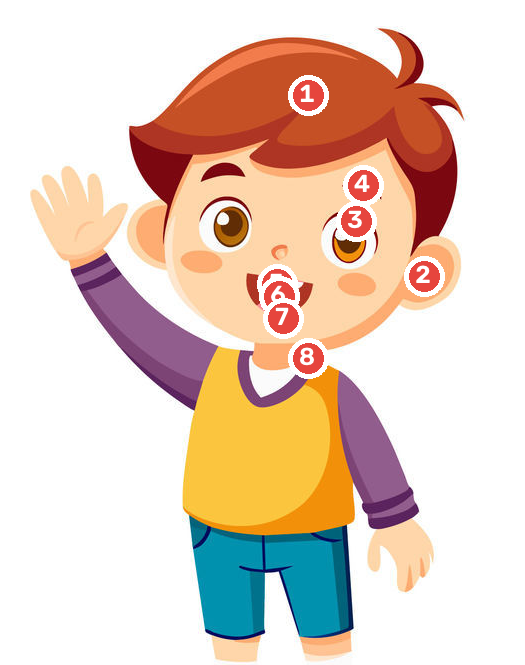
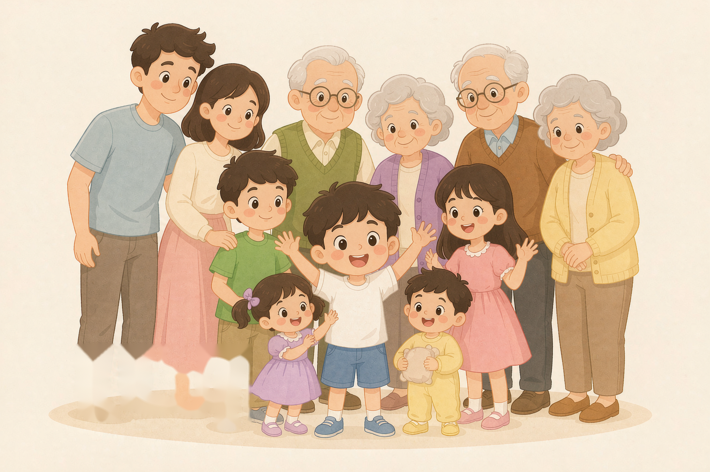

# 小学英语词汇 · 精简本

| 版本 | 日期 | 说明 |
|---|---|---|
| 第一版 | 2026 年 10 月 28 日 | 从完整手稿中析出，供小学生自学使用 |

---

## 写在前面

这份材料是给孩子自己用的。词从广州小学一至六年级里挑出要会写的那一批。一年级、二年级先会说的词，能写了再写。

它只做一件事：把小学阶段最该会写的单词，按类别排好，配上音标和一句好记的提示。原来那本完整的手稿有六百多个词、三十多章，讲的东西太多，孩子拿在手里反而不知从哪下手。这一本把范围收窄：去掉只有考试才用得上的拓展词，去掉长篇讲解，只留最核心的三百多个词。

怎么用，有三条建议。

第一，一次不要多。每天五个词，读三遍、写两遍，第二天回头再看一眼昨天那五个。一个月就是一百五十个词，一学期足够走完一本。

第二，先读后写。看着音标读出来，读顺了再写。读不出就写，记住的是字母的形状，不是这个词的声音，过几天就散了。

第三，会读的跳过。这本书不是任务清单，哪一章已经熟了，翻过去就好。用得上的时候再回来查。

---

## 音标怎么看

每个词后面的斜杠里是音标。几条基本的：

| 符号 | 读音 | 例子 |
|---|---|---|
| ː | 这个音读长一点 | /iː/ 比 /i/ 长 |
| ˈ | 后面的音节重读 | /ˈtiːtʃə/ 前面重 |
| ə | 很轻的“呃” | 词尾常有，读得很弱 |
| θ / ð | 舌尖放在上下齿之间 | three /θ/、this /ð/ |
| ŋ | 鼻音，像“嗯” | sing /sɪŋ/ |
| ʃ | 像“嘘”的声音 | she /ʃiː/ |

标着“英”和“美”两种读音的词，说明英国人美国人的念法不一样，两种都对，跟着课本念就好。

---

## 一、认识自己：身体

先学跟自己有关的词。指着自己身上说，比看图片有用。

### 头部（25 个核心词里的前一半）

| 单词 | 音标 | 意思 | 单词 | 音标 | 意思 |
|---|---|---|---|---|---|
| head | /hed/ | 头 | hair | /heə/ | 头发 |
| face | /feɪs/ | 脸 | eye | /aɪ/ | 眼睛 |
| ear | /ɪə/ | 耳朵 | nose | /nəʊz/ | 鼻子 |
| mouth | /maʊθ/ | 嘴 | tooth | /tuːθ/ | 牙齿 |
| teeth | /tiːθ/ | 牙齿（多颗） | neck | /nek/ | 脖子 |
| body | /ˈbɒdi/ | 身体 | back | /bæk/ | 背 |

### 手脚

| 单词 | 音标 | 意思 | 单词 | 音标 | 意思 |
|---|---|---|---|---|---|
| arm | /ɑːm/ | 手臂 | hand | /hænd/ | 手 |
| finger | /ˈfɪŋɡə/ | 手指 | leg | /leɡ/ | 腿 |
| foot | /fʊt/ | 脚 | feet | /fiːt/ | 脚（两只） |
| knee | /niː/ | 膝盖 | toe | /təʊ/ | 脚趾 |

对着图指一个部位，再说英文。眉毛是 eyebrow /ˈaɪbraʊ/。

序号：1 hair，2 ear，3 eye，4 eyebrow，5 nose，6 mouth，7 teeth，8 neck。

### 生病了怎么说

| 单词 | 音标 | 意思 |
|---|---|---|
| cold | /kəʊld/ | 感冒 |
| fever | /ˈfiːvə/ | 发烧 |
| headache | /ˈhedeɪk/ | 头疼 |
| toothache | /ˈtuːθeɪk/ | 牙疼 |
| stomachache | /ˈstʌməkeɪk/ | 肚子疼 |
| sore throat | /sɔː θrəʊt/ | 嗓子疼 |
| hurt | /hɜːt/ | 疼、受伤 |

> **一条规律**：身体部位 + ache = 那个地方疼。head 头疼，tooth 牙疼，stomach 肚子疼。会一个词，就能造三个。

---

## 二、我的家

### 家里的人

| 单词 | 音标 | 意思 | 单词 | 音标 | 意思 |
|---|---|---|---|---|---|
| family | /ˈfæməli/ | 家 | father | /ˈfɑːðə/ | 爸爸 |
| mother | /ˈmʌðə/ | 妈妈 | dad | /dæd/ | 爸爸（口语） |
| mum | /mʌm/ | 妈妈（口语） | brother | /ˈbrʌðə/ | 兄弟 |
| sister | /ˈsɪstə/ | 姐妹 | baby | /ˈbeɪbi/ | 婴儿 |
| parents | /ˈpeərənts/ | 父母 | grandfather | /ˈɡrænfɑːðə/ | 爷爷、外公 |
| grandmother | /ˈɡrænmʌðə/ | 奶奶、外婆 | uncle | /ˈʌŋkl/ | 叔叔、舅舅 |
| aunt | /ɑːnt/ | 姑姑、姨 | cousin | /ˈkʌzn/ | 堂表兄妹 |
| son | /sʌn/ | 儿子 | daughter | /ˈdɔːtə/ | 女儿 |

从中间的小孩看起，左边是父母，后面一排是祖辈。

### 哥哥、弟弟、姐姐、妹妹

中文分得细，英文只加一个词在前面。

| 中文 | 英文 | 音标 |
|---|---|---|
| 哥哥 | elder brother | /ˈeldə ˈbrʌðə/ |
| 弟弟 | younger brother | /ˈjʌŋɡə ˈbrʌðə/ |
| 姐姐 | elder sister | /ˈeldə ˈsɪstə/ |
| 妹妹 | younger sister | /ˈjʌŋɡə ˈsɪstə/ |

> 口语里更常说 big brother（哥）、little sister（妹）。

### 说“谁的东西”

| 单词 | 音标 | 意思 | 单词 | 音标 | 意思 |
|---|---|---|---|---|---|
| boy | /bɔɪ/ | 男孩 | girl | /ɡɜːl/ | 女孩 |
| man | /mæn/ | 男人 | woman | /ˈwʊmən/ | 女人 |
| friend | /frend/ | 朋友 | child | /tʃaɪld/ | 孩子 |

---

## 三、吃什么

### 主食和菜

| 单词 | 音标 | 意思 | 单词 | 音标 | 意思 |
|---|---|---|---|---|---|
| rice | /raɪs/ | 米饭 | noodles | /ˈnuːdlz/ | 面条 |
| bread | /bred/ | 面包 | soup | /suːp/ | 汤 |
| hamburger | /ˈhæmbɜːɡə/ | 汉堡 | hot dog | /hɒt dɒɡ/ | 热狗 |
| sandwich | /ˈsænwɪtʃ/ | 三明治 | cake | /keɪk/ | 蛋糕 |
| meat | /miːt/ | 肉 | chicken | /ˈtʃɪkɪn/ | 鸡肉 |
| beef | /biːf/ | 牛肉 | fish | /fɪʃ/ | 鱼 |
| egg | /eɡ/ | 蛋 | milk | /mɪlk/ | 牛奶 |

### 水果和蔬菜

| 单词 | 音标 | 意思 | 单词 | 音标 | 意思 |
|---|---|---|---|---|---|
| fruit | /fruːt/ | 水果 | apple | /ˈæpl/ | 苹果 |
| banana | /bəˈnɑːnə/ | 香蕉 | orange | /ˈɒrɪndʒ/ | 橙子 |
| pear | /peə/ | 梨 | grape | /ɡreɪp/ | 葡萄 |
| watermelon | /ˈwɔːtəmelən/ | 西瓜 | strawberry | /ˈstrɔːbəri/ | 草莓 |
| tomato | /təˈmɑːtəʊ/ | 西红柿 | potato | /pəˈteɪtəʊ/ | 土豆 |
| vegetable | /ˈvedʒtəbl/ | 蔬菜 | carrot | /ˈkærət/ | 胡萝卜 |

### 喝的和三餐

| 单词 | 音标 | 意思 | 单词 | 音标 | 意思 |
|---|---|---|---|---|---|
| water | /ˈwɔːtə/ | 水 | juice | /dʒuːs/ | 果汁 |
| tea | /tiː/ | 茶 | milk | /mɪlk/ | 牛奶 |
| breakfast | /ˈbrekfəst/ | 早饭 | lunch | /lʌntʃ/ | 午饭 |
| dinner | /ˈdɪnə/ | 晚饭 | hungry | /ˈhʌŋɡri/ | 饿的 |
| thirsty | /ˈθɜːsti/ | 渴的 | delicious | /dɪˈlɪʃəs/ | 好吃的 |
| sweet | /swiːt/ | 甜的 | fresh | /freʃ/ | 新鲜的 |

> **能数不能数**：rice、bread、milk、water 这些不能加 s，也不能说 a rice。egg、apple、cake、tomato 可以数，两个就是 two eggs。
>
> **要记住的两句**：I'm hungry.（我饿了）I'm thirsty.（我渴了）

---

## 四、动物

| 单词 | 音标 | 意思 | 单词 | 音标 | 意思 |
|---|---|---|---|---|---|
| animal | /ˈænɪml/ | 动物 | pet | /pet/ | 宠物 |
| cat | /kæt/ | 猫 | dog | /dɒɡ/ | 狗 |
| rabbit | /ˈræbɪt/ | 兔子 | bird | /bɜːd/ | 鸟 |
| duck | /dʌk/ | 鸭子 | pig | /pɪɡ/ | 猪 |
| cow | /kaʊ/ | 奶牛 | sheep | /ʃiːp/ | 绵羊 |
| horse | /hɔːs/ | 马 | hen | /hen/ | 母鸡 |
| panda | /ˈpændə/ | 熊猫 | monkey | /ˈmʌŋki/ | 猴子 |
| elephant | /ˈelɪfənt/ | 大象 | tiger | /ˈtaɪɡə/ | 老虎 |
| lion | /ˈlaɪən/ | 狮子 | bear | /beə/ | 熊 |
| giraffe | /dʒəˈrɑːf/ | 长颈鹿 | snake | /sneɪk/ | 蛇 |
| mouse | /maʊs/ | 老鼠 | tail | /teɪl/ | 尾巴 |
| wing | /wɪŋ/ | 翅膀 | zoo | /zuː/ | 动物园 |

> **复数要注意**：sheep 和 fish 单复数一样，两只羊是 two sheep，不是 sheeps。mouse 的复数是 mice。

---

## 五、颜色

| 单词 | 音标 | 意思 | 单词 | 音标 | 意思 |
|---|---|---|---|---|---|
| colour | /ˈkʌlə/ | 颜色 | red | /red/ | 红色 |
| yellow | /ˈjeləʊ/ | 黄色 | blue | /bluː/ | 蓝色 |
| green | /ɡriːn/ | 绿色 | black | /blæk/ | 黑色 |
| white | /waɪt/ | 白色 | orange | /ˈɒrɪndʒ/ | 橙色 |
| pink | /pɪŋk/ | 粉色 | brown | /braʊn/ | 棕色 |
| purple | /ˈpɜːpl/ | 紫色 | grey | /ɡreɪ/ | 灰色 |

> **问颜色**：What colour is it?（它是什么颜色？）回答 It's red.

---

## 六、数数

### 一到十二

| 数字 | 单词 | 音标 | 数字 | 单词 | 音标 |
|---|---|---|---|---|---|
| 1 | one | /wʌn/ | 2 | two | /tuː/ |
| 3 | three | /θriː/ | 4 | four | /fɔː/ |
| 5 | five | /faɪv/ | 6 | six | /sɪks/ |
| 7 | seven | /ˈsevn/ | 8 | eight | /eɪt/ |
| 9 | nine | /naɪn/ | 10 | ten | /ten/ |
| 11 | eleven | /ɪˈlevn/ | 12 | twelve | /twelv/ |

### 十三到十九

规律是“个位数 + teen”。

| 数字 | 单词 | 音标 | 数字 | 单词 | 音标 |
|---|---|---|---|---|---|
| 13 | thirteen | /ˌθɜːˈtiːn/ | 14 | fourteen | /ˌfɔːˈtiːn/ |
| 15 | fifteen | /ˌfɪfˈtiːn/ | 16 | sixteen | /ˌsɪksˈtiːn/ |
| 17 | seventeen | /ˌsevnˈtiːn/ | 18 | eighteen | /ˌeɪˈtiːn/ |
| 19 | nineteen | /ˌnaɪnˈtiːn/ | 20 | twenty | /ˈtwenti/ |

### 整十和更大

| 数字 | 单词 | 音标 | 数字 | 单词 | 音标 |
|---|---|---|---|---|---|
| 30 | thirty | /ˈθɜːti/ | 40 | forty | /ˈfɔːti/ |
| 50 | fifty | /ˈfɪfti/ | 60 | sixty | /ˈsɪksti/ |
| 70 | seventy | /ˈsevnti/ | 80 | eighty | /ˈeɪti/ |
| 90 | ninety | /ˈnaɪnti/ | 100 | hundred | /ˈhʌndrəd/ |

> **最容易听错的地方**：thirteen（13）和 thirty（30）只差一个音。13 后面重读、音长；30 前面重读、音短。多说几遍：thirTEEN — THIRty。

### 水、面包怎么数

水、牛奶、面包不能说 a water，也不能说 two breads。借一个容器来数，复数加在容器上，里面的东西不变。

| 说法 | 意思 | 说法 | 意思 |
|---|---|---|---|
| a cup of tea | 一杯茶 | two cups of tea | 两杯茶 |
| a glass of milk | 一杯牛奶 | a bottle of juice | 一瓶果汁 |
| a bowl of rice | 一碗米饭 | a plate of fruit | 一盘水果 |
| a piece of bread | 一块面包 | a slice of bread | 一片面包 |
| a kilo of meat | 一公斤肉 | a pair of shoes | 一双鞋 |
| a lot of water | 许多水 | two pairs of shoes | 两双鞋 |

> two cups of water，不是 two cup of waters。鞋要说 a pair of shoes。

---

## 七、在学校

### 教室里的东西

| 单词 | 音标 | 意思 | 单词 | 音标 | 意思 |
|---|---|---|---|---|---|
| school | /skuːl/ | 学校 | classroom | /ˈklɑːsruːm/ | 教室 |
| library | /ˈlaɪbrəri/ | 图书馆 | playground | /ˈpleɪɡraʊnd/ | 操场 |
| window | /ˈwɪndəʊ/ | 窗户 | door | /dɔː/ | 门 |
| desk | /desk/ | 课桌 | chair | /tʃeə/ | 椅子 |
| book | /bʊk/ | 书 | bag | /bæɡ/ | 书包 |
| pen | /pen/ | 钢笔 | pencil | /ˈpensl/ | 铅笔 |
| ruler | /ˈruːlə/ | 尺子 | eraser | /ɪˈreɪzə/ | 橡皮 |
| notebook | /ˈnəʊtbʊk/ | 笔记本 | picture | /ˈpɪktʃə/ | 图画 |

### 人和课

| 单词 | 音标 | 意思 | 单词 | 音标 | 意思 |
|---|---|---|---|---|---|
| teacher | /ˈtiːtʃə/ | 老师 | student | /ˈstjuːdnt/ | 学生 |
| classmate | /ˈklɑːsmeɪt/ | 同学 | lesson | /ˈlesn/ | 课 |
| English | /ˈɪŋɡlɪʃ/ | 英语 | Chinese | /ˌtʃaɪˈniːz/ | 语文 |
| maths | /mæθs/ | 数学 | music | /ˈmjuːzɪk/ | 音乐 |
| art | /ɑːt/ | 美术 | science | /ˈsaɪəns/ | 科学 |

### 做功课

| 单词 | 音标 | 意思 | 单词 | 音标 | 意思 |
|---|---|---|---|---|---|
| read | /riːd/ | 读 | write | /raɪt/ | 写 |
| draw | /drɔː/ | 画 | listen | /ˈlɪsn/ | 听 |
| speak | /spiːk/ | 说 | study | /ˈstʌdi/ | 学习 |
| homework | /ˈhəʊmwɜːk/ | 作业 | exam | /ɪɡˈzæm/ | 考试 |

> write 的 w 不发音。同样的还有 wrong、wrist。记住：wr- 开头，w 不读。

---

## 八、穿什么

| 单词 | 音标 | 意思 | 单词 | 音标 | 意思 |
|---|---|---|---|---|---|
| shirt | /ʃɜːt/ | 衬衫 | T-shirt | /ˈtiː ʃɜːt/ | T 恤 |
| coat | /kəʊt/ | 外套 | jacket | /ˈdʒækɪt/ | 夹克 |
| sweater | /ˈswetə/ | 毛衣 | dress | /dres/ | 连衣裙 |
| skirt | /skɜːt/ | 短裙 | shorts | /ʃɔːts/ | 短裤 |
| trousers | /ˈtraʊzəz/ | 长裤 | jeans | /dʒiːnz/ | 牛仔裤 |
| hat | /hæt/ | 帽子 | cap | /kæp/ | 鸭舌帽 |
| shoes | /ʃuːz/ | 鞋 | socks | /sɒks/ | 袜子 |
| gloves | /ɡlʌvz/ | 手套 | scarf | /skɑːf/ | 围巾 |

### 穿和脱

| 单词 | 音标 | 意思 |
|---|---|---|
| wear | /weə/ | 穿着（状态） |
| put on | /pʊt ɒn/ | 穿上（动作） |
| try on | /traɪ ɒn/ | 试穿 |
| fit | /fɪt/ | 合身 |
| size | /saɪz/ | 尺码 |

> **成双的东西都用复数**：shoes、socks、gloves、trousers、shorts、jeans。中文说“一条裤子”，英文的 trousers 却是复数，因为有两条腿。

---

## 九、天气和季节

| 单词 | 音标 | 意思 | 单词 | 音标 | 意思 |
|---|---|---|---|---|---|
| weather | /ˈweðə/ | 天气 | season | /ˈsiːzn/ | 季节 |
| spring | /sprɪŋ/ | 春天 | summer | /ˈsʌmə/ | 夏天 |
| autumn | /ˈɔːtəm/ | 秋天 | winter | /ˈwɪntə/ | 冬天 |
| sunny | /ˈsʌni/ | 晴 | cloudy | /ˈklaʊdi/ | 多云 |
| windy | /ˈwɪndi/ | 有风 | rainy | /ˈreɪni/ | 下雨 |
| snowy | /ˈsnəʊi/ | 下雪 | hot | /hɒt/ | 热 |
| cold | /kəʊld/ | 冷 | warm | /wɔːm/ | 暖和 |
| cool | /kuːl/ | 凉爽 | rain | /reɪn/ | 雨 |
| snow | /snəʊ/ | 雪 | wind | /wɪnd/ | 风 |
| cloud | /klaʊd/ | 云 | umbrella | /ʌmˈbrelə/ | 雨伞 |

> **一条加 y 的规律**：sun → sunny，cloud → cloudy，wind → windy，rain → rainy，snow → snowy。名词后面加 y 就变成“有……的”。注意 sunny 要双写 n。

---

## 十、时间和日子

### 一天

| 单词 | 音标 | 意思 | 单词 | 音标 | 意思 |
|---|---|---|---|---|---|
| time | /taɪm/ | 时间 | morning | /ˈmɔːnɪŋ/ | 上午 |
| afternoon | /ˌɑːftəˈnuːn/ | 下午 | evening | /ˈiːvnɪŋ/ | 傍晚 |
| night | /naɪt/ | 夜晚 | day | /deɪ/ | 白天 |
| hour | /ˈaʊə/ | 小时 | minute | /ˈmɪnɪt/ | 分钟 |
| today | /təˈdeɪ/ | 今天 | tomorrow | /təˈmɒrəʊ/ | 明天 |
| yesterday | /ˈjestədeɪ/ | 昨天 | week | /wiːk/ | 星期 |

### 星期

| 单词 | 音标 | 意思 | 单词 | 音标 | 意思 |
|---|---|---|---|---|---|
| Monday | /ˈmʌndeɪ/ | 星期一 | Tuesday | /ˈtjuːzdeɪ/ | 星期二 |
| Wednesday | /ˈwenzdeɪ/ | 星期三 | Thursday | /ˈθɜːzdeɪ/ | 星期四 |
| Friday | /ˈfraɪdeɪ/ | 星期五 | Saturday | /ˈsætədeɪ/ | 星期六 |
| Sunday | /ˈsʌndeɪ/ | 星期日 | | | |

> 星期和月份的第一个字母永远大写。Wednesday 最好单独抄两遍，它的 d 和 e 都不发音。

### 月份

| 单词 | 音标 | 单词 | 音标 | 单词 | 音标 |
|---|---|---|---|---|---|
| January | /ˈdʒænjuəri/ | February | /ˈfebruəri/ | March | /mɑːtʃ/ |
| April | /ˈeɪprəl/ | May | /meɪ/ | June | /dʒuːn/ |
| July | /dʒuˈlaɪ/ | August | /ˈɔːɡəst/ | September | /sepˈtembə/ |
| October | /ɒkˈtəʊbə/ | November | /nəʊˈvembə/ | December | /dɪˈsembə/ |

---

## 十一、怎么走

| 单词 | 音标 | 意思 | 单词 | 音标 | 意思 |
|---|---|---|---|---|---|
| bus | /bʌs/ | 公交 | bike | /baɪk/ | 自行车 |
| car | /kɑː/ | 小汽车 | train | /treɪn/ | 火车 |
| plane | /pleɪn/ | 飞机 | ship | /ʃɪp/ | 轮船 |
| boat | /bəʊt/ | 小船 | metro | /ˈmetrəʊ/ | 地铁 |
| taxi | /ˈtæksi/ | 出租车 | station | /ˈsteɪʃn/ | 车站 |

### 怎么去

| 说法 | 意思 |
|---|---|
| by bus | 坐公交 |
| by bike | 骑车 |
| by car | 坐小汽车 |
| on foot | 走路 |

> **一句口诀**：by 车、by 船、by 飞机，只有走路用 on foot。走路用 by foot 是错的。

---

## 十二、长大做什么

| 单词 | 音标 | 意思 | 单词 | 音标 | 意思 |
|---|---|---|---|---|---|
| doctor | /ˈdɒktə/ | 医生 | nurse | /nɜːs/ | 护士 |
| teacher | /ˈtiːtʃə/ | 老师 | driver | /ˈdraɪvə/ | 司机 |
| farmer | /ˈfɑːmə/ | 农民 | worker | /ˈwɜːkə/ | 工人 |
| cook | /kʊk/ | 厨师 | policeman | /pəˈliːsmən/ | 警察 |
| singer | /ˈsɪŋə/ | 歌手 | dancer | /ˈdɑːnsə/ | 舞蹈演员 |
| writer | /ˈraɪtə/ | 作家 | artist | /ˈɑːtɪst/ | 画家 |
| scientist | /ˈsaɪəntɪst/ | 科学家 | pilot | /ˈpaɪlət/ | 飞行员 |

> **一条构词规律**：动词后面加 -er，就变成“做这件事的人”。teach（教）→ teacher（老师），sing（唱）→ singer（歌手），drive（开车）→ driver（司机），write（写）→ writer（作家）。

---

## 十三、心情

| 单词 | 音标 | 意思 | 单词 | 音标 | 意思 |
|---|---|---|---|---|---|
| happy | /ˈhæpi/ | 高兴 | sad | /sæd/ | 难过 |
| angry | /ˈæŋɡri/ | 生气 | tired | /ˈtaɪəd/ | 累 |
| bored | /bɔːd/ | 无聊 | worried | /ˈwʌrid/ | 担心 |
| excited | /ɪkˈsaɪtɪd/ | 兴奋 | afraid | /əˈfreɪd/ | 害怕 |
| fine | /faɪn/ | 挺好 | ill | /ɪl/ | 生病 |
| surprised | /səˈpraɪzd/ | 惊讶 | nervous | /ˈnɜːvəs/ | 紧张 |

### 问心情

| 说法 | 意思 |
|---|---|
| How do you feel? | 你感觉怎么样？ |
| I feel happy. | 我觉得开心。 |
| What's the matter? | 怎么了？ |
| Don't worry. | 别担心。 |

> **-ed 和 -ing**：I am bored 是“我觉得无聊”，boring 是“这个东西无聊”。说人用 -ed，说东西用 -ing。写成 I am boring 就变成“我是个无聊的人”了。

---

## 十四、运动

| 单词 | 音标 | 意思 | 单词 | 音标 | 意思 |
|---|---|---|---|---|---|
| sport | /spɔːt/ | 运动 | football | /ˈfʊtbɔːl/ | 足球 |
| basketball | /ˈbɑːskɪtbɔːl/ | 篮球 | ping-pong | /ˈpɪŋpɒŋ/ | 乒乓球 |
| tennis | /ˈtenɪs/ | 网球 | volleyball | /ˈvɒlibɔːl/ | 排球 |
| swim | /swɪm/ | 游泳 | run | /rʌn/ | 跑 |
| jump | /dʒʌmp/ | 跳 | race | /reɪs/ | 赛跑 |
| ball | /bɔːl/ | 球 | team | /tiːm/ | 队伍 |
| win | /wɪn/ | 赢 | lose | /luːz/ | 输 |
| play | /pleɪ/ | 玩、打（球） | game | /ɡeɪm/ | 游戏、比赛 |

> **play 的三种用法**：play basketball（打球，不加 the）；play the piano（弹琴，要加 the）；play games（玩游戏，不加 the）。球和游戏都不加 the，乐器要加。

---

## 十五、最常用的小词

这些词长得不起眼，但句子里天天出现。学不好它们，句子就写不对。

### a 还是 an

看后面的音，不看字母。

| 用 a | 用 an |
|---|---|
| a book | an apple |
| a pen | an egg |
| a dog | an orange |
| a university（读 /juː/） | an hour（h 不读） |

> 一句话判断：读出来的第一个音是元音就用 an，是辅音就用 a。

### 位置：in、on、at

| 词 | 用在哪 | 例子 |
|---|---|---|
| in | 大地方 | in China、in the room |
| on | 表面上 | on the desk、on the wall |
| at | 一个点 | at the door、at the bus stop |

### 时间：in、on、at

| 词 | 用在哪 | 例子 |
|---|---|---|
| in | 年、月、季节 | in 2026、in May、in winter |
| on | 具体某天 | on Monday、on May 1st |
| at | 几点 | at 6 o'clock、at night |

> 三个例外单独记：at night（夜里）、at noon（中午）、at midnight（半夜）。

### 代词

| 我 | 你 | 他 | 她 | 它 | 我们 | 他们 |
|---|---|---|---|---|---|---|
| I | you | he | she | it | we | they |
| me | you | him | her | it | us | them |
| my | your | his | her | its | our | their |
| mine | yours | his | hers | its | ours | theirs |

> 三行分别是：做主语的、做宾语的、表示“谁的”。最后一行是“谁的东西”，可以单独用：This book is mine。（这本书是我的。）

### 我、你、他 + am / is / are

| 主语 | 用的词 | 例子 |
|---|---|---|
| I | am | I am a student. |
| you / we / they | are | You are my friend. |
| he / she / it | is | She is a teacher. |

> 口诀：我用 am，你用 are，is 跟着他她它。

---

## 十六、三种时间

### 一般现在时：经常做的事

信号词：always（总是）、usually（通常）、often（经常）、sometimes（有时）、never（从不）、every day（每天）。

| 说法 | 例子 |
|---|---|
| 我做 | I play football. |
| 他做 | He plays football.（动词加 s） |
| 否定 | I don't play. / He doesn't play. |
| 疑问 | Do you play? / Does he play? |

> 只有“他、她、它”做主语时动词加 s。这一条是小学阶段错得最多的，写句子时先看主语是谁。

### 一般过去时：已经发生的事

信号词：yesterday（昨天）、last night（昨晚）、last week（上周）、ago（以前）、just now（刚才）。

| 说法 | 例子 |
|---|---|
| 我做 | I played football yesterday. |
| 否定 | I didn't play. |
| 疑问 | Did you play? |

> 用了 did 或 didn't，后面的动词就要回到原形。He didn't went 是错的，应该是 He didn't go。

### 常用动词的过去式

| 现在 | 过去 | 现在 | 过去 | 现在 | 过去 |
|---|---|---|---|---|---|
| be | was / were | have | had | do | did |
| go | went | come | came | see | saw |
| eat | ate | drink | drank | take | took |
| give | gave | get | got | make | made |
| say | said | tell | told | think | thought |
| buy | bought | bring | brought | find | found |
| run | ran | swim | swam | write | wrote |
| read | read（读 /red/） | sing | sang | put | put |

> 这二十四个词没有规律，只能硬记。建议做成小卡片，每天读一遍，一周就熟了。

### 一般将来时：还没发生的事

信号词：tomorrow（明天）、next week（下周）、soon（很快）、in the future（将来）。

| 说法 | 例子 |
|---|---|
| 我做 | I will play football tomorrow. |
| 否定 | I won't play. |
| 疑问 | Will you play? |

> will 后面永远用原形。He will plays 是错的。昨天看见了说 I saw it，不说 I seen it。

---

## 十七、最容易写错的地方

| 错的 | 对的 | 为什么 |
|---|---|---|
| two tooths | two teeth | tooth 的复数是 teeth |
| two sheeps | two sheep | sheep 单复同形 |
| a hair | hair | 头发不可数 |
| a homework | homework | 作业不可数 |
| I brush the teeth | I brush my teeth | 部位前用 my |
| I have headache | I have a headache | 要加 a |
| take a medicine | take medicine | 药不可数 |
| by foot | on foot | 走路用 on |
| He go to school | He goes to school | 三单加 s |
| He didn't went | He didn't go | 有 did 就回原形 |
| He will plays | He will play | will 后回原形 |
| He is go to school | He goes to school | be 和实义动词不能并排 |
| I seen it | I saw it | seen 不能单独当谓语 |
| two cup of water | two cups of water | 复数加在杯上，water 不变 |
| I am boring | I am bored | 说人用 -ed |
| play the basketball | play basketball | 球类不加 the |
| play piano | play the piano | 乐器要加 the |
| a hour | an hour | h 不读，用 an |
| monday | Monday | 星期要大写 |
| /kniː/ | /niː/ | knee 的 k 不读 |
| /ˈstʌmətʃ/ | /ˈstʌmək/ | stomach 的 ch 读 /k/ |
| fourty | forty | 没有 u |
| swiming | swimming | 双写 m |

> 这一页值得单独打印一张贴在书桌前。错的地方，往往就那么几个。

---

## 十八、怎么记才记得住

单词记不住，多半不是记性差，是没给它挂上钩子。四个办法，挑顺手的用。

**一、拆开看。** 长词不是一整块。careful 是 care（关心）加 -ful（充满），就是“充满关心的”。careless 是 care 加 -less（没有），“没有关心的”。学一个 care，能懂四个词。

**二、找出反义。** big 对 small，hot 对 cold，long 对 short，happy 对 sad。记住一半，另一半不用教。

**三、编个画面。** pest（害虫）读起来像“拍死它”，正好该拍死。ambulance（救护车）像“俺不能死”，车里的人都这么想。这种联想不严谨，但管用。

**四、放在句子里。** 单独背 water 容易忘，背 I drink water every day 就忘不了，因为它在做事情。

**五、指着一个词往外发散。** 这是最有用的一个，尤其背身体部位。指着自己的头说 head，再往下数：头上有什么？hair、eye、ear、nose、mouth、tooth。数到 ear 数不下去了，再想 ear 里面有什么——outer ear、middle ear、inner ear，想不出来就退回 head，换个地方继续，比如 mouth 里面有 lip、tongue、tooth。数一个词，能带出一串词。这一套叫"发散＋回溯"：往下数到没词了就退回来，换一处分叉接着数。每天把身体从头到脚这么走一遍，看图指、指自己、说出英文，比背拼写记得牢。

学完一章，再给自己留个作业：挑一个本章的词当中心，把能想到的词全写在它周围，想不到的地方画个问号。下次先补问号。

---

## 十九、一天五个词，怎么排

这本书一共三百多个核心词。按每天五个算，两个月能走完一遍。下面这个排法可以照着做。

| 阶段 | 内容 | 大概用时 |
|---|---|---|
| 第一周 | 身体、家庭 | 35 个词 |
| 第二周 | 食物、动物 | 54 个词 |
| 第三周 | 颜色、数字 | 40 个词 |
| 第四周 | 学校、衣物 | 43 个词 |
| 第五周 | 天气、时间 | 50 个词 |
| 第六周 | 交通、职业、心情 | 34 个词 |
| 第七周 | 运动、小词 | 33 个词 |
| 第八周 | 三种时间 + 错题 | 复习为主 |

每周最后一天不学新词，只把这一周的二十几个词默写一遍。错的重抄三遍，抄的时候读出声音。

---

## 二十、最后几句

学英语这件事，快不了。

一个词从“见过”到“会用”，中间要经过好几道：看着认识、听着能懂、自己会念、动手会写、放进句子不出错。每天五个词，看起来慢，一学期下来是六百多个——比一个劲儿往前赶要结实。

遇到记不住的词，别死磕。放一放，过两周再看，往往就记住了。人的记忆本来就是这样，急不来。

这本书不用从头读到尾。你现在学哪一课，就翻哪一章。剩下的，等用得上的时候再来。
